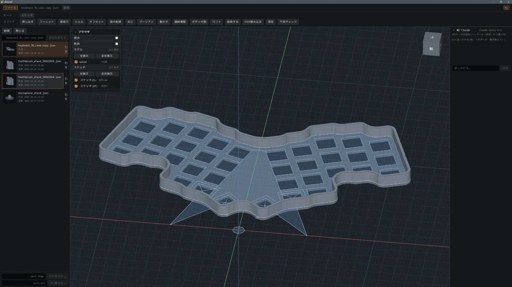

# duocad

人とAIの協働を前提に設計された3D CAD です。



## 考え方

AI に形を作らせるとき、難しいのは「どこを」を伝えることです。言葉で対象を指定するのは手間がかかり、AI に任せきりにすると意図からずれます。

duocad では、**選択（いま操作の対象になっているもの）を、人と AI が共有する1つのもの**として扱います。AI が選び、人が確かめて直し、AI が操作する。対象を決める作業と形を変える作業を分け、その間に人の判断を挟むことで、AI の速さと人の意図の両方を生かします。

画面の操作も同じ考えでそろえています。どの操作も「何をするか → 何に → どうするか」の順で進み、画面上で直接指せるものには別のボタンを用意しません。

## できること

- 一般的なパラメトリック CAD のモデリング操作（スケッチ、押し出し、フィレット、ブーリアンなど）
- 測定・干渉チェックなどの確認
- STEP の読み書き、STL の書き出し
- 画面内の AI パネルからの操作（Claude API またはローカルの LLM）
- MCP サーバーとして、Claude Code などの外部の AI からの操作

## 動かす

Windows 11 で開発・確認しています。

**必要なもの**：Python 3.14、[uv](https://docs.astral.sh/uv/)、Node.js（23.6 以上）

```powershell
git clone https://github.com/morikawa976321/duocad.git
cd duocad
uv sync
npm install --prefix web
npm run build --prefix web
uv run python -m duocad.mcp_server --open
```

ブラウザが開き、画面と MCP サーバー（`http://127.0.0.1:8766/mcp`）が同じプロセスで立ち上がります。リポジトリ直下で Claude Code を開くと、`.mcp.json` で自動的に繋がります。

画面内の AI パネルを使うには、画面の「設定」から Anthropic の API キーを入力します。

## 技術構成

| 層 | 使っているもの |
|---|---|
| 形状カーネル | OCCT（[build123d](https://github.com/gumyr/build123d) / OCP 経由）、manifold3d |
| サーバー | Python、WebSocket、MCP |
| 画面 | Svelte、three.js、Vite |
| テスト | pytest、実ブラウザでの操作テスト |

## 状態

個人で開発中です。`develop` が開発版、`main` が安定版です。

## 文書

- [docs/DEVELOPMENT.md](docs/DEVELOPMENT.md) — 開発者向けの詳細（アーキテクチャ、テスト、既知の落とし穴）
- [docs/DESIGN_DECISIONS.md](docs/DESIGN_DECISIONS.md) — 設計判断とその根拠
- [MCP.md](MCP.md) — MCP ツールの一覧

## ライセンス

[MIT](LICENSE)
