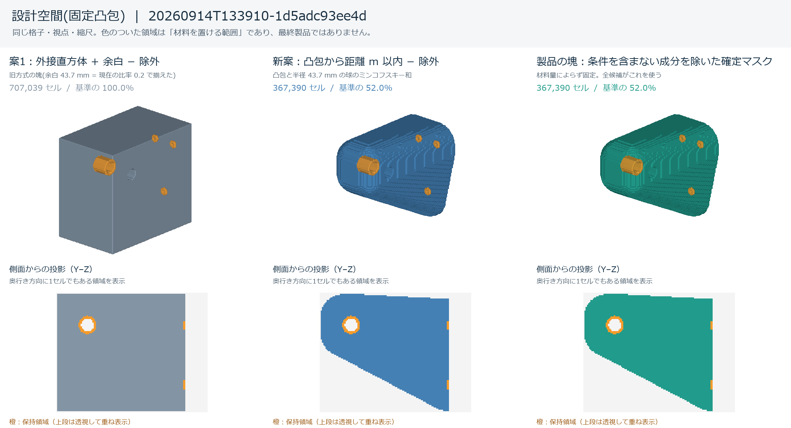

# 形状最適化(topopt) — 測って分かったこと

**現在の最優先目標と最終形状の2条件(水密・単一ソリッド)**は [TOPOPT_ACCEPTANCE.md](TOPOPT_ACCEPTANCE.md)。
保持・除外は平滑化後のCADブーリアンで反映する。

| 何が | どこにあるか |
|---|---|
| **契約・不変条件**(呼ぶ面の引数、守るべき性質、依存してはいけないもの) | **コードのそば**(`duocad/topopt/*.py` の docstring)。ここには写さない —— 二重になると必ずずれる |
| **実測の記録**(費用・余白比率・代表応力・面アンカー) | **この文書** |
| **現在の既定値** | 次の「現在の正」 |
| **走らせ方**(受入検査・所要) | `README.md` §3 |
| **形状探索の時間短縮**(内訳・候補評価の費用) | [TOPOPT_SPEED.md](TOPOPT_SPEED.md) |

**コードは `duocad/topopt/`、受入検査は `topopt_checks/`(`duocad/` の外)、画面と撮影は `web/` にある。**

**秒数は熱状態で 1.2〜1.7倍振れる。** この文書の秒はすべてその幅の中で読むこと(反復数・要素数・
SHA-256 は振れない)。**解法・前処理の改良は CG 反復数の差で主張し、秒は補助にする** —— 同じ設定を
同じセッションで撮り直すと CG 反復数は solve 8回とも1つ残らず一致するのに、秒は 1.00〜1.16倍振れる。
小さい題材(1反復1秒前後)では機械が空いていても時間を置くだけで壁時計が ±16% 動く。**倍率を1回の
実測から書かず、向きが複数ケースで揃っているかを見る。** **並列化は秒に出て反復数には出ず、
マルチグリッドは反復数に出る** —— 両方の欄が無いとどちらが効いたか切り分けられない。

**「## 現在の正」の表は `tests/test_doc_code_agreement.py` が機械で読む**(2列目の太字の数値と
3列目の `module.SYMBOL`)。ここを書き換えるときは検査も一緒に見ること。**他の節は自由に畳んでよい。**

**節の並びは時系列であって、話題別ではない。日付は非単調な箇所がある。**
**節の位置で新旧を判断せず、値が要るときは常に「現在の正」を見ること。**
**2026-09-17より前の節は、密度ベースのSIMP法(連続密度・OC/MMA更新則・材料量の二分探索)を使って
いた当時の記録である**(段階6でコードごと削除した)。数値・単調性・費用の実測としての価値は残るが、
**当時の呼び出し例(`simp.optimize` 等)はもう動かない。**

## 現在の正

**値そのものはコード側が正。** ここは「いまの既定値が何で、その根拠(実測・判断)がどの節に
あるか」を時系列を読まずに引くための索引であり、値を複製して二重管理する節ではない
(手動同期の削減。本人指示 2026-09-05)。値が食い違って見えたら**コードを信じる**こと。

| 項目 | 現在の既定値 | コード上の場所 | 根拠(下記の節) |
|---|---|---|---|
| 塊(設計空間)の余白比率 `margin_ratio` | **0.20** | `design_space.DEFAULT_MARGIN_RATIO` | 「固定凸包による設計空間(2026-09-16)」(2026-09-16 本人判断で 0.25 → 0.20。0.25 の根拠は「余白比率をどう決めたか(既定 0.25)」) |
| 塊の導出方式 | 固定凸包(保持・条件面のボディの外接箱の頂点の凸包から距離 `m` 以内 = 球とのミンコフスキー和)。材料量によらず1実行に1回 | `design_space.DERIVATION` | 「固定凸包による設計空間(2026-09-16)」 |
| 許容応力(PETG の降伏応力 × 造形の低減係数) | **50** MPa × **0.8** | `material.PETG_YIELD_MPA` / `PRINT_DERATE` | 「許容応力の導出」 |
| 代表応力の規則 | ρ >= **0.5** の要素の上位 **99.5%** 点 | `stress.DEFAULT_RHO_MIN` / `DEFAULT_PERCENTILE` | 「代表応力の規則(黙って max にしない)」 |
| メッシュ平滑化(Taubin)の反復数 `DEFAULT_ITERS` | **30** | `mesh.DEFAULT_ITERS` | 「平滑化の既定をどう決めたか」 |
| 既定スレッド数 `PARALLEL_THREADS` | **総コアの半分** | `fem.PARALLEL_THREADS`(`_default_thread_count()`) | 「既定スレッド数を総コアの半分にする」 |
| 段階4で1回に削る割合の上限 `DEFAULT_MAX_STEP_RATIO` | **0.2** | `binary_search.DEFAULT_MAX_STEP_RATIO` | 計画書§11.2 |
| 段階4の削る割合を安全率の余裕で変える指数 θ(r = min(上限, 1 − (目標/安全率)^θ)) `DEFAULT_STEP_EXPONENT` | **0.5** | `binary_search.DEFAULT_STEP_EXPONENT` | 計画書§11.2 |
| 段階4で要素エネルギーをならす近傍の一辺 `ENERGY_FILTER_SIZE` | **3** セル | `binary_search.ENERGY_FILTER_SIZE` | 順位の平滑化(自身と26近傍の材料平均で、1セルごとの値のばらつきによる順位の入れ替わりを抑える)。計画書§11.1 |
| 段階4で、削ったセルが1つで安全率が落ちたとき、順位から外して続けるのを何セルで収束とみなすか `DEFAULT_SINGLE_CELL_PATIENCE`(`None` は順位が尽きるまで) | **16** | `binary_search.DEFAULT_SINGLE_CELL_PATIENCE` | 計画書§12.7(最終体積が最小の 16 と無制限が同じ試行列で並び、小さい方。段階4のFEMは 999 回で予算切れ) |
| 条件面の作用位置のずれの許容 = 対応付けの探索半径(要素サイズ比。CAD面の面積重心から節点重心まで、モーメント誤差の許容はこの値×荷重の大きさ。`anchor.position_limit`) | **1.0** | `anchor.DEFAULT_RADIUS_RATIO` | 「境界条件の確定(2026-09-17)」 |
| 要素サイズを指定しないときの最長軸の要素数 `DEFAULT_ELEMENTS_LONG_AXIS` | **40** | `design_space.DEFAULT_ELEMENTS_LONG_AXIS` | 塊の導出(`derive`) |
| ヤング率の既定 `DEFAULT_YOUNGS_MODULUS_MPA` | **2000** MPa | `material.DEFAULT_YOUNGS_MODULUS_MPA` | 応力の実単位換算(`stress.UnitScale`) |


## これは何か

**3Dの二値形状探索(初期合格探索と、ひずみエネルギーの順位で削る体積削減)の実測記録。**
固定した設計空間の中で材料あり/なしのboolマスクを操作し、6条件(境界・単一成分・保持/除外・
荷重欠落なし・目標安全率)を満たす最小体積のモデルを探す
(計画は [PLAN_BINARY_STRESS_SEARCH.md](PLAN_BINARY_STRESS_SEARCH.md))。

出力は、平滑化後の三角形を面として縫合し、保持・除外CADとのブーリアンを適用したソリッド。
三角形から元の設計意図や滑らかな解析曲面を逆推定する処理は行わない。保持・除外の曲面は元CADから
引き継ぐ。処理順と現在の判定は [TOPOPT_ACCEPTANCE.md](TOPOPT_ACCEPTANCE.md) を参照。

**範囲は FEA(線形静解析)だけ**(2026-08-29 本人決定)。Fusion 360 の Generative Design を
①線形静解析 ②SIMP 密度法 ③製造方法別の幾何制約 ④複数 outcome の同時探索+クラウド課金
⑤結果メッシュ → T-spline 変換 に分解したうち、③④⑤は作らない。**出力はメッシュ止まりと最初から
決めてある** —— 3Dプリント直行(STL/3MF)前提で、有機的な三角メッシュを編集可能な NURBS B-rep へ
自動変換する道は OSS に無い(2026-08 調査)。OCCT でできるのは `BRepBuilderAPI_Sewing`+`MakeSolid`
の faceted B-rep 化(三角形1枚=Face 1枚)で、`ShapeUpgrade_UnifySameDomain` も有機形状では
ほとんど効かない。`geomdl` の曲面フィッティングは構造化 UV グリッド前提で非構造三角メッシュには
直接使えない。

## 設計空間をB-repから起こす(voxelize.py)

`simp.py` の設計空間は numpy の3次元配列を直接作っているだけで、**OCCTの形状から格子を
起こす経路が無かった**。`voxelize.py` がそれを埋める(**stage1**。境界条件を面に紐づける
「面アンカー」は stage2 = `anchor.py` が担当する。下記「CADの面 → 格子の節点」)。

```python
import voxelize
from build123d import Box, Cylinder, Pos

model = voxelize.voxelize(
    Box(40, 20, 10),                       # 設計空間(TopoDS_Shape / build123d のどちらでも)
    elements_long_axis=40,                 # 最長軸方向の要素数 → 要素サイズが決まる
    keep=Pos(18, 0, 0) * Box(12, 20, 10),  # 保持領域(材料を必ず残す)。省略可
    obstacle=Pos(-10, 0, 0) * Cylinder(4, 20),  # 障害物領域(材料を入れない)。省略可
)
model.grid          # Grid(origin, spacing, shape) —— 立方体要素・ワールド軸整列
model.design        # bool (nx,ny,nz)。設計空間の占有
model.keep          # bool。**設計空間の内側に切り詰め済み**
model.obstacle      # bool。同上
model.free          # design & ~keep & ~obstacle(最適化が動かしてよい要素)
model.soup          # TriangleSoup。三角形ごとに OCCT の面添字(1始まり)を持つ
model.initial_density(0.3)  # SIMP へ渡す初期密度場(保持=1 / 障害物=0 / 外=0)
```

**セル中心規約**: `mask[i, j, k]` は要素 (i,j,k) の**中心**の値。中心のワールド座標は
`origin + spacing * (i+0.5, j+0.5, k+0.5)` で、`mesh.py` の `rho[ex]` と同じ規約。
**新しく格子と実座標を対応づけるときは必ず `Grid.centers_1d` / `Grid.centers_of` /
`Grid.center_of` を通すこと**(添字に `spacing` を直接掛けると半セルずれる。
`mesh.py` は2026-08-30にこれを踏んだ ── 下記「設計上の決定」の `rho[ex]` の項)。
配列の軸順 `(nx, ny, nz)` は `simp.py` の `rho` (nelx, nely, nelz) とそのまま合う。

格子の作り方: 要素サイズ = 最長辺 / `elements_long_axis`、各軸の要素数 =
`ceil(辺長 / 要素サイズ) + 2`(**周囲に1要素の余白**)、形状は格子の中央に置く。

占有判定は **`kernel.tessellate` が返す三角形群に +z のレイを飛ばして巻き数で数える**
(新規依存ゼロ。numpy だけ)。**`BRepClass3d_SolidClassifier` は本番経路に使わない** ──
1点ずつしか判定できず 100³=100万点をPythonループで回すのは非現実的なので、
`check_voxelize.py` の**神託**としてだけ使う。

守りが2つ入っている。**どちらも実測で必要だと分かったもの**で、片方では足りない:

1. **偶奇(parity)ではなく巻き数(winding)で数える。** レイが2枚の三角形の共有辺を
   ちょうど通ると同じ z に交点が2つ出る。偶奇だとその上の全域で内外が反転する
   (実測: 40×40×10 の箱で、上面の対角線が列の中心を厳密に通り **15,200 mm³ / 正解16,000**)。
   巻き数なら「入る(+1)/出る(−1)」が相殺して壊れない。
2. **レイの (x,y) を列の中心から決定的にずらし、縮退したらずらし幅を変えてやり直す。**
   格子は bbox から起こすので、軸整列した形状では面や辺が列の中心と厳密に一致する縮退が
   **系統的に**起きる。巻き数でも守れないのは**頂点に三角形が集まる点**で、円錐の頂点を
   レイが貫くと「出る」ばかりが数十回数えられる(実測: 円錐+板がずらし幅ゼロでは
   n=6〜40 の全解像度で「巻き数が0に戻らない列がある」と落ちる)。
   **ずらし幅を1つの固定値にすると守れない** —— その値にちょうど合った位置に頂点が来る
   格子を作れば必ず縮退させられる(2026-08-31のQAが実際に再現した)。なので
   `RAY_JITTER_SEQUENCE`(要素サイズの 1e-4 に素数を掛けた6通り)を順に試し、
   縮退を検知したら次のずらし幅でやり直す。**乱数は使わない**ので決定性は保たれる。
   全部だめだったときだけ例外にする。実際に使われた幅と試行回数は
   `stats["occupancy"]["jitter"]` / `["jitter_attempts"]` に出る。

**壊れた入力は黙って通さない。** 次のどれかに当たると `ValueError` で落ちる ──
(a) 三角形が取れなかった面がある、(b) 有向辺の対が揃わない(非水密な開シェル/向きの不整合)、
(c) 符号付き体積が正でない(法線が内向き)、(d) **殻(連結成分)ごとの向きが入れ子の深さと
合わない**、(e) ずらし幅を6通り試してもレイの巻き数が 0 に戻らない列がある、
(f) 保持/障害物領域が設計空間の格子とまったく重ならない、または1要素も掴めない、
(g) 保持領域と障害物領域が重なっている。開いたシェルを黙って通すと
「レイが1回しか交差しない列は全部内部」という**もっともらしいゴミ**が返る。

(d) は**総符号付き体積だけを見ても分からない壊れ方**への対処。内部空洞の殻だけを裏返すと、
総体積は正のまま(実測: 40³の箱に20³の空洞で 56,000 → 72,000 mm³)で「向きは正しい」と
判定され、**空洞が材料として埋まる**。連結成分ごとに符号付き体積を出し、
「他の殻いくつの内側にあるか」を +z のレイの巻き数で数えて、深さが偶数の殻は正・
奇数(=空洞)の殻は負でなければならない、という形で見ている
(2026-08-31のQA指摘。健全な中空の箱は殻2個・体積 [+64000, −8000]・深さ [0, 1] で通る)。

(f) を空マスクとして黙って受け入れないのは、「材料を必ず残せ」と言われた領域が1要素も
掴めないまま最適化が走ると、支えの無い構造がもっともらしく出てくるため。いちばんありそうな
原因は座標系か単位の取り違えなので、**どの領域が / どこにあって / 格子はどこか**を出して落とす。

**stage2 への引き渡し**: `model.soup` は面添字と、B-repから直に取った面ごとの
面積・重心・法線(`soup.face_props`)を捨てていない
(`soup.face_index[t]` / `soup.triangles_of_face(i)`)。`voxelize.closest_triangle(soup, points)`
が各点の最近傍三角形とその距離を厳密に返すので、`soup.face_index[tri]` で面に戻れる。
同じ格子に別のソリッドを載せたいときは `voxelize(other, grid=model.grid)`。

`closest_triangle` は最近傍点を**7候補(3頂点 / 3辺への射影 / 面への射影)の最小値**で求める。
教科書(Ericson)の領域分けを優先順位つきの上書きで書くと、**退化した三角形(2頂点が重なる)で
複数の領域が同時に真になり、後から上書きしたほうが勝って誤った距離を返す**
(2026-08-31のQA指摘。`a=b=(0,0,0), c=(5,4,4), p=(10,4,-8)` で 13.416407865 を返したが、
線分への正解は 12.638010059)。**退化三角形はOCCTの三角形分割に実際に現れる**ので
(円錐の頂点まわりで実測1枚。`shelf_attachment_7.step` では0枚)、入力で弾くのではなく
ここで正しく扱う。**stage2 は面へ戻る経路をこの関数に頼るので、ここの誤りはそのまま伝播する。**

## 塊(設計空間)と面アンカーの対象ソリッドの分離(2026-09-04)

`voxelize(shape, ...)` は**1つのソリッドに2つの役割を兼ねさせる** —— そのソリッドの占有が
`VoxelModel.design`(削る前の塊)になり、同じソリッドの三角形が `VoxelModel.soup` になって
**拘束・荷重に指定できる面はその面だけ**になる。`run_pipeline` は `void = ~design | obstacle` を
最適化へ渡すので、この経路では**材料は入力ソリッドの外へ一切出られない**(答えは必ず「元の形に
穴が開いたもの」になる)。duocad 本体では塊は利用者に見せない合成物で、拘束面・荷重面は保持
ソリッド等の**別のボディ**に付く。この2つを切り離した入口を足したのがここ。

### 塊はどこから来るか

`voxelize.model_from_design_mask(grid, design, *, anchor_shape, keep=None, obstacle=None, on_outside="raise", ...)`。
**塊は呼び出し側が渡す bool マスク**(`grid.shape` と同じかたち)で、ソリッドの占有である必要は
ない。マスクは複製して持つので、呼び出し側があとから書き換えても `VoxelModel` の中身は変わらない。
かたちが格子と違う場合・全要素 False の場合は `ValueError`(黙って全体を塊にしない)。
戻り値は既存と同じ `VoxelModel` で、`stats` は `voxelize()` と同じキーに `design_source="mask"` と
`on_outside` を足したもの。**`occupancy` キーは無い**(塊がソリッド由来でないため)。

### 面アンカーの対象はどこから来るか

`anchor_shape` から来る。`TopoDS_Shape` / build123d のオブジェクト / **既に作った `TriangleSoup`**
のいずれかを受ける。**面添字は渡したものの面の並びで決まる**ので、面を選ぶのに使った
`TriangleSoup` があるならそれをそのまま渡すこと(作り直すと面添字が食い違いうる)。
`build_anchors(soup, grid, ...)` はもともと三角形群と格子を別々に受け取っていて**下位は既に
分かれていた**。束ねていたのは `voxelize()` と `anchors_for()` の側だけで、
`anchors_for(model)` は `build_anchors(model.soup, model.grid)` のままでよい。

### はみ出しは例外

`keep` / `obstacle` は同じ格子に載せる(内部は `voxelize(..., grid=grid)` と同じ道)。
**塊からはみ出したら既定で `voxelize.OutsideDesignSpaceError`**。`ValueError` の派生なので既存の
`except ValueError` はそのまま効く。文面に「どの領域が何要素はみ出したか(領域の総要素数つき)」を
書き、`e.outside`(`{"keep": n, "obstacle": n}`)で機械からも引ける。
塊を自動で決める経路でははみ出しが普通に起こるため、既定は例外である。
切り詰めてよいときだけ `on_outside="clip"` を明示する(`stats["keep_dropped_outside"]` に件数が残る)。

### 端から端まで

`anchor.run_pipeline(shape=soup, design_mask=mask, design_grid=grid, fixed_faces=..., load_faces=...)`。
面は `int` 1つでも並びでも受ける。荷重の向きは `force`(全ての荷重面で共有する1本)か
`forces`(`load_faces` と同じ並びの、面ごとの力ベクトル[N])のどちらか一方。
`design_mask` と `design_grid` は両方渡すか両方省略する(片方だけは `ValueError`)。渡したときは
**`shape` は塊ではなく面アンカーの対象**になり、`shape` の省略は許さない。あわせて `keep` /
`obstacle`(保持ソリッド / 除外ソリッド)をどちらの経路でも渡せるようにした(どちらも同じ格子に
載り、マスク経路でははみ出しが例外になる)。省略時(既存のデモ経路)の挙動は1ビットも変えていない。
戻り値に `solid`(ρ=1 に固定した要素のマスク)と `void` を足した(既存キーは不変)。

### 実測(2026-09-04・分離の実証。`check_design_space.py` の検査4)

合成ブラケット(`demo_bracket()`: 60×24×24 の箱 + 8×8×6 の耳。bbox は x -30..30 / y -12..12 /
z -12..18)の**面はそのまま**にして、**塊だけ**を差し替える。格子は両方とも同じ
(28, 15, 18) / 要素サイズ 2.769mm。固定=面1(x=-30)、荷重=面10(耳の上面、-z へ 1.0)、
volfrac 0.3、30反復。

| 塊 | 塊の要素数 | ρ>0.5 で**ブラケットの外**に出た要素 | 30反復の所要 | 最終コンプライアンス |
|---|---|---|---|---|
| 一回り大きい箱(x -31..31 / y -13..13 / z -13..25) | 2,772 | **331** | 8.4秒 | 9.93 |
| ブラケットの占有(=旧来の `voxelize()` と同じ塊) | 1,602 | **0**(`void = ~design` により構造的に0) | 5.7秒 | 5.73 |

331 は `run_pipeline` が拘束・荷重の近傍を ρ=1 に固定した分を**除いた**数(除かないと固定分だけで
検査が自明に通ってしまう)。外に出た材料の範囲は [-29.08, -11.08, -12.23] .. [20.77, 11.08, 23.77]
で、耳の上・箱の上下いずれにも出ている。`check_design_space.py` 全体で約20秒。

## 4条件から塊(設計空間)を導出する — 効いている設計判断

> **導出方式そのものは 2026-09-16 に固定凸包へ置き換えた**(現在の正は「固定凸包による設計空間(2026-09-16)」)。
> ここに残すのは方式が変わっても効いている判断だけで、案1(条件の点群の外接直方体+余白)と
> 案5(粗く1回回して膨らませる)の比較実測は 2026-09-18 に削った(git履歴が持つ)。

**利用者は4条件を入れてボタンを押すだけで、塊は最後まで見ない**(2026-08-31 / 09-03 本人決定)。
設計空間を入力させないのは「拘束からも荷重からも離れたところに体積を置く意味がない」から ——
条件から自動で決まり、囲いたい場合(ケースの中に収める等)は除外ソリッドで表現する。
`design_space.Conditions` は**4条件しか受け取らない**(設計空間ソリッドを渡す口が型に無い)。
`anchor_shape` は第5の条件ではなく「面添字が誰の面の並びのものか」の指定で、省略すると保持ソリッド。
塊を見せない以上、**塊は必ず答えを含むだけ大きく取る**必要がある。

### 除外ソリッドを `obstacle` に渡さない(設計判断)

除外ソリッドは**塊を作る時点で引き切り**、`voxelize.model_from_design_mask` の `obstacle` には
渡さない。塊 = 外枠 − 除外 と定義した以上その領域には塊の要素が1つも無く、**同じ除外を
`obstacle` として渡すと必ず全要素はみ出して `OutsideDesignSpaceError` になる**(文面は
「座標系・単位が違う」と誤誘導するので、なおさら渡さない)。最適化に渡る情報は同じ ——
`void = ~design | obstacle` なので `~design` 側で同じ要素が落ちる。`on_outside="clip"` へ倒す
選択もしない(「はみ出しは例外」という保証をこの経路だけ骨抜きにするため)。除外が保持を
食っているケースは保持のはみ出しとして現れ、`design_space.DesignSpaceTooSmallError` になる。

### 格子の外は誰も数えていない

`voxelize` のはみ出し判定は**格子の内側しか見ていない** —— 保持ソリッドが格子の外へ出た分は
`keep_dropped_outside` にも入らず例外にもならない(格子の外にはセル中心が存在しないため)。だから
`derive` は `model_from_design_mask` を呼ぶ前に、保持ソリッドの **B-rep の bbox** が格子の
ワールド箱に入っていることを自分で見て、外れていれば `DesignSpaceTooSmallError` にする。
もう1つ塞いである食い違い: `run_pipeline` は保持ソリッドを**自分でもう一度**格子へ載せるので、
三角形分割の細かさが `derive` と違うと「ここで通した塊が向こうでは通らない」が起こりうる。
`derive` は格子が決まったあとに `deviation = 要素サイズ × DEFAULT_DEVIATION_RATIO` を
取り直して `run_pipeline` と揃える。

### 余白比率の決め方(現在 0.20)

案1のときに 0.25 を選んだ実測が、決め方としてそのまま生きている。
**最適化が置いた材料のうち塊の壁に接した割合**は 余白比率 0.10 で 34.2% → 0.25 で 8.9% →
0.40 で 3.3%(形を決めているのが荷重と拘束ではなく**箱の壁**になっている)。一方
**コンプライアンスは 0.10 と 0.25 を区別しない**(材料の総体積を固定した比較で
3.14 → 3.18 → 3.32 → 2.89 と横ばい・非単調)ので、**この2つを分けているのは壁への接触だけ**。
したがって「壊れない一番小さい値」ではなく**「答えが変わらなくなる一番小さい値」**に取り、
そこから下げない。見るのは材料比であって塊比ではない(塊比は余白を広げると分母の塊が膨らむぶん
だけ勝手に下がるので、「箱の壁が形を決めているか」の指標にならない)。

### 現在の呼び出し経路(2026-09-17。段階5〜6で書き換え)

**この節は2026-09-17に全面的に書き直した。** 密度ベースのSIMP(材料量[mm³]を目標に
`safety_loop`が何度も最適化を回す構成)は段階6で削除し、bool二値マスクを直接動かす探索に置き換えた
(段階3は設計空間の全材料の1回の評価、段階4はひずみエネルギーの順位で削る。計画書§4.2・§11・§13)。

```text
optimize_run.run
  └─ trace.recording(doc, options) の中で _run(doc, options, ...) を呼ぶ
       ├─ design_space.derive                固定凸包の塊を1回導出(格子・設計マスク・保持マスク・面アンカー表)
       ├─ 条件面・保持/除外の点検              空の条件面 / 表現できていない領域 → 早期return
       ├─ binary_search.find_best_feasible(space.mask, conditions, max_evaluations=..., is_cancelled=...)
       │    ├─ find_initial_feasible          初めての6条件合格を探す(段階3)
       │    │    └─ 候補ごとに: 幾何検査(境界・単一成分・保持/除外/荷重欠落) → fem.Model.solve → stress.evaluate
       │    └─ _reduce_volume                 エネルギーの低い材料を安全率の余裕に応じて削る(段階4。計画書§11)
       │         └─ 各候補: 支えを残して選ぶ → 水密の修復 → 島処理 → 6条件(FEM。要素エネルギーも返す)
       ├─ mesh.build_surface_from_mask        最終確定マスク(best_feasible)だけをメッシュ化
       ├─ finalize.finalize                   平滑化後に保持union・除外cut、水密・単一ソリッド検査
       └─ add_solid_body                      採用したCADを文書へ追加
```

**候補中はメッシュ化を呼ばない**(計画書§3)——後段へ渡るのは`binary_search.find_best_feasible`が
返す最終確定マスクだけ。**探索候補は材料量[mm³]ではなくbool二値マスクの操作(段階4の削減)**
で、材料量は結果として出る値であって探索変数ではない。`rmin`(密度フィルタ半径)・`MATERIAL_MIN_RATIO`
/`MATERIAL_MAX_RATIO`(材料量の上下限)・`estimate_seconds`(旧SIMP係数による所要時間見積もり)は
段階6でコードごと削除した——渡しても意味の翻訳先が無いので`OptimizeInputError`になる(上「設計と画面」)。
`check_design_space.py` [5]〜[11] が導出を、`check_trace.py` が「導出1回・全候補のマスク一致」を、
`tests/test_design_space.py` が幾何と接続の単体を、`check_optimize_wiring.py`が端から端までを見る。
詳細は「固定凸包による設計空間(2026-09-16)」。


## 塊の中で拘束と荷重がひと続きかを検査する(連結性ガード。2026-09-04)

塊から除外ソリッドを引いた結果、**拘束面と荷重面が別々の島に落ちる**ことがある。そうなると
壁と荷重をつなぐ道が塊の中に存在しない。利用者は塊を見ない
(上「4条件から塊を導出する」)ので、**塊の不備は利用者側からは
観測できない**。だから `design_space.derive` が**つながりを確認してから返す**。

### 連結性の定義: 6近傍(面で接する)

`scipy.ndimage.label` を `generate_binary_structure(3, 1)` で取る(`design_space.NEIGHBOURHOOD = 6`)。
**26近傍にしない。** 角1点・稜1本だけで触れている2要素が共有するのは節点1つで、それは回転を
止められないピン接合(機構)にしかならない —— 力の道として成立しないものを「つながっている」と
数えると、この検査は「切れていない」と言い張りながら宙に浮いた形を通す。検査[10]が、角1点だけで
接する2島を題材にこの定義と実装の一致を見張る(同じ 2島が 26近傍では1成分になることも
同じコードで出す)。

### 何を見て、どこで落とすか

- 対象は **塊 − 除外ソリッド**(`DesignSpace.mask` と同じもの)。
- 拘束側・荷重側の要素は `AnchorTable.element_mask([face])`(アンカー節点を角に持つ要素)。
  **塊からはみ出したアンカー要素は落として数える** —— 道になるのは塊の中の要素だけ。
- 拘束側が乗っている連結成分の集合と荷重側のそれに**共通のラベルが1つも無ければ**
  `design_space.DesignSpaceDisconnectedError`(`ValueError` の派生)。文面には
  **成分の数・各成分の要素数・拘束側と荷重側がどの成分にいるか**が入り、例外オブジェクトの
  `components` / `fixed_labels` / `load_labels` から機械でも引ける。
- **`DesignSpaceTooSmallError` とは別の型にしてある。** あちらの文面は「`margin_ratio` を上げろ」で、
  分断には効かない直し方を指す(余白を上げても塞がれた道は開かない)。
- **アンカーの表は `run_pipeline` と同じ作り方(全面・既定の半径)で作る。** `build_anchors` の
  `faces=` で2面に絞ると稜線の規則(節点は最も面積を配った面が持つ)の競争相手が減り、
  **向こうとは別の節点集合**になる —— 同じものを見ているつもりで違うものを見ることになる。
  費用は実測 9ms(長辺22要素)。
- **保持ソリッドの連結性は見ない。** 保持が浮いていても、最適化が材料でつなぐのが正しい
  振る舞いになりうる。見るのは拘束↔荷重の1点だけ。
- **条件面のアンカーが空のときは連結性を見ない**(`skipped: empty_anchor_faces` を返す)。
  それは「要素サイズより小さい面にアンカーが付かない」という別の穴で、ここで落とすと
  `empty_faces()` を見る既存の口より手前で別の例外に化ける。
- **挿入位置は `model_from_design_mask`(= 保持が塊に入っているかの確認)の後。** 前タスクの契約は
  「格子外ガードより前」と書いているが、そこからは意図的に外している。3つの位置を実際に試した:

  | 位置 | `check_design_space.py` |
  |---|---|
  | 格子外ガードより**前**(契約の指定) | **検査[9]が落ちる**(57件中1件 FAIL) |
  | 格子外ガードの後・`model_from_design_mask` の前 | 全緑 |
  | `model_from_design_mask` の後(**採用**) | 全緑 |

  **必須なのは「格子外ガードより後」の1点だけ。** 余白比率 -0.05 / -0.10 では保持ソリッドが
  格子の外へ出るが、その前に条件面のアンカー要素が塊から消えるので、前へ置くと連結性が先に
  発火し、検査[9]の梯子の verdict が「格子外」から「拘束側のアンカー要素が塊の中に1つも無い」へ
  化ける。**`model_from_design_mask` の前か後かは、いまの検査では固定されていない**(どちらも
  全緑)—— 後にしてあるのは、除外が保持を食っている配置では「保持がはみ出している」ほうが
  原因に近い診断だという判断による。
  なお**検査[6]は位置を変えても動かない**: 検査[6]の除外(`Box(10, 30, 30) @ (-30,0,0)`)は
  塊の断面を塞がないので、前へ置いても連結性は通る(実測: 1成分・拘束側の要素が63個
  除外の外に生き残る)。「上へ動かすと検査[6]が落ちる」は誤りで、2026-09-04のQA指摘を受けて
  実測し直して書き換えた。

### 切れている塊をそのまま最適化に通すと何が起きるか(実測 2026-09-04)

題材は `design_space.severed_conditions()` —— `demo_conditions()` の除外ソリッドを、2つのパッドの
間を丸ごと塞ぐ壁(厚さ10mm・塊より大きい断面)に差し替えたもの。**連結性の確認だけを迂回して**
(`assert_faces_connected` を no-op に差し替え)最後まで回した。格子は長辺22要素、60反復。

| 配置 | volfrac | 何が起きたか |
|---|---|---|
| 0° | 0.30 / 0.50 | **1反復目で `ZeroDivisionError: float division by zero`**(`simp.py:472`、体積制約の二分法 `while (l2 - l1) / (l1 + l2)`)。numpy の警告が 1,099 件(`invalid value` / `overflow in divide`)。STL は出ない |
| 0° | 0.15 | **60反復を最後まで走り、STL(88 KB)が出る。例外も警告も無し** |
| 30° | 0.15 / 0.30 / 0.50 | **60反復を最後まで走り、STL(181 KB)が出る。例外も警告も無し** |

最後まで走った2件を、つながっている系と並べる:

| | つながっている(参照) | 切れている 0° / vf 0.15 | 切れている 30° / vf 0.30 |
|---|---|---|---|
| 例外・警告 | 無し | 無し | 無し |
| 反復 | 60 | 60 | 60 |
| 塊の要素数(連結成分) | 4,254(**1**) | 3,705(**2**) | 5,205(**2**) |
| コンプライアンス 初期 → 最終 | 30.06 → **3.33** | 1,570,220 → **1,570,197** | 1,348,123 → **1,348,120** |
| 60反復での改善 | 9.0倍 | **0.0014%** | **0.0002%** |
| 達成 volfrac | 0.326 | 0.187 | 0.326 |
| 材料 | 110,022 mm³ | 54,825 mm³ | 131,827 mm³ |
| ρ>0.5 の連結成分 | **1** | **4** | **3** |
| 拘束側 / 荷重側がいる成分 | 1 / 1(**同じ**) | 1 / 2(**別**) | 1 / 2(**別**) |
| STL | 102 KB | 88 KB | 181 KB |

**結論: 検査が無いと、切れている系は2通りに壊れる。どちらも利用者には見えない。**

1. **黙って形が出る**(0°/vf 0.15、30° の全 volfrac)。例外も警告も無く、60反復を走り切り、
   体積制約も満たし、STL も出る。出てくるのは**拘束側の塊と荷重側の塊が別々に浮いた形**で、
   ρ>0.5 の材料は 3〜4 個の島に割れ、拘束側と荷重側は一度も同じ島に入らない。
   コンプライアンスは参照の**約 40 万倍**だが、**利用者はコンプライアンスを見ない**(見るのは形)。
   60反復かけて 0.001% しか下がらないのは「最適化する余地が無い」ことの表れだが、
   これも表に出ない。
2. **原因から遠い場所で落ちる**(0°/vf 0.30・0.50)。`ZeroDivisionError: float division by zero`
   で、文面には設計空間も連結性も出てこない。

**`simp` 側の拘束不足ガードがなぜ作動しないか。** 空要素も剛性の下限 `emin`(既定 1e-9)を持ち、
`simp._floating_dofs` が「空要素にしか触れない節点」を拘束側へ足すので、**荷重側の島は emin の
要素越しに固定節点へぶら下がる**。K は特異にならず、`Model._verify_solution` の残差検算も通る
(実測 max|u| = 1.58e6、コンプライアンス 1.57e6)。`emin` を 1e-12 まで下げると残差検算が
作動する(`残差 2.934e-05 > 1e-06`)ので、**この経路は emin の大きさ次第で黙る**。
**塊の分断は塊を組み立てる側でしか安く確実に検出できない。**

### 検査[10](`check_design_space.py`)

1. 正常系の導出が通り、拘束と荷重が同じ成分にいる。両側のアンカー要素が塊の中に
   実際にあることも見る(自明に通るのを防ぐ)。
2. 拘束と荷重の間を除外ソリッドで断ち切ると `DesignSpaceDisconnectedError`。文面に成分数と
   両者の成分が出ること、`DesignSpaceTooSmallError` **ではない**こと、
   **壁を外すと同じ条件が通る**こと(落とした原因が壁であることの裏取り)。
3. 塊を**直接**2つの島にして `assert_load_path` に渡すと落ちる。**隙間を埋めると通る**
   (構造的に落ちているのではないことの確認)。
4. **角1点だけで接する2島**が落ちる。同じ `element_components` を 26近傍で呼ぶと1成分に
   なることを並べて出す。
5. 片側のアンカー要素が塊の中に1つも無い場合も落ちる。

### 検査に入れなかったこと

- **保持ソリッドの連結性**(上記のとおり見るべきものではない)。
- **「道が細すぎる」の判定。** 6近傍でつながってさえいれば通る —— 幅1要素の糸でつながっている
  塊も「つながっている」と判定する。細さの妥当性は最適化の仕事であって、塊の妥当性ではない。
- **最適化後の材料の連結性。** 探索側の島の処理(`binary_search.resolve_islands`)は候補の後処理で、
  塊の不備は直せない。

## 拘束面・荷重面のアンカーが空のときにメッセージを出す(2026-09-05)

要素サイズより小さい面(フィレット・面取り)を拘束面・荷重面に選ぶと、`AnchorTable.empty_faces()`
に入り節点が1つも付かない。**道具(`empty_faces()`)は `20260903-2234` から既にあり、
`assert_faces_connected` も `20260903-2235` からこれを見て連結性の判定を降りている**が、
**実行経路の入口(`design_space.run_topopt` / `anchor.run_pipeline`)では誰も見ていなかった**。

### 実測: いまの経路は「黙って別の問題を解く」のではなく、既に例外で落ちていた

このタスクの前提だった記述(「荷重面が空だと荷重ゼロで解いて、もっともらしい形が出る。拘束面が
空なら `simp` の残差検算が拾うが、メッセージは『拘束不足の可能性』」)を、着手前に実測で確かめ
直したところ、**現状のコードはこの経路に該当しない**ことが分かった(推測で進めず実測に合わせる)。

`AnchorTable.node_ids`(`table.fixed_dofs` / `table.load_vector` / `table.element_mask` が
内部で通る)は `_require_nodes` を呼び、**空の面が1つでも混ざっていたら `ValueError` で落ちる**
(`20260903-2234` で入った安全策。`check_anchor.py` [6] が「黙って0にせず落ちる」ことを検査で
固定している)。したがって `anchor.run_pipeline` は `table.fixed_dofs(fixed_faces)` /
`table.load_vector(load_faces, force)` の時点で(`simp.optimize` を呼ぶ**前**に)例外を投げる ——
`simp` の残差検算まで届く前に、もっと手前で落ちていた。実測(下の合成題材、要素サイズ5mm):

```
ValueError: 指定した面に格子節点が1つも付いていない: 面7(plane, CAD面積 0.25 mm^2)。
要素サイズ 5 mm に対して面が小さすぎて、稜線の規則で隣の面が節点を全部取った可能性が高い。
解像度を上げるか、隣接する大きい面を指定すること
```

**このメッセージ自体は既に実用的**(面添字・CAD面積・要素サイズ・逃げ道1つが入っている)。
本タスクの完了条件が求めているのは (1) 例外にしない (2) 機械可読な形で返す、の2点なので、
「もっと分かりやすい例外にする」のではなく、**この例外が飛ぶ手前で立ち止まり、同じ情報+αを
返り値に積んで戻る**、という形にした。

### 実装: `run_pipeline` の入口で立ち止まる

- **`AnchorTable.empty_face_diagnosis(face_index) -> dict`** —— 空の面1つの診断。空でない面を
  渡すと例外(呼び出し側の勘違いを早く拾うため)。
  - `cad_area_mm2` / `element_size_mm`。
  - `representative_length_mm` = `√cad_area_mm2`。**近似**(正方形とみなした代表寸法。曲面や
    極端な縦横比の面では粗い)。`suggested_max_spacing_mm` に同じ値を「要素サイズをこれ以下に
    すれば節点が付く見込み」の**目安**として出す(保証ではない)。
  - `absorbed_by_faces` —— 稜線の規則(最も多く面積を配った面が持ち主)でこの面の
    `raw_node_ids`(持ち主を決める前に配った先)を実際に持っていった面。**「別の面を選ぶ」の
    具体名**。標本点が1つも節点の球に入らなかった極端に小さい面では空リストになる。
- **`AnchorTable.condition_face_diagnoses(fixed_faces, load_faces) -> list[dict]`** —— 上を
  `"side"`(`"fixed"`/`"load"`)つきでまとめる。**1枚も空でなければ `[]`**。面は
  `int` 1つでも並びでも受ける。
- **`anchor.format_condition_face_warning(diagnoses) -> str`** —— 上を1つの日本語文にする。
- `anchor.run_pipeline` は `table = build_anchors(...)` の直後、`table.fixed_dofs` /
  `table.load_vector` を呼ぶ**前**にこれを呼ぶ。1件以上あれば `stderr` に印字したうえで
  **`simp.optimize` を呼ばずに早期return**する。戻り値は
  `{"model", "table", "empty_condition_faces", "warning", "fixed_faces", "load_faces",
  "timings", "result": None, "solid": None, "void": None, "surface": None, "stl": None}`
  (最後まで走った戻り値にはこれに加えて `"load_total"`(荷重の大きさの総和[N])が入る)
  (voxelize と面アンカーはこの時点で完了しているので `model` / `table` / `timings` はある)。
  通常どおり最後まで走った戻り値では **`"empty_condition_faces"` は常に `[]`**
  (既存の呼び出し側は無視してよい。新しいキーが1つ増えただけ)。
- `design_space.run_topopt` は `anchor.run_pipeline` へ委譲しているだけなので、上の早期return
  はそのまま伝わる(保持領域の食い違いを見る事後チェックは `model` があれば動くので、
  早期returnでも変わらず効く)。加えて `space.stats["empty_condition_faces_warning"]` にも
  同じ診断を書く —— `DesignSpace` は呼び出し元がそのまま持っているので、戻り値を経由しなくても
  後から `space.stats` で見える(完了条件の「機械から拾える形」を2経路(戻り値 / `stats`)で
  満たす。`progress` コールバックは使っていない — 反復ごとの通知の口を1回だけの通知に流用すると
  意味が変わるため)。

### 逃げ道2つ(完了条件の「利用者が次に何をすればよいか」)

実測(合成題材: 40×24×10 の箱に 0.5×0.5×0.5 の突起、要素サイズ5mm。`check_anchor.py` [6] と同じ形):

```
[anchor.run_pipeline] 警告: 荷重面(面7)に格子節点が1つも付いていない: CAD面積 0.25 mm^2
(代表寸法 約0.5mm)が要素サイズ 5 mm に対して小さすぎる。このままでは荷重面の条件が最適化に
伝わらない。逃げ道: 別の面(面[3])を選ぶか、要素サイズを約0.5mm以下にする
(節点が付く保証はない目安 — 実際に付くかはその要素サイズで確認すること)。
```

- **「別の面を選ぶ」**: `absorbed_by_faces` が実際にこの面の節点を持っていった面を名指しする。
- **「要素サイズをいくつ以下にすれば付くか」**: `√cad_area_mm2` を目安として出す。**近似である
  ことをメッセージにも明記した** —— 面の縦横比が極端だと過大・過小になりうる。保証したいなら
  その要素サイズで実際に `empty_faces()` を取り直すしかない(このタスクではそこまではしない)。

### 検査(`check_design_space.py` [14])

`check_anchor.py` [6] と同じ合成題材(40×24×10 の箱に 0.5×0.5×0.5 の突起)で:

- `anchor.run_pipeline` / `design_space.run_topopt` の両方が、拘束面・荷重面のどちらが空でも
  例外にならず、`empty_condition_faces` に診断(側つき)が載ること。診断の数値(要素サイズ・
  CAD面積・代表寸法)が正であること。メッセージに面添字と逃げ道2つの文言が入っていること。
  `design_space` 側は `space.stats["empty_condition_faces_warning"]` にも同じ診断が載ること。
- **通常経路(空の条件面なし)は影響を受けない**(回帰確認) —— `empty_condition_faces == []`
  で、いままでどおり最後まで解く。
- **変異検査**: `AnchorTable.condition_face_diagnoses` を「常に `[]` を返す」に差し替えると、
  `anchor.run_pipeline` が元の `_require_nodes` の `ValueError` に戻ることを確認(検出力)。
- **14-6/14-7(参照 run `build_reference` での空条件面)は 2026-09-16 に旧方式ごと削除した。**
  固定凸包では探索の前に SIMP を回す段が無く、`run_topopt` の早期 return を受け取るのは
  `safety_loop._run_once`(`ConditionFacesEmptyError`)だけになった(`tests/test_optimize_backend.py`
  が見る)。

### 面が小さすぎて空になる問題は、本当の解決は保留する(なぜ保留か)

**要素サイズより小さい面にも節点を付けること自体は可能**(「表の作り方」の3段目、稜線の規則の
「多数決」を曲げるか、排他をやめて重みで配るかすれば付く)。**このタスクではやらない**:

1. **排他には理由がある。** 稜線を共有すると同じ節点が「拘束されていて、かつ荷重を受ける」
   状態になり、その荷重は黙って消える(拘束された自由度に載せた荷重は解に効かない)。
   排他はこれを防ぐために置かれた規則(上「稜線の規則」節)。壊すなら代わりの守りが要る。
2. **付けても解決しない。** 節点1つに荷重を載せるのは点荷重=特異点。`20260904-0143` の実測で、
   プリセットの素の最大応力は「ρ=1 の荷重直下(点荷重の特異点)」に出ている。無理やり節点を
   付けた小さい面は、そこに応力が集中して安全率が信用できない値になる —— しかも silent。

「いずれ解きたい問題」として、この2点を次に考え直すときの出発点として残す。

## von Mises応力と最小安全率(後処理。2026-09-04)

出てきた形が「保つか」を数字で言えるようにする段(`stress.py`)。**最適化そのものには
手を入れていない。** 応力を制約に入れて最軽量を解く型(応力制約トポロジー最適化)は
**採らない**と決めてある(2026-09-04 本人決定)。理由は4点:
(1) 制約が1本から要素数ぶんへ増える —— `simp.py` の体積制約はスカラーの乗数を二分探索する
OC 更新で、制約1本でしか成り立たない(MMA か p-norm/KS 集約が要り、更新ループを丸ごと置き換える
ことになる) (2) 特異最適 —— ρ→0 で応力は0に行かない(σ = E(ρ)×ひずみで、剛性が消えると
ひずみが発散しうる)ので真の最適が勾配法で到達できない部分空間に乗り、ε緩和・qp緩和という
研究水準の対処が要る (3) 感度が自己随伴でなくなる —— コンプライアンスの感度は同じ変位から
作れて追加の線形解が要らないが、応力制約は随伴解が1本増え、実行時間の99.5%を占める線形解が
素朴には2倍になる (4) **ボクセルの階段状境界では応力が最も信用できない** —— 体積は積分量で
階段に鈍いが、応力は最大値を見る量で階段に最も敏感。安全率を制約にすると離散化が最も苦手な
数字を拘束条件にすることになる。
安全率は最適化器の外側のループで実現する(材料量を決めて最も硬い形を探す → 出た形の応力を
後処理で計算 → 目標を下回っていたら材料を増やして再実行)。ここで作ったのは「形を渡すと最小安全率が返る」
ところまでで、外側のループ(安全率 → 材料量の二分探索)は別の段。

### 口

```python
model = fem.Model(*material.shape, fixed_dofs=fixed, load=load,
                  extra_fixed_dofs=浮いた節点, active_mask=material)
u = stress.solve_displacement(model, density, solver=solver)
scale = stress.UnitScale(grid.spacing, 1.0, youngs_modulus_mpa, solved_load=1.0)
report = stress.evaluate(model, density, scale=scale, allowable_mpa=..., u=u, percentile=...)
report.safety_factor        # 最小安全率 = 許容応力 / 代表応力
report.representative_mpa   # 代表応力[MPa](ρ>=0.5 の 99.5% 点)
report.raw_max_mpa          # 素の max[MPa]。**安全率には使わない**(下記)
report.field.von_mises      # 要素ごとの von Mises [MPa] (nelx,nely,nelz)
```

**応力評価には解いた `Model` そのものを渡す。** 後処理側が拘束・荷重・浮いた節点の扱いを手で
組み直すことになると、**組み直しを誤っても落ちずに違う応力が出る**。
### 変位はどこから来るか

`simp.Result` は変位を持っていない。**最終 ρ でもう一度 `Model.solve()` を呼ぶ**方を採った
(60反復に対して1回なので費用は無視できる)。`Result` に `u` を持たせなかったのは、
`rho` を後から差し替えた瞬間に `u` が黙って古くなる欄になることと、この後処理が
**`optimize` を通っていない ρ 場**(受入検査の一様な棒・片持ち梁)でも同じ口で動く必要が
あるため。`stress.evaluate(..., u=...)` で外から渡せば解き直さない。

### 応力の実単位への換算則

`simp` は **E=1.0 / 総荷重 1.0 / 要素サイズ 1** の無次元で解く(`optimize` の既定は
変えない。換算は後処理側の責任)。要素サイズ L[mm]・実荷重 F[N]・ヤング率 E[MPa] に対して:

```
sigma_real[MPa] = sigma_nd * (F / F_nd) / L^2
u_real[mm]      = u_nd     * (F / F_nd) * (E_nd / E) / L
```

**応力は E に依存しない。** 剛性は E に比例し変位は 1/E に比例するので、σ = E ε で E が
落ちる。したがって**安全率も E で動かない** —— `youngs_modulus_mpa` が効くのは変位の側
だけである(検査3が「E と荷重を同時に10倍 → 応力はちょうど10倍」で押さえている)。
剛性は要素サイズに比例する(K ~ E·L)ので、変位は L に**反比例**する。

`F_nd`(無次元側の合力)は `stress.UnitScale.for_model` が `Model.f` から読む。
手で書くと `anchor.load_vector` に `force` を渡した系で応力が黙って定数倍ずれる。

### 代表応力の規則(黙って max にしない)

**代表応力 = 「ρ >= 0.5 の要素」の von Mises の 99.5 パーセンタイル**
(`stress.DEFAULT_RHO_MIN` / `DEFAULT_PERCENTILE`)。素の max を採らない理由は2つあり、
**どちらも単独では足りない**(だから2段になっている):

1. **ρ の低い要素を落とす。** そこの応力は物理的に意味が薄い。実測(下表)では
   全要素の max が代表値の 9.8〜30.5倍まで跳ね、細分するほど大きくなる。
2. **残った母集団の上位パーセンタイルを取る。** ρ>=0.5 に絞ってもなお max は
   階段状境界の角で発散する。これは実在の応力集中ではなく離散化の産物で、
   **max で安全率を決めると解像度を上げるほど安全率が下がり続ける。**

要素応力は**要素中心1点**で評価する(意図した平滑化。8つの角で評価すると階段の出隅・入隅が
要素内でも尖り、拾いたくないスパイクを1段増やす)。値は SIMP の見かけの剛性 `ρ^penal·E`
ではなく **材料そのものの応力**(D は E そのまま)で、中間密度の要素はひずみが大きく出るぶん
**安全率を小さい側へ倒す**(安全側)。

母集団が空(どの要素も ρ < 閾値)なら**例外で落とす**。0 を返すと安全率が無限大になり、
「材料が1つも無い形」が最も安全という判定になる。**母集団の von Mises に非有限値
(nan / inf)が混ざっている場合も同じく落とす** —— nan は比較が常に偽になるので、
黙って通すと安全率が nan のまま「許容応力を下回っている」の判定にも引っかからない
(2026-09-04のQA指摘。`check_stress.py` [4b] が守っている)。

### 実測: 斜めに切った板(階段状境界。`check_stress.py` [4])

上端が45度で下がり幅が半分になる板を引っ張り、細い側の公称応力 F/A に対する倍率で見た
(3段の細分。`solver="direct"`):

| 格子 | 素の max | ρ>=0.5 の max | **代表(99.5%)** | 所要 |
|---|---|---|---|---|
| 24×16×2 | 12.92x | 1.538x | **1.324x** | 0.03秒 |
| 48×32×4 | 26.32x | 1.862x | **1.289x** | 1.0秒 |
| 72×48×6 | 39.72x | 2.089x | **1.304x** | 15.5秒 |

- **素の max は収束しない**(12.9 → 39.7。ρ≈0 の要素が支配している)。
- **ρ で絞ってもなお max は単調に増える**(1.54 → 2.09、+35.8%)。階段の角は細分すると
  角が細かくなるだけで、応力は下がらない。
- **代表値は動かない**(1.324 / 1.289 / 1.304。振れ幅 2.7%)。しかも公称応力より 30% 高い
  ので、**本当の応力集中(断面変化)は捨てていない**。

### 実測: 片持ち梁の曲げ(解析解 σ = M·c/I への収束。`check_stress.py` [2])

先端荷重の片持ち梁で、断面内の σ_xx を y で直線近似して外縁 y=±c へ外挿した値と
M·c/I を比べた。測る断面は**根元そのものではなく梁せい1つぶん先**に取る —— x=0 は
全自由度を固定した面で、梁理論の前提(断面が自由に反る)が成り立たない(実測: 根元の
要素は理論値を 8.5% 上回る)。

| 格子 | 外挿fiber / 理論 | 外側1層の要素中心 / 理論 | 所要 |
|---|---|---|---|
| 32×8×4 | 0.9913 (−0.87%) | 0.9911 | 0.03秒 |
| 64×16×8 | 0.9978 (−0.22%) | 0.9977 | 0.8秒 |
| 96×24×12 | 0.9990 (−0.10%) | 0.9989 | 3.4秒 |

誤差は細分でおよそ 1/4 ずつ減る(2次収束)。一様な棒の単軸引張(検査1)のほうは
**丸め誤差の水準で厳密に一致する**(最大相対誤差 3.9e-15)。

### 実測: SIMP の出力(中間密度あり。`check_stress.py` [4b])

プリセット 20×10×10 / 25反復、E=68900 MPa・荷重 1234 N・要素 2.5mm・許容 183.3 MPa:

| 量 | 値 |
|---|---|
| 素の max | 153.5 MPa |
| ρ>=0.5 の max | 153.5 MPa |
| **代表(99.5%)** | **85.77 MPa** |
| ρ の閾値を外した代表値 | 115.4 MPa(**1.346倍**) |
| 最小安全率 | 2.137 |

**ここでは素の max が ρ>=0.5 の max と一致する** —— この形の最大応力要素は ρ=1 の
荷重直下(点荷重の特異点)にあり、ρ の閾値では動かない。それでも von Mises 上位10要素の
うち8つは ρ≈1e-6 の要素で、**閾値を外すと採用する代表値が 34.6% 上がる**。
「ρ の閾値は素の max を下げるためのもの」と読むと**要らないという誤った結論**になるので、
効いているのは**代表値のほう**だと押さえておくこと。

### 留保(消えない問題)

- **この応力はボクセルFEAの上で計算するので、階段の問題は消えない。** 安全率の絶対値は
  信用せず、**同じ解像度での相対比較**と「明らかに足りない/足りている」の判定に使う。
  厳密な検証は別途まともなメッシュのFEAが要る(範囲外)。
- **99.5% と ρ>=0.5 は実測で選んだ値であって、理論値ではない。** 母集団の要素数が少ないと
  99.5% 点は max に近づく(600要素なら上位3要素)。解像度を跨いで安全率を比べるときは
  要素数も一緒に見ること(`RepresentativeStress.element_count`)。
- **点荷重・点拘束の特異点は代表値に残りうる。** 面アンカー経由(`anchor.load_vector`)なら
  荷重は面に配られるが、節点が少ない面では実質的に点荷重になる。
- **疲労・座屈・接触は見ていない。** 出るのは静的な降伏に対する安全率だけである。
- **複数荷重ケース(別シナリオ)は入れていない。** 同時にかかる複数荷重は1回の解で扱えるが、
  設計反復ごとにケース数だけ解く必要がある別シナリオは未対応。打ち消し合う荷重を1つの系に
  合成して代用してはならない。

### 許容応力の導出

**PETG の降伏応力 50MPa に、3Dプリントを想定した低減係数 0.8 を掛けた 40MPa を暫定で使う**
(2026-09-04本人決定)。`material.PETG_YIELD_MPA = 50.0` / `material.PRINT_DERATE = 0.8`
を別々に定義し、`material.DEFAULT_ALLOWABLE_MPA = PETG_YIELD_MPA * PRINT_DERATE`(40.0)を使う ——
**40 という数字だけをハードコードしない**。50 はフィラメントのデータシート級の公称値で、
実際に使う銘柄の値へ差し替えられる。

**留保**: 0.8 は積層方向(Z)には楽観的である。FDM の層間接着はふつう XY 方向の40〜60%で、
0.8 には届かない。さらにトポロジー最適化が出す形は、どの部分がどの向きに荷重を受けるかが
最適化の時点では分からないので、造形姿勢が決まるまで一つのスカラーでは異方性を代表できない。
**暫定値である。**

安全率(利用者入力)とは**二重に効く**。0.8 は材料側の低減、安全率は設計側の余裕であり、
両方掛かるのは意図どおり(片方に畳み込むと、造形法を変えたときにどちらを動かせばよいか
分からなくなる)。

### 荷重を実単位[N]で持つ(`Conditions.load_n`)

`stress.UnitScale.for_model` は `load_n`[N] を要求するが、`Conditions` はそれまで荷重の
**向き**(`force=(0,0,-1)`)しか持たず、大きさは無次元1.0だった。`Conditions` に
`load_n: float = 1.0` を足した ——**探索そのもの(`force` の合力)は無次元のまま変えていない**。
`load_n` は `stress.UnitScale.for_model(..., load_n=conditions.load_n)` が応力を実単位[MPa]へ
換算するときにだけ参照する。

### 反力は荷重釣り合いの確認にだけ使う

`fem.reaction_forces(model, rho, penal, u)` が `R=(Ku-f)|_fixed`(拘束自由度全体の反力)の
合力を返す。**用途は荷重釣り合いの確認だけ**で、拘束面ごとの内訳や下限制約は持たない
(旧`simp.reaction_forces`にあった`groups`・`fraction`・MMA配線は段階6で削除した)。
**`fraction` の合計は1にならない**ことに注意 —— 全グループの反力**ベクトル**の和は
荷重の合力の符号を反転したものになる(剛体並進が K の零空間にあることから従う)が、
**大きさの和はそれ以上になる**(取付点どうしが引き合っていれば打ち消し合うぶんが乗る)。
「合計が1になるはず」と思って読むと必ず間違える。

## 幾何マルチグリッド前処理(2026-09-04)

**既定の解法は「幾何マルチグリッド前処理付きCG」**(`fem.Model.solve` の `solver="mg"`)。
Jacobi 前処理からの置き換えで **CG反復/solve は 0.07〜0.20倍**(約7〜13倍減)、**秒/設計反復は
0.53〜0.95倍**。**反復が10分の1でも秒は半分にしかならない** —— V-cycle 1回は SpMV の
4.7〜6.3回ぶんの仕事があり、密度が変わるたびに各段の RAP と最粗格子の LU を組み直すため。
**反復数の比は費用の比にならない。** `solver="cg"`(Jacobi)と `"direct"` も残してある。

### 決めた3点(選択肢があるところ)

**1. 粗格子の作用素は Galerkin(`A_c = P^T A P`)。密度を粗格子へ移さない。**
`emin=1e-9` と `penal=3` で実効剛性は **10^9倍**開くので、密度を算術平均で粗格子へ落とすと
空の領域が硬くなりすぎて粗格子が別の問題になる(調和平均でも最小値でも「どれだけ間違えるか」が
変わるだけ)。**RAP は近似ではなく、細格子の作用素そのものを粗空間へ射影した唯一の対称作用素**
なので、移し方を選ぶ問題自体が消える。おまけに**拘束と浮いた節点の扱いが自動的に引き継がれる**。
代償は毎 solve の RAP の費用で、実測 66,150自由度・非零496万で 0.08秒(反復5回ぶん程度)。

**2. 平滑化は damped Jacobi(赤黒 Gauss-Seidel ではない)。**
1回あたりの効きは Gauss-Seidel に劣るが、**行列ベクトル積と要素ごとの積だけ**で書けるので
CPU並列化がそのまま載る。減衰係数は `omega = 1/hi`(`hi` は `λmax(D^-1 A)` の見積もり)。
**前処理が対称正定値であるための十分条件 `omega < 2/λmax` を満たす必要がある**ので、
べき乗法の見積もり `lam`(下から近づく)に安全率1.2を掛け、**`gershgorin <= 2.4*lam` が
成り立つときだけ**それを採る —— 成り立てば `omega < 2/λmax` が**証明できる**。成り立たなければ
Gershgorin の上界へ退避する(必ず安全側)。**Gershgorin をそのまま使うと平滑化が弱すぎる**
(実測: 真の λmax 3.1 に対して上界 5.36。50x20x20 の実密度で 56 → 48反復の差)。

**3. 粗視化は軸ごとに独立。要素数が4未満の軸は間引かない(半粗視化)。**
等方に間引き続けると薄板で厚み方向が先に潰れる。`_coarse_axis` が要素数 `min_axis_elements`
(既定4)未満の軸をそのまま残すので、**規則1つで自動的に半粗視化になる**。要素数が奇数の軸も
扱える。**格子寸法が2の冪になることはない**(ボクセル化が決める)ので、偶数しか扱えない実装だと
2段目でほぼ必ず止まる。最粗格子は自由度が `direct_dofs`(既定6000)を下回ったら `splu` で直接解く。

### 検出力(`check_multigrid.py`)

**マルチグリッド前処理が壊れていても、CG は遅くなるだけで正しい答えに収束する。**
だから「速くなった」「答えが合っている」の2つを見ても実装の正しさは示せない。検査が見るのは
補間の単位分割・非負・剛体並進の厳密な再現、半粗視化(薄い軸が間引かれない)、**前処理の対称性**
(後平滑化を0にした版は 5.0e-01 で落ちる = 検出力がある)、正定値性、効き目(`κ(MA)` 2.91 対
`κ(D^-1A)` 2907.6 の999倍)、粗格子補正を捨てると反復 18 → 217回、格子非依存(段数を揃えた
3格子で 21/19/18、同じ格子の Jacobi は 214/325/437)。**「劣化させても答えは同じ」(どの劣化でも
変位の相対差 1e-8 台)を検査に入れてあるのが要点** —— 答えの一致は実装の正しさの証拠にならない、
ということをコードで示している。

### 費用の伸びと、当たり取りの落とし穴(2026-09-04実測)

Jacobi 前処理では **CG 反復数が線形解像度 s に比例**し(条件数 ∝ h^-2、CG 反復 ∝ √条件数)、
1反復の費用が要素数 ∝ s^3 なので **所要は s^4**(s=2 で実測 16.2倍)。**要素数比(s^3)で
見積もると外す。** ただし**指数は形ごとに違う** —— 4題材で秒/設計反復の伸びは 1.05乗〜2.03乗、
CG 反復数は DOF^(0.41〜0.45) で、`DOF^(1/3)` で割ると汎用ブラケット 8.2〜8.9 に対し
薄板 19.7〜21.8 と2群に割れる。**条件数は大きさではなく形で決まる**ので、**「4/3乗」は一つの
部品の中でだけ成り立つ経験則で、部品を跨いで外挿しない。** 指数が形ごとに散ること自体が前処理が
形の条件数を拾っている証拠で、格子非依存にすればその散らばりごと消える —— これがマルチグリッドを
配線の前に入れた根拠である(性能が定数倍の話であるうちは「性能は配線の後」でよいが、
費用の伸びが前処理の性質=指数だと分かったため。2026-09-04 本人判断)。

**当たり取りは本番と同じ条件数の入力でやる。** 既定値(段数・平滑化回数・最粗格子)を一様密度
`rho=0.5` で測ると教科書どおり効く(片持ち梁 32×16×16 で 1〜4段が 14/16/17/18反復)が、
設計反復を12回まわした密度では 17/33/53/69反復と**結論が逆転する**。効き方を決めているのは
`emin=1e-9`・`penal=3` が作る 10^9倍の剛性差で、それは設計が二値へ寄ってから出る。一様密度には
剛性差が無いので粗格子が細格子と同じ問題になり何をしても効く —— **順位そのものが入れ替わるので、
解きやすい入力で取った当たりは使えない**(1時間溶かした)。

## CPU並列化(2026-09-04)

**並列化するのは「疎行列×密ベクトル」の3箇所だけ**(CG自身の `A@x`、V-cycleの平滑化 `A@x`、
V-cycleの移送 `P@e` / `P.T@r`)。実装の前に測った結果: **BLASのスレッド数は効かない**(重い計算が
疎行列演算で、密行列を経由する量が少なすぎる)/ **scipy の CSR 行列ベクトル積は GIL を解放する**
(行ブロック並列で12スレッド3.8倍。これが本命)/ **RAP と `splu` は同じ手で並列化しても速くならない**
(結果の組み直しコストが利得を上回る)。新規パッケージは使っていない
(`concurrent.futures.ThreadPoolExecutor` は標準ライブラリ)。

- スレッド数は `fem.PARALLEL_THREADS`(既定**総論理コアの半分・下限1**)。環境変数
  `TOPOPT_THREADS` で上書きできる(壊れた値や0以下は1へ退避)。**全論理コアを占有すると
  最適化中にマシンが応答しなくなる**(duocad のフロントエンドが同じマシンで動く)ので半分にした。
  **性能でも損をしない** —— 実測 t=4 78.9秒 / **t=8 69.9秒** / t=14 73.5秒で、半分(=7)は
  最良だった t=8 の隣かつ全コアより速い側。`t=14` が遅い原因は切り分けていない(熱状態か、
  P/E コア混在で E コアが帯域を食い合うか。**「E コアのせいだ」と決めつけて書かない**)。
- **行数がスレッド数に対して少なすぎるとき(`_MIN_ROWS_PER_THREAD=512` 未満/スレッド)は
  自動的にスレッド数を絞る**(`_effective_threads`)。小さい格子でオーバーヘッドだけが乗らない門番。
- **スケーリングは t=1 → t=14 で 1.57倍**(t=8 で 1.65倍が実用上の目安)。頭打ちの主因は
  RAP+splu が並列化されない **Amdahl 分**。

### 答えの再現性 —— 加算順序を変えていないからビット一致する

**行ブロックへの分割は答えを変えない。** CSR の行 `i` の内積はその行に格納された非零要素だけで
決まり、どのスレッドが計算しても**各行の丸め誤差が発生する順序はまったく変わらない**。変わるのは
「どのスレッドが計算するか」だけである。実測: `threads=1/2/3/4/8` の変位が mg / cg どちらの解法でも
**全てビット一致**、`threads=8` を5回繰り返しても毎回ビット一致、`optimize` のコンプライアンスと
場もビット一致。

**これは「行ブロック分割」という実装に紐づいた結論であって、「並列化はいつもビット一致する」という
一般則ではない。** 将来「複数スレッドの部分和を最後に足し合わせる」形(縮約の並列化)を足すなら、
そちらは加算順序が変わるので**改めて選び直す必要がある**。**CG本体の縮約(内積・ノルム)を
並列化していない**のは、O(自由度) の仕事が SpMV(O(非零要素数)、自由度の数百倍)に比べて無視できる
大きさで、**律速でない場所に再現性の議論を持ち込まない**ため。常駐ワーカー(`ThreadPoolExecutor`
を `threading.Barrier` 2枚に置き換える案)も試したが 8スレッドの単発 matvec で 2.41ms → 2.09ms
(1.15倍)しか出ず、実装の複雑さ(ライフサイクル管理・例外時のバリア解放)に見合わないので見送った。

## 安全率探索(SIMP・2026-09-05〜2026-09-16。削除済み)

`safety_loop.py`(材料量[mm³]を安全率目標から二分/Illinois補間で探すループ)と、それが使っていた
密度フィルタ半径 `rmin` の口は、段階6でコードごと削除した。現行の探索は bool二値マスクの探索
(`binary_search.py`)で、材料量を直接の探索変数にしない。当時の実測のうち今も参照する価値がある
ものは移してある: 許容応力の導出と荷重の実単位[N]化は上「von Mises応力と最小安全率」へ、
反力の使い方は同章「反力は荷重釣り合いの確認にだけ使う」へ、1回のFEM解(assemble/mg_setup/CG)の
内訳実測は [TOPOPT_SPEED.md](TOPOPT_SPEED.md)へ。材料量二分探索の比較・密度フィルタ半径の下限根拠・
チェッカーボード検出力といった連続密度固有の実測は、再現しない過去の測定なので削除した。
## CADの面 → 格子の節点(anchor.py)

`voxelize.py` が起こした格子の上に、**「ボディXの面#42」を「これらの格子節点」へ翻訳する
対応表**を載せる(**stage2「面アンカー」**)。これが無いと固定面・荷重面を指定できず、
統合時の `add_fixture` / `add_load` verb も書けない。

**ボクセルの側から境界を取り直してはいけない。** ボクセルの表面は階段状で、真のCAD面から
最大で半要素ずれる。「占有ボクセルの最も左の層」のような取り方をすると、斜面や曲面で
荷重の向きと面積が歪み、階段の角に**偽の応力集中**が出る。出てくる形は「少し悪い」のではなく
「自信を持って間違っている」。正解は**両方の表現が手元にある瞬間(=ボクセル化時)に対応を
固定し、以後はその表を引く**こと。`anchor.py` は `TriangleSoup`(面添字つきの三角形群)と
`Grid` だけを見て表を作り、**占有マスクを一切見ない**(見た瞬間に階段が混入する)。

### 契約(後続がここに依存する)

| 事項 | 決め |
|---|---|
| 節点 | 要素の**角**。要素格子 `(nx,ny,nz)` に対し節点格子は `(nx+1,ny+1,nz+1)` |
| 節点の座標 | `origin + spacing*(i,j,k)`。**要素中心の `+0.5` は付かない**(中心は `Grid.centers_of`) |
| 節点番号 | `n = i*(ny+1)*(nz+1) + j*(nz+1) + k`、自由度 `3n+{0,1,2}`。**`fem._build_edof` と一致** |
| 面と節点 | **1節点は高々1面に属する**(下記の稜線規則)。面ごとの節点集合は排他 |
| 担当面積 | 節点ごとに `mm^2` を持つ。**荷重はこの面積比で配る**(等分は禁止) |

節点番号の一致は `check_anchor.py` の検査[0]が `fem._build_edof` と全要素×8隅で突き合わせる。
**ここがずれると荷重は別の場所に入り、それでも最適化はもっともらしく収束する**ので、
他の検査が全部緑でも意味が無くなる。だから最初に置いてある。

### 表の作り方

1. 面の三角形を、辺長が `sample_ratio * spacing`(既定 0.25)以下になるまで**細分**し、
   各小三角形の重心を標本点にする。小三角形の面積は厳密に等しいので面積は分割で保存される。
   細分が要るのは、平面の面が三角形2枚で返ってくるため —— 三角形の重心だけを見ると
   40×20 の面の荷重が2点に集中する。
2. 各標本点から半径 `radius_ratio * spacing`(既定 **1.0**、引数で変更可)の球に入る節点へ、
   **テント重み** `1 - d/radius` で面積を配る。標本ごとに重みの和で正規化するので面積は保存される。
   - 既定を範囲(要素サイズの0.5〜1.0倍)の**上端**にしてあるのは、`radius >= sqrt(3)/2 * spacing`
     でないと「どの節点も球に入らない標本点」が出るため(要素の中心から最も近い節点までが
     `sqrt(3)/2 * spacing`)。そこへ落ちると最近傍1点へ全部載り、**面の置かれ方によって
     荷重が特定の節点へ集中する**(まさに避けたい失敗)。
   - 既定の `radius = spacing` では、球に入りうる節点は**その要素の8隅だけ**になり、
     重みは三線形形状関数と同じ形になる(候補の探索範囲は `_candidate_offsets` が
     半径から算術的に決める。総当たりの27近傍・64近傍は要らない)。
3. 1つの節点が複数の面の球に入りうる(稜線付近)ので、最後に**持ち主**を決める。

### 稜線の規則(明文化。黙って重複させない)

**節点の持ち主は、その節点へ最も多くの面積を配った面。同点なら面添字の小さい面**が勝つ
(決定的にするため)。したがって:

- 面ごとの節点集合は**排他**。`table.node_ids([面A, 面B])` は素直に連結してよい。
- 他面に取られた節点へ配った面積は**捨てる**(再正規化しない)。捨てた割合は
  `FaceAnchor.leak_ratio`。担当面積の合計を「その面が実際に受け持っている面積」に
  保ちたいため。捨てた分は隣の面が受け持っている。
- 荷重は「その面の節点の担当面積の比」で配るので、捨てた分があっても**指定した総荷重は
  厳密に保存される**(比の正規化で吸収される。実測の相対誤差 2.3e-16)。
- **圧力(`pressure_vector`)の合力は、捨てた面積から独立している。** `p × 面積` が合力
  そのものなので、担当面積から出すと捨てたぶんがそのまま不足する(実測: 要素サイズ
  2.5mm で 11.7%、1.25mm で 4.5%)。**合力は `FaceAnchor.cad_area`(B-repから取った
  真の面積)から出し、その総量を担当面積の重みで按分する。** 配り方は変えていない。

重みを割って両方に配る案(節点を共有する)は採らなかった —— 固定面と荷重面が稜線を
共有していると、同じ節点が「拘束されていて、かつ荷重を受ける」ことになり、
**その荷重は黙って消える**(拘束DOFの荷重は解に効かない)。排他なら少なくとも
どちらか一方には必ず効く。

**この規則の帰結として、要素サイズより小さい面(フィレット・面取り・小さな段差)は
節点が1つも付かず空になる**。実測では 231面のSTEPを要素サイズ 1.54mm で割ると 22面が空。
`table.empty_faces()` で見えるようにしてあり、空の面を名指しして荷重・拘束を作ろうとすると
**黙って「荷重0」「拘束なし」を返さず落ちる**(そのまま通すと、拘束の無い系が最適化に入る)。

### 使い方

```python
model = voxelize.voxelize(shape, 32)                      # stage1
table = anchor.build_anchors(model.soup, model.grid)      # stage2
fixed_dofs = table.fixed_dofs(face_a)                     # 面 → 拘束する自由度
load = table.load_vector(face_b, (0, 0, -1000))           # 面 → 荷重ベクトル(合計は厳密に一致)
keep = table.element_mask([face_a, face_b])               # 荷重・拘束の近傍(非設計領域)
```

`table.pressure_vector(face, p)` は圧力(面法線の逆向き)を載せる口。合力ではなく面の向きの分布で
決まるので、`load_vector` とは意味が違う。

### FEM 側の受け口(`fem.Model`)

境界条件を渡さない(`fixed_dofs` / `load` が `None`)ときの挙動は、この口を足す前と1ビットも
変わらない —— 既存の `check_fem.py` はその経路をそのまま通る。注意が要るのは4点:

- **解いたあと `K U = F` を残差で検算し、通らなければ拘束不足を名指しして落とす。**
  `fixed_dofs=[0]` のような拘束不足は「非空で範囲内」の検査を通ってしまい、CG が収束しないまま
  **max\|u\| = 1.2e16 の有限値**が返って、呼び出し側はそれを信じて進んだ末に原因から遠い場所で落ちる。
- **空要素にしか接していない節点は拘束側へ寄せて系から外す**(`extra_fixed_dofs`)。剛性
  `emin=1e-9` でしか繋がっていない浮いた自由度を残すと K がほぼ特異になり CG が収束しない。
  **これは追加であって置き換えではない** —— `fixed_dofs` に混ぜると、`active_mask` だけを渡して
  拘束は既定のままにしたい呼び出しで**片持ち梁の拘束が黙って消える**(2026-08-31 の自己レビューで
  見つけて直した欠陥。受入検査[0]が「既定の拘束が全部残っている」を見る)。
- **荷重が全部拘束DOFに落ちていたら `ValueError`。** 固定面と荷重面が節点を共有しているとそうなり、
  「変位ゼロ・コンプライアンスゼロ」で**荷重を掛けたつもりで何も掛かっていない**計算が
  もっともらしく通る。
- **`active_mask` で組み立てから外した要素は、目的値の総和からも外す。** 片方だけ絞ると
  `c = F・U + (解いた系に無い emin 媒質のひずみエネルギー)` になる(下「void除去」)。

### 確定表の節点所有権(2026-09-18実測。測定のみ・実装なし)

タスク `20260918-1913-topopt-measure-anchor-node-ownership`。`optimize_run._map_boundary_conditions`
が作る確定表(`anchor.build_anchors(..., allowed_nodes=acceptance.active_nodes(space.mask))`)は、
**設計空間**(`space.mask` = 保持ボディの凸包+余白。条件面を持つボディ自身の占有より広い)に
接する節点を拾う。したがって拾った節点の一部は、その面を持つボディの材料ではなく、設計空間の
他の場所(最適化で消えうる一般材料)の節点でありうる。これから入れようとしている変更(節点を
「その面のボディ由来の材料」に限る)が実機でどれだけ挙動を変えるかを、入れる前に測った
(`topopt_checks/measure_anchor_node_ownership.py`。2026-09-18 に入った門「拘束面・荷重面は
保持ソリッドの面に限る」(`9f25371`)の後の状態)。

**測り方**: 「そのボディ由来」は `optimize_run._region_representation` と同じ式
(そのボディの `voxelize.occupancy` ∩ `space.mask` → `anchor.active_nodes`。製品関数を呼ぶだけ)。
制限したときの予行は、面ごとに `allowed_nodes` をそのボディ由来の節点だけにして
`anchor.build_anchors` をもう一度呼び(`faces=` は絞らない——絞ると稜線の競争相手が減り、
絞らずに作った表とは別の節点集合になる。`design_space.derive` と同じ注意)、面ごとの
`FaceAnchor` を集めて表を組み直し(`anchor.AnchorTable` はただの dataclass なので束ねるだけでよい)、
`anchor.condition_mapping` をかけ直した(製品コードは1行も変えていない)。

**実機(hanger、`models/hanger_bar_attachment.json`)**: 4本の条件面はすべて別々の保持ボディに
載っている。**別途の確認**(本節の測定スクリプトの標準出力には含まない、2.4mm実行時の
アドホックな確認)として各ボディの `voxelize.occupancy ∩ space.mask` を数えたところ
74〜1,276要素で、設計空間全体(377,075要素)の0.02〜0.34%しかなかった——ボディが設計空間
全体を覆っているわけではなく、100%所有権が「ボディが大きいので当然」ではないことを確かめた。
2.4mm(実測 2.387506mm・
要素377,075)・要素サイズの下限 1.874852mm(要素777,843、`resolution_limits` 実測値。
タスク文書の見込み1.8749mmと一致)のどちらでも**節点数・担当面積とも100%がそのボディ由来**
(下表)。**1.2mm は実際に要求すると `OptimizeInputError` で断られた**(文面:
「要素サイズ 1.2 mm は下限 1.875 mm より細かい(総要素数が 2000000 を超える)」)。`derive` は
呼んでいない(`MAX_ELEMENTS` は変えていない)。

| 面(hanger) | ボディ | 要素サイズ[mm] | 節点数 | ボディ由来節点 | 節点割合 | 担当面積[mm²] | ボディ由来面積[mm²] | 面積割合 |
|---|---|---|---|---|---|---|---|---|
| fixed_face_10 | body-7e41dce3a34b | 2.387506 | 15 | 15 | 100.0% | 55.9901 | 55.9901 | 100.0% |
| fixed_face_7  | body-5f6ac405de6c | 2.387506 | 15 | 15 | 100.0% | 55.9900 | 55.9900 | 100.0% |
| fixed_face_23 | body-3ea53d969bc2 | 2.387506 | 16 | 16 | 100.0% | 48.5317 | 48.5317 | 100.0% |
| load_face_31  | body-48c2ba06938d | 2.387506 | 802 | 802 | 100.0% | 2715.7194 | 2715.7194 | 100.0% |
| fixed_face_10 | body-7e41dce3a34b | 1.874852(下限) | 26 | 26 | 100.0% | 55.9189 | 55.9189 | 100.0% |
| fixed_face_7  | body-5f6ac405de6c | 1.874852(下限) | 26 | 26 | 100.0% | 55.9189 | 55.9189 | 100.0% |
| fixed_face_23 | body-3ea53d969bc2 | 1.874852(下限) | 31 | 31 | 100.0% | 54.8049 | 54.8049 | 100.0% |
| load_face_31  | body-48c2ba06938d | 1.874852(下限) | 1302 | 1302 | 100.0% | 2763.0492 | 2763.0492 | 100.0% |

**制限したとき(hanger)**: **「元の確定表の節点が100%そのボディ由来」と「制限後に作り直した
表が元の表と一致する」は別物だった**(QA(`composer-2.5`)の指摘で判明。当初「no-op・完全一致」と
書いていたのは誤り)。制限後の表は `allowed_nodes` をそのボディ由来だけに絞って**全面(`faces=`
を絞らない)を作り直す**ので、同じ呼び出しの中で処理される**他の面の標本も同じ `allowed_nodes`
で絞られ、稜線の競合相手が変わりうる**(モジュール docstring の稜線規則)。実測では
2.4mmの `fixed_face_10`/`fixed_face_7` が**15→14節点、担当面積 55.99→52.63mm²(約6%減)**に
変わった(`fixed_face_23`/`load_face_31` は不変)。下限 1.874852mm では固定3面は節点数・面積とも
不変、荷重面のみ浮動小数点の桁の差(2763.049239633758 → 2763.049239900455)だけだった。
**それでも `condition_mapping` は2.4mm・下限とも全4条件が pass のまま**(reasons 空)。
作用位置のずれ(`centroid_shift_mm`)は2.4mmで0.033〜0.211mm・下限で0.032〜0.185mm(許容
= `anchor.position_limit` = 探索半径そのもの、2.4mmでは2.387506mm・下限では1.874852mm)。

**合成題材(cube/cylinderボス、前タスク `measure_small_keep_bodies.py` の `build_small_case` を
再利用、s=5mm・固定パッド10×10×10mm・z_shift無し・荷重は対象自身の上面)**: 2.4mm(実測
2.375mm・要素3,056)では hanger と同様に**節点・面積とも100%がそのボディ由来**。**1.2mm(実測
1.209091mm・要素22,996)で乖離が出た**:

| 題材 | 面 | ボディ | 節点数 | ボディ由来節点 | 節点割合 | 担当面積[mm²] | ボディ由来面積[mm²] | 面積割合 |
|---|---|---|---|---|---|---|---|---|
| cube | fixed_face_7 | fixed_pad | 130 | 49 | **37.7%** | 73.4197 | 67.7296 | 92.2% |
| cube | load_face_6  | obj       | 41  | 16 | **39.0%** | 18.7672 | 18.4134 | 98.1% |
| cylinder | fixed_face_4 | fixed_pad | 130 | 49 | **37.7%** | 73.4197 | 67.7296 | 92.2% |
| cylinder | load_face_2  | obj       | 31  | 10 | **32.3%** | 13.7650 | 13.5238 | 98.2% |

(要素サイズはいずれも1.209091mm。2.4mm側は cube/cylinder とも fixed 16節点・load 7/6節点で
100%ボディ由来だった。ただし2.4mmでも `restricted_mapping` の担当面積は cylinder の
`load_face_2` だけ 10.6867→11.2758mm² と動いている——節点集合は変わらないが、稜線で隣の面の
標本が同じ `allowed_nodes` で絞られてテント重みの配分がわずかに変わるため。下記「制限したとき」
参照。)

**節点数の割合(32〜39%)と、配った重み/面積の割合(92〜98%)が大きく食い違う**——荷重は
テント重み `1-d/radius` で配るため、球の中心に近い(=そのボディ自身の材料である可能性が高い)
節点ほど重みが大きく、そのボディ由来でない節点の大半は周縁の低重み節点だった。**「配った重みの
うちボディ由来へ行った割合」と「面積の割合」は数値として同じ**になる(`FaceAnchor.weights()` は
`areas/total` なので、面積比=重み比。測定スクリプトはこの2つを同じ値として報告している)。

**制限したとき(合成題材)**: 「元の表の節点がそのボディ由来かどうか」(上表)と「`allowed_nodes`を
そのボディ由来だけに絞って**全面を作り直した**表」は別物で、後者は稜線の競合相手(同じ呼び出しで
処理される他の面の標本)も同じ `allowed_nodes` で絞られるぶん、**上表の「ボディ由来節点」の数と
厳密には一致しない**(hanger と同じ理由)。実測した**作り直した表**の節点数・担当面積:

| 題材 | 面 | 要素サイズ | 元の節点数/面積 | 作り直した後の節点数/面積 | status |
|---|---|---|---|---|---|
| cube | fixed_face_7 | 2.4mm(実2.375) | 16 / 84.7229 | 16 / 84.7229 | pass |
| cube | load_face_6  | 2.4mm(実2.375) | 7 / 13.0677 | 7 / 13.0677 | pass |
| cube | fixed_face_7 | 1.2mm(実1.209091) | 130 / 73.4197 | 49 / 71.6515 | pass |
| cube | load_face_6  | 1.2mm(実1.209091) | 41 / 18.7672 | **14** / 17.3403 | pass |
| cylinder | fixed_face_4 | 2.4mm(実2.375) | 16 / 84.7229 | 16 / 84.7229 | pass |
| cylinder | load_face_2  | 2.4mm(実2.375) | 6 / 10.6867 | 6 / 11.2758 | pass |
| cylinder | fixed_face_4 | 1.2mm(実1.209091) | 130 / 73.4197 | 49 / 71.6515 | pass |
| cylinder | load_face_2  | 1.2mm(実1.209091) | 31 / 13.7650 | 10 / 13.7457 | pass |

1.2mmの `load_face_6`(cube)だけ、上表の「ボディ由来節点16」より作り直した後の節点数(14)が
少ない——稜線の競合相手が変わった影響がここにも出ている。**それでも `condition_mapping` は
cube・cylinderともfixed/loadの両条件で pass**(reasons 空)のままだった。制限後の作用位置の
ずれは0.111〜0.481mm(許容=探索半径1.209091mm)、荷重面のモーメント誤差は0.0749〜0.474 N·mm
(許容1.209091 N·mm)——いずれも許容の半分未満に収まった。

**要素サイズでどう変わるか**: 今回測った範囲では、粗い側(2.4mm)は hanger・合成題材とも
ボディ由来100%(節点集合は不変。cylinderの荷重面だけ面積がわずかに動いた)で、細かい側
(1.2mm、合成題材でのみ実測できた)で初めて節点数ベースの所有権が32〜39%まで下がり、
作り直した表の節点数も元の62〜68%が失われた。**hanger では1.2mm相当の解像度が測れなかった**
(下限1.875mmが1.2mmより粗く、要求すると断られるため)——hanger を細かくしたときに同じ乖離が
起きるかどうかは、この解像度域では確認できていない。

**「制限を入れたら hanger は通るのか落ちるのか」への回答**: **測った2解像度(2.4mm・下限
1.874852mm)ではどちらも通る(`condition_mapping` は全4条件 pass のまま)。** ただし理由の性質に
注意が要る——hanger の4条件面はこの解像度域で元の表の節点が最初から100%そのボディ由来
なので、作り直した表の節点数もほぼ変わらない(2.4mmで固定2面だけ15→14、他は不変)。制限が
実際にノードの6割超を削る局面(合成題材の1.2mmで観測)で hanger がどう振る舞うかは、hanger
自身がその解像度を要求できないため**測れていない**。合成題材では、制限で節点の6割超を失っても
`condition_mapping` は pass のままだった(上記)。

再現手順: `.venv\Scripts\python.exe topopt_checks\measure_anchor_node_ownership.py --out <path>`
(実測: 全体で約20秒。`--skip-hanger` / `--skip-synthetic` / `--skip-synthetic-fine` で部分実行可。
`--out` を渡さなければ標準出力にJSONを書くだけで、`output/` を含めどこにもファイルを残さない)。

## メッシュ化(marching cubes + Taubin平滑化)

`mesh.py` が持つパイプライン。**この順序で、段を飛ばさない**:

入口は `build_surface_from_mask` だけで、受け取るのは探索が返す最終確定マスク(bool、6条件に合格済み・
単一連結)。保持/除外の塗り直しも浮島除去もここではしない(2026-09-21 に旧入口 `build_surface` と
`apply_density_masks` / `remove_islands` を削除した)。

1. **ゼロの縁を1層足す**(`pad_field` = `np.pad(rho, 1)`)—— 材料が設計空間の端に接していると
   そこだけメッシュが開き、水密でない STL になる。
2. **marching cubes**(`run_marching_cubes`、`skimage.measure.marching_cubes`)——
   入力は 0/1 の場なので、辺の内分比は常に 0.5 になり、面は材料セルと空セルの境界面の位置に出る
   (階段状。`check_mesh.py` [8] が位置を見張る)。`level` は定数で埋め込まず引数(既定0.5)。
3. **Taubin平滑化**(`taubin_smooth`)—— **自前実装**(`pyvista` / `vtk` / `pymeshlab` は使わない)。
   頂点隣接をscipyの疎行列で1度作り、離散ラプラシアン `L = D^-1 A - I` を λ→μ の2段で適用する
   (λ=0.5・μ=-0.53・30反復が既定、すべて引数)。**`|μ| > λ` が本質的な条件**で、破ると
   通過帯域周波数が負になり形が縮む。
4. **STL書き出し**(`write_stl`)—— 自前のバイナリSTLライタ(依存追加なし)。

### 平滑化の既定をどう決めたか(2026-09-05実測)

**Taubin の反復数は 30**(`mesh.DEFAULT_ITERS`)。片持ち梁 35×14×14 で反復数だけを振ると、
格子ファセットの残り `f(k=1)^n` は 6反復 20% → 12反復 4.0% → **30反復 0.03%** → 45反復 0.001%、
Taubin による体積変化は 12反復 −0.21% に対し **30反復 −0.003%**(45反復では +0.29% と増えに転じる)。
費用はメッシュ化の段が全体で10〜20msなので無視できる。

**密度場側のガウシアン平滑化は既定を切り(2026-09-05)、実装ごと削除した(2026-09-14)。**
入れた動機は marching cubes 出力に残る中周波のうねりで、Taubin では落ちない帯域
(30反復でも `f(0.25)^30 = 0.761`)をぼかしで隠していた。しかし密度フィルタ半径を上げると筋そのものが
消え、σ を上げると薄板で体積乖離が 15% を超えたため、**ぼかしがやっていたのは「見えなくする」で
あって「滑らかにする」ではなかった**という結論で切った。**ぼかす場合は保持/除外/設計空間外を
後から塗り直さないと壊れる**(保持は角が丸まり、除外と設計空間の外は隣の材料がにじみ込む)。

## ファイル

**コードは `duocad/topopt/`、受入検査は `topopt_checks/` にある**(2026-09-05に実験場
`probe_topopt/` から移設し、**同じ日に実験場そのものを削除した**。履歴は `03bf794`)。

**2026-09-17(段階6)に SIMP・OC/MMA・材料量二分探索・密度フィルタ半径・反力下限制約を
コードごと削除した。** `simp.py`・`safety_loop.py`・`bench.py` は存在しない。現在のモジュール層
構成(`duocad/topopt/__init__.py` のdocstring)は `fem → voxelize → anchor → design_space →
stress → material → acceptance → binary_search → mesh`。

| ファイル | 役割 |
|---|---|
| `duocad/topopt/fem.py` | **FEM本体**(要素剛性行列・全体組立・CG/direct/MG・残差検算・`PARALLEL_THREADS`)。numpy + scipy のみ。荷重釣り合い確認用の `load_resultant` / `reaction_forces` もここ |
| `duocad/topopt/voxelize.py` | **B-repソリッド → 規則格子**(占有マスク・保持/障害物領域)。`duocad.kernel.tessellate` の三角形へ +z のレイを飛ばして巻き数で内外を決める。CLIとしても動く(`python -m duocad.topopt.voxelize --step <path> --n 100`) |
| `duocad/topopt/anchor.py` | **CADの面 → 格子の節点の対応表(面アンカー)**。担当面積つき。固定/荷重/非設計領域の口。CLIは面アンカー表の要約だけ(`python -m duocad.topopt.anchor --table-only --n 32`。full-pipeline実行とSIMP呼び出しは段階6で削除) |
| `duocad/topopt/design_space.py` | **4条件(保持ソリッド・除外ソリッド・拘束面・荷重面)+ボディの外接箱 → 塊(設計空間)を1実行に1回**(`derive`。2026-09-16〜固定凸包)。保持・条件面のボディの外接箱の頂点の凸包から余白(`DEFAULT_MARGIN_RATIO` × 最長辺)以内の距離にあるセル(球とのミンコフスキー和。`distance_to_hull`)を取り、除外ソリッドを引き、保持ボディごと・条件面ごとに6近傍の接続を確かめて条件を含まない成分を落とす(`connect_seeds`。`DesignSpaceDisconnectedError` / `DesignSpaceConflictError` / `DesignSpaceGeometryError`)。塊は読み取り専用でハッシュ付き。材料量は受け取らない |
| `duocad/topopt/stress.py` | **密度場と変位 → 要素ごとの von Mises 応力・代表応力・最小安全率**(後処理)。無次元 → 実単位の換算則(`UnitScale`)を持つ。**最適化には手を入れない**(応力制約の定式化は採らない。「von Mises応力と最小安全率」) |
| `duocad/topopt/material.py` | **材料定数**(`PETG_YIELD_MPA` / `PRINT_DERATE` / `DEFAULT_ALLOWABLE_MPA` / `DEFAULT_YOUNGS_MODULUS_MPA`)。段階6で`safety_loop.py`から移設した |
| `duocad/topopt/acceptance.py` | **島除去後・平滑化前の6条件判定**(境界・単一成分・保持/除外・荷重欠落なし・目標安全率)。`inspect_document` / `inspect` が入口。詳細は [TOPOPT_PRE_SMOOTHING_CHECKS.md](TOPOPT_PRE_SMOOTHING_CHECKS.md) |
| `duocad/topopt/binary_search.py` | **bool体積削減探索**。`find_initial_feasible`(段階3、入口検査と全材料の1回の評価。不合格なら落ちた検査を返す)→ `find_best_feasible`(段階4、ひずみエネルギーの低い材料を安全率の余裕に応じて削る、単一の探索入口)。段階4の `DEFAULT_STEP_EXPONENT` / `DEFAULT_MAX_STEP_RATIO` / `DEFAULT_SINGLE_CELL_PATIENCE` / `ENERGY_FILTER_SIZE` を持つ |
| `duocad/topopt/mesh.py` | パディング→marching cubes→Taubin平滑化→表面生成。入口は `build_surface_from_mask`。**CLIは持たない**(段階6でSIMPを回すCLIを削除) |
| `duocad/topopt/finalize.py` | 最終確定マスクの表面 → 保持union・除外cutのCADブーリアン → 水密・単一ソリッド検査 |
| `duocad/topopt/trace.py` | 実行ごとの途中記録(`stage` / `snapshot`)。詳細は [TOPOPT_RECORDING.md](TOPOPT_RECORDING.md) |
| `web/scripts/shoot-topopt.mjs` / `shoot_topopt_export.py` | **受入検査ではない。** 設定を2つ以上並べた比較画像を撮る道具。1コマンドで最適化・描画・ラベル焼きまで通し、面数に上限が無く、`--model` で実物の文書も撮れる。使い方は本書「比較スクリーンショットの撮影台」 |
| `duocad/topopt/__init__.py` | パッケージの入口。**サブモジュールを import しない**(`import duocad` の費用に scipy / skimage を足さないため)。`OUTPUT_DIR`(= `duocad/topopt/output/`)だけを公開する |
| `topopt_checks/check_fem.py` | **受入検査(合否そのもの)**。FEM側(要素剛性・組立・CG/direct/MG・残差検算)を assert する |
| `topopt_checks/check_mesh.py` | **受入検査(合否そのもの)**。メッシュ化側(下記10項目)を assert する |
| `topopt_checks/check_voxelize.py` | **受入検査(合否そのもの)**。ボクセル化側(下記10項目)を assert する |
| `topopt_checks/check_anchor.py` | **受入検査(合否そのもの)**。面アンカー側(下記7項目。旧[7]端から端までのSIMP実行は段階6で削除) |
| `topopt_checks/check_stress.py` | **受入検査(合否そのもの)**。[0] B行列と局所節点順 + [1] 一様な棒の単軸引張(解析解) + [2] 片持ち梁の曲げの M·c/I への収束(3解像度) + [3] 実単位への換算則 + [4] 代表応力の規則 + [5] 安全率を assert する |
| `topopt_checks/check_design_space.py` | **受入検査(合否そのもの)**。[1]-[4] 塊と面アンカーの対象ソリッドの分離 + [5]-[9] 固定凸包の導出(2026-09-16〜) + [10] 条件ごとの連結性 + [11] 実物の基準実行との突き合わせ(`--run <実行フォルダ>` を渡したときだけ) + [14] 空の条件面の通知を assert する([13] 参照場からの切り出し・[15] 幅つき回廊は 2026-09-16 に旧方式ごと削除) |
| `topopt_checks/check_multigrid.py` | **受入検査(合否そのもの)**。幾何マルチグリッド前処理 |
| `topopt_checks/check_parallel.py` | **受入検査(合否そのもの)**。CPU並列化 |
| `topopt_checks/check_optimize_wiring.py` | **受入検査(合否そのもの)**。duocad本体への配線(4条件→塊→二値探索→メッシュボディ) |
| `topopt_checks/check_trace.py` | **受入検査(合否そのもの)**。途中記録(導出1回・全候補の塊一致・表面の再現・最終文書/STLの一致) |
| `topopt_checks/check_pre_smoothing.py` | **受入検査(合否そのもの)**。島除去後・平滑化前の6条件 |
| `topopt_checks/check_final_shape.py` | **受入検査(合否そのもの)**。最終形状の水密・単一ソリッド |
| `topopt_checks/measure_binary_search.py` | 二値探索(`find_best_feasible`)の評価回数・最良体積の履歴を計測する(`measure_safety_search.py`の後継。**2026-09-17時点で未実機検証**——手元の`models/`で1回通してから使うこと) |
| `topopt_checks/inspect_optimization_run.py` / `analyze_recorded_stages.py` / `analyze_recorded_geometry.py` / `render_recorded_analysis.py` / `render_domain_comparison.py` / `replay_finalization.py` | 保存済み実行を読む分析・可視化・再生ツール(受入検査ではない) |
| `topopt_checks/_bootstrap.py` | 検査スクリプトからリポジトリ直下を `sys.path` へ足すだけの小物。**これらを pytest に入れない**理由もここに書いてある |

**成果物(`duocad/topopt/output/`)。** 追跡しているのは検査が「その検査自身の標準的な実行の
成果物」として書き出す次の2本だけで、それ以外は `duocad/topopt/.gitignore` が外している
(回すたびに差し替わる計測・一時ファイル)。

| ファイル | 何を書いたか |
|---|---|
| `output/optimized.stl` | `check_mesh.py` [7] STLの往復で書き出したSTL |
| `output/check_design_space_case1.stl` | 案1で端から端まで通した実行(`check_design_space.py` 検査5)で書き出したSTL |

`.venv`(Python 3.11.15 / numpy 2.4.6 / scipy 1.17.1 / websockets 17.0.1 /
**scikit-image 0.26.0**)と、`web/node_modules` にある puppeteer-core・three を使う。
この venv は uv 管理で **pip が入っていない**(`uv pip ...` を使う。[CAD_LIBRARY_PITFALLS.md](CAD_LIBRARY_PITFALLS.md))。

## 実測値の記録(時系列)

**新しい実測・基準線を追加するときは、この見出しの下に新しい `###` 節を1つ足すこと。**
2026-09-18 に、SIMP 時代の測定表(格子ごとの秒数・面ごとの節点数・材料量ごとの安全率曲線)は
**結論だけ残して削った**(数値そのものが要るときは git 履歴を引く)。

### ボクセル化(2026-08-31)

- **所要は要素数に比例**し、100³(約50万要素)で 0.014〜0.019秒。実物STEP(231面)では
  0.6秒のうち**約0.4秒が OCCT の三角形分割**で、占有判定そのものは合成形状と同じ桁。
  **ここは律速にならない。**
- **神託(`BRepClass3d_SolidClassifier`)は無謬ではない。** 合成6種 23,523件は不一致0件だが、
  実物STEPの 3,819件で1件だけ食い違い、**誤っていたのは神託のほう**だった(その点は B-rep 表面から
  2.0139mm 離れた材料の内部にあり、±0.1mm ずらすと前後は全点 `IN`。分類器が飛ばすレイが面の縁を
  舐めた数値的な取りこぼし)。不一致は**偽陽性の側にしか出ない**ので受入検査は0件要求のままでよい。
  **落ちたときは `BRepExtrema_DistShapeShape` で表面までの距離を測り、周囲を掃いて孤立点かを見る。**
- 神託は1点あたり約21ms(3,819点で79秒)で、高速経路の全格子0.6秒と**桁が4つ違う** ——
  本番経路に神託を使えない理由がこの数字。
- **体積誤差は解像度に対して単調でない。** 板状の部位では「厚さ ÷ 要素サイズ」の端数がそのまま
  数%の誤差になる(円錐+厚さ4mmの板では要素0.31mmまで細かくしても ±4% で振動する)。
  `check_voxelize.py` の収束検査が**位置をずらした10通りの平均**を見ているのはこのため。

### 面アンカー(2026-08-31)

- **「節点が空の面」がこの段でいちばん重要な実測。** 実物STEP(231面)を要素サイズ 1.54mm で通すと
  **22面**、2.567mm では **30面**が空になる。フィレットや面取りが要素サイズより小さいと、
  稜線の規則で隣の大きい面が節点を全部取る。**そういう面は固定面・荷重面に指定できない**ので、
  UI は `table.empty_faces()` を見て「この面はこの解像度では指定できない」と言う必要がある。
- **こぼれ(稜線で隣の面に持っていかれた割合)は面が小さいほど大きい**(周長 ÷ 面積のため)。
  要素サイズ 1.875mm に対して 8×8mm の耳の側面で 23〜28%、24×24mm の固定面で 10.7%。これは
  誤りではなく稜線の規則から出る帰結である(こぼれた面積は隣の面が受け持っている)。
- **誤差は面積・重心とも O(要素サイズ) で減るが、1段ごとに単調とは限らない**(半円柱の重心誤差は
  0.264 → 0.041 → 0.054mm)。稜線でどちらの面が勝つかは節点の位置と格子の位相で決まるので、
  受入検査[2]は「4倍にして半分以下」を見て**1段ごとの単調性は要求しない**。
- **秒数は標本点の数に比例**し、標本点は `sample_ratio`(既定 0.25 = 要素サイズの1/4)の2乗で効く
  (実物STEP・要素1.54mm で 825万点・8.5秒)。実運用で遅ければまずここを緩める(0.5 で4分の1)。
- 冷えたプロセスでの `voxelize` の初回は **1.8〜2.2秒**(BRepMesh の初回コストが乗る)。
  同じプロセスで2回目以降は 0.008秒。

### hanger を初めて完走させて分かったこと(2026-09-09。SIMP時代)

- **要素サイズについて「N mm 以下なら通る」という書き方はできない。** 格子の原点と刻みが要素サイズ
  ごとに引き直されるので、薄い部品(hanger の最小辺は 5.00mm)にセル中心が入るかどうかが偶然で
  決まり、保持/除外が0要素になる要素サイズが**飛び飛びに**現れる(4.2 / 4.6 / 5.333mm は落ちるが
  4.4 / 4.8mm は通る)。
- **hanger の作業解像度は 2.4mm** —— コードは変えず、回すときに `element_size_mm=2.4` を明示的に
  渡す。**既定(文書ごとに導出し、条件面が許す一番粗い値)を 2.4mm 固定に変える案は採らない**:
  2.4mm は hanger 固有の事情(薄い部品が 5.00mm)から出た数字で、絶対値の固定は部品の大きさに
  追随しない(10mm角なら4要素、500mmなら200要素)。実測が溜まる前に規則を決めない。
- **`MAX_ELEMENTS`(200万)はもうメモリの安全域ではない**(上限いっぱいは約46GBでこの機械では
  走らない)。**実用の目安は120万要素前後。**
- **安全率は材料量に対して単調だが傾きが大きく揺れる**(材料を半分にするごとに 0.127〜0.669倍)。
  **2点から外挿して交差点を当てようとすると必ず外す** —— 650→435 の2点から「答えは範囲の下端より
  2桁下」と読んだが、実際の交差は容量の 0.35〜0.57% だった。代表応力が「ρ>=0.5 の要素の上位99.5%点」
  なので、位相が変わると跳ぶ。
## 受入検査の題材の大きさ(2026-09-04)

**方針: 解像度と反復数は検証が速い側に倒す。性能と品質を詰めるのは配線の後**(2026-09-04 本人指示)。
ここを「本番相当にすべきでは」と揺り戻さないための記録である。題材の大きさは **`bench.py` 1箇所**に
まとめてある。当時の通しは 661秒 → 110秒(6.0倍)になった。**秒数は機械の熱状態で 1.2〜1.7倍振れる**
ので、引用するときは「何回測って何秒だったか」ごと引くこと。

**縮めなかったもの**(縮めると検出力が落ちることを実測で確かめた場所):

| 場所 | 残した大きさ | 縮めたときに壊れるもの(実測) |
|---|---|---|
| `check_mesh.py` の題材 | 35×14×14 / 15反復 | marching cubes 直後の体積誤差が要素サイズで決まる。20×8×8 では **9.19%**、25×10×10 でも 5.91% で検査[2]の閾値を割る |
| `check_anchor.py` [5] の円筒面 | `n=32` | 「面積重みを外した対照が落ちる(=検査が効いている証拠)」の最大ずれが n=32 で 3.53% なのに n=24 で 1.03% / n=16 で 1.77% と閾値1.5%の上下で暴れる。縮めると**検出力の根拠そのものが消える** |
| `check_stress.py` [4b] | 20×10×10 / 25反復 | 「パーセンタイルが効いている(ρ≥0.5 の max が代表値の1.5倍以上)」が 16×8×8 で 1.18倍になり成り立たない |

**実機(hanger)の検証・測定で使う要素サイズは 2.4mm と 1.2mm**(2026-09-18 本人指示)。
**4.8mm は以後使わない** —— 製品で選ぶ値としては粗すぎ、そこで通ったことが製品の保証にならない
(2.4mm でも粗い可能性がある)。速さのために 4.8mm を多用してきたのはここまでで、
過去の記録に 4.8mm が出てくるのはそのためである。

**値が単調ではない場所(踏んだ罠)**: `voxelize.occupancy` のレイのずらしは、格子が粗くなると
**飛び飛びの解像度で縮退する**(「6通り試したがすべて縮退した」で `derive` が落ちる)。実測では
`check_design_space.py` の `CASE1_LONG_AXIS` が **12 と 16 で落ち**、13/14/15/17/18/20/22 は通る。
**「小さいほど危ない」ではないので、1点で試して通ったら採る、をやらないこと。**
通る値の帯を確かめて、その真ん中を採ってある。
### OCCT の bbox はトリムを見ない(2026-09-07)

`BRepBndLib::Add` は**面のトリムを見ず、下地のサーフェス全体で囲む**。トリムされたトーラス面は
ドーナツ丸ごとで囲まれるので、曲がったバーの一部のような形では bbox が実寸から大きく外れる。
実測(`models/hanger_bar_attachment.json` の1ボディ。トーラス6枚+平面2枚): `Add` が
**482.8 x 252.1 x 252.1 mm** に対し、`AddOptimal`(トリムを見る)と三角形分割はどちらも
35.0 x 36.6 x 36.6 mm。**x で約14倍。** `derive` の格子外ガードがこれを使っていたため、格子に
収まっている保持を「格子の外へ出ている」と落としていた。しかもエラー文は `margin_ratio` を
上げろと言うが、**上げても直らない**(実寸の14倍を覆う余白にすると要素サイズが使い物にならない)。

**「トリムを見ない」だけでは説明が足りない —— トリムしていない全周トーラスでも `Add` は外す**
(全周トーラス R100 r10 で `Add` 238.13 対 `AddOptimal` 220.0)。**外れ幅は 9.06mm でほぼ一定**で、
r=10 の面を R=100 の円に沿わせたときの極の周りのふくらみである。逆に
`BRepPrimAPI_MakeCylinder(r, h, angle)` / `MakeSphere(r, angle)` の部分形状は `Add` と `AddOptimal` が
厳密に一致した —— **「曲面をトリムすれば必ずずれる」ではないので、bbox の取り方を試す題材には
トーラスを使う**(円柱・平面だけの部品では両者がほとんど一致してしまい、検査が1件も動かない)。
三角形分割の箱は真の寸法を超えない(節点は必ず真の面の上にある)ので実寸の独立した基準に使える。

`kernel.bounding_box` と `voxelize._shape_bbox` は**両方とも `AddOptimal`** で取る。
`check_design_space.py` [9]・`check_voxelize.py` [10]・`tests/test_kernel_bbox.py` が、どちらの
bbox も三角形分割の節点と一致することを固定する。

**`AddOptimal` は繰り返しても速くならない**(OCCTは内部で結果を持たない。実測: 11ボディで
`Add` 0.09ms 対 `AddOptimal` 178ms = 約2000倍)。そこで繰り返し呼ぶ経路は
`kernel.BoundingBoxCache` に載せてある —— `Document` が1つ持ち(`document.bbox_cache`)、文書を
差し替えると `Document` ごと捨てられる。キャッシュ有りで 0.50ms、無しで **145ms**。
**初回のコストは消えない**(11ボディの `describe_document(include_bbox=True)` が初回 190ms・
2回目 7.5ms)—— 29%のボディの寸法が最大9倍狂っているほうが害が大きい、という判断で受け入れてある
(2026-09-07 ユーザー決定)。

**`TopoDS_Shape` は `hash` が一致しても `__eq__` が False を返す**ので、素の `dict` や `lru_cache` は
**1回も当たらない**(遅いままメモリだけ増え、動いてはいるので気づかない)。鍵は `IsSame` で引く
(`kernel._ShapeKey`)。**`IsSame` は Orientation を見ない**ため、この同一性を bbox 以外へ流用すると
静かに壊れる。

## 受入検査が見ているもの

**走らせ方は `readme.md` §3「形状最適化の受入検査」にある。** ここに書くのは、各 `check_*.py` が何を守っているか。

どれも最後の行が `OK:` で、終了コードが 0 なら合格。

`check_fem.py`(段階6で`check_simp.py`から移設・改称。二値FEM=`fem.py`を検査する)が見ているもの:

1. **要素剛性行列** — 対称 / 半正定値 / 剛体モードがちょうど6本 / **パッチ試験**
   (一様ひずみ・せん断のひずみエネルギーが弾性論の値と 1e-10 相対で一致、剛体運動のエネルギーが0)。
   B行列・D行列・ヤコビアン・局所節点順のどれが狂っても落ちる。
2. **全体系** — `K U = F` の残差 / 拘束DOFが0 / **コンプライアンス = F・U** / 荷重と拘束がz対称。
   要素→全体のDOF写像の誤りを捕まえる。
3. **移設前一致** — 複数の格子・void配置ケースで、移設前(旧`simp.Model`相当)の計算と数値が一致する。
4. **void要素の除去** — `active_mask`で組み立てから外した要素の扱い(下記「空要素を組み立てから
   外す」参照)。
5. **反力と多重右辺** — `fem.reaction_forces`の荷重釣り合い、複数右辺の同時解。

`check_mesh.py` が見ているもの:

1. **水密** — すべての辺がちょうど2枚の三角形に共有される。孤立頂点・縮退三角形が無い。
2. **体積の一致** — marching cubes 直後(保持/除外の塗り直しを経た後)のメッシュ体積が
   `sum(rho_clean) × 要素体積` と一定範囲内で一致する(等値0.5の面としてまともか)。
   許容差はコードが正 —— 題材を 20×8×8 まで縮めると誤差が 9.19% まで育つので
   (下「受入検査の題材の大きさ」)、閾値と題材は対で読むこと。
3. **Taubinが体積を保つ** — 平滑化の前後で体積変化が5%以内。
4. **Taubinが素のLaplacianより縮まない** — 同じ反復数・同じ開始点で素のLaplacianを回し、
   Laplacianのほうが明確に大きく縮むことを確認する
   (「Taubinと名乗っているが実はLaplacian」の検出)。
5. **補間が効いている(先に二値化していない)** — marching cubesが辺上に置いた頂点の
   内分比の分布の標準偏差が0でないことを見る(二値化した場を渡すと厳密に0になる)。
6. **最小肉厚** — 平滑化の後も、最小肉厚が平滑化前の50%を下回らない
   (細い部材を食っていないこと)。
7. **STLの往復** — 書き出したSTLを `build123d.Mesher().read()` で読み戻し、三角形数(=面数、
   facetedB-rep)と体積が一致する。
8. **座標系の整合(セル中心規約)** — 既知の位置に置いた合成密度場で、面のバウンディング
   ボックスが期待どおりの位置にあるかを見る。1〜7はどれも並進不変(体積・水密性・
   分布の形は位置のズレでは変わらない)なので、**全軸を一律に半セルずらす**類のバグを
   検出できない(2026-08-30、QAが実データで発見した不具合。下記「設計上の決定」参照)。
9. **面の向き(巻き順が外向き)** — 閉曲面の向きは「全部外向き」か「全部内向き」の2通り
   しかないので、(a)向きが全面で一貫している(共有辺を2枚の三角形が必ず逆向きにたどる
   ＝同じ有向辺が2度現れない)ことと、(b)発散定理の符号付き体積が正であること、で確定する。
   (a)だけだと全体反転を、(b)だけだと一部反転の打ち消し合いを見逃す。**閾値は無い。**
   1〜8で巻き順を見るのは検査7だけで、それは**STL経路しか通らない**ため、`mr.faces` を
   直接使う消費者(当時は実験場の `server.py` → three.js描画。いまは
   `duocad/optimize_run.py`→`add_mesh_body`→`web/src/viewport.ts`)が内向きのまま残る事故を捕まえられなかった
   (2026-09-02発見。下記「設計上の決定」の巻き順の項)。
10. **保持/除外の塗り直し** — 合成密度場(本体ブロック+保持スパイク+除外の穴)を
    極端になまらせた場に塗り直しを掛け、(a)塗り直した場で
    保持=1・除外=0が厳密に保たれる、(b)できたメッシュを`voxelize.occupancy`で焼き直し、
    保持マスクの要素がすべて内側・除外マスクの要素に材料が1つも入っていない、
    (c)この合成場でも水密・面の向きが保たれる、を見る。

`check_voxelize.py` が見ているもの(合成ソリッドだけで、私物STEPには依存しない):

1. **OCCT の神託との一致** — `BRepClass3d_SolidClassifier` の判定と高速経路が一致する。
   合成6形状 × (無作為に選んだ要素2,000個 + 表面の近くに偏らせた要素2,000個)。
   比べるのは**要素の中心**であって任意の点ではない —— 高速経路が決めているのは中心の
   内外なので、任意の点を要素の占有と比べると「中心と点が表面をまたぐ」だけで不一致になる
   (最初にそれをやって4.9%の偽の不一致を出した)。**表面から要素サイズの5%以内の中心は
   集計から除く**(三角形分割の弦誤差=2%より大きく取ってある)。除いた件数も表示する。
2. **既知形状の体積が収束する** — 円筒と傾けた箱で、格子に対する形状の位置を
   **サブセル単位でずらした10通りの平均誤差**が解像度とともに単調に減る。
   1つの解像度の1点の誤差では駄目 —— 実測で円筒の相対誤差は n=16 で 0.4%、n=24 で 3.5% と
   **増える**(位置をずらして平均すると n=8→64 で 3.9%→0.2% と単調に減る)。
3. **貫通穴が埋まらない** — 穴のある板で、穴の内側が1要素も占有されない。
   かつ実体側は隙間なく埋まる(「全部空」で通らないように両側を見る)。
4. **壊れた入力で黙って通らない** — 開いたシェル / 向きを裏返した面を含むシェル /
   裏返したソリッド / **内部空洞の殻だけを裏返した中空の箱** /
   (`inspect_soup` を通さずに)閉じていない三角形群を `occupancy` へ直接、
   の5種で `ValueError` になる。健全な入力(ただの箱・**健全な中空の箱**)が通ることも
   併せて見る(「常に落ちる」実装で緑にならないように)。
5. **保持/障害物マスクが設計空間の内側に収まる** — 外へはみ出した分が捨てられ、
   捨てた件数が報告され、`free` と `initial_density` が整合し、保持と障害物が重なったら落ちる。
   **設計空間とまったく重ならない領域**は、どの領域が/どこにあって/格子はどこかが分かる
   文言で拒否される。
6. **決定性** — 同じ入力で2回呼ぶと格子もマスクも完全に一致する。加えて
   **同じ形状オブジェクトを使い回して(別解像度を挟んで)も**三角形群まで一致する
   (2026-08-31にここで欠陥を発見。下記「設計上の決定」参照)。
7. **セル中心規約の整合** — 辺長が要素サイズの整数倍の軸整列の箱は、**どの解像度でも
   体積が厳密に一致する**(幅 L の区間に入るセル中心の数は、L が要素サイズの整数倍なら
   位置によらず L/h 個)。原点や中心の取り方が半セルずれれば必ず崩れる。あわせて
   占有要素の中心の範囲・`Grid` の3つの口の一致・添字との往復を見る。
   1〜6はどれも半セルの平行移動に鈍感なので、これを別に置いている。
   さらに **B-rep の bbox に対して**1要素以上の余白があること(三角形分割の bbox から
   格子を作り直すと1要素を割る)と、**原点から 1e10 mm 離しても符号付き体積が桁落ちしない**
   ことを見る。
8. **縮退したレイでも壊れない** — 上面の対角線が列の中心を厳密に通る箱で、レイのずらしを
   切っても体積が厳密に一致する(巻き数で数えていることの確認。偶奇だと5%低く出る)。
   併せて円錐で、ずらしのほうが実際に効いていることと、**既定のずらし幅にちょうど合わせた
   格子でもやり直しで最終的に成功する**ことを見る。
9. **表面までの最短距離(`closest_triangle`)** — stage2 が面へ戻る経路。退化した三角形での
   反例(上記)/ 三角形上を細かく標本化した参照値との突き合わせ(自前 ≤ 参照、差は標本の
   刻み以内)/ 三角形の重心から `face_index` で元の面へ戻れること、の3つ。
10. **トリムされた曲面のソリッドの bbox が実寸を返す** — `_shape_bbox` の6面が、三角形分割の
    箱をすべて包み(切り落としが無い)、その外へ弦誤差(0.2mm)より大きくは膨らまないこと。
    題材は箱・円筒に加えて**トリムされたトーラス片**(`BRepPrimAPI_MakeTorus(100, 10, pi/6)`)。
    箱・円柱・平面だけでは `BRepBndLib` の `Add` と `AddOptimal` が一致してしまい、
    bbox の取り方を変えても検査が1件も動かない。トーラス片の膨らみは実測 0.011mm
    (`Add` に戻すと 9.063mm になって落ちる)。`tests/test_kernel_bbox.py` が
    `kernel.bounding_box` 側で同じ役をする。

`check_anchor.py` が見ているもの(合成ソリッドだけで、私物STEPには依存しない):

0. **節点番号と境界条件の口の契約** — `NodeGrid` の通し番号・自由度番号が
   `fem._build_edof` と一致する(全要素×8隅で突き合わせ)。節点座標に半セルのずれが
   無いこと、要素中心とはちょうど半セル離れていることも見る。**ここがずれると荷重は
   別の場所に入り、それでも最適化はもっともらしく収束する**ので、1〜6が全部緑でも
   意味が無い。だから最初に置いてある。あわせて、**`fem.Model(fixed_dofs=None)` の既定が
   非空(片持ち梁の拘束が立っている)**ことと、**拘束不足(1自由度だけ拘束)が
   拘束不足と名指しした例外(`K U = F が解けていない`)で落ちる**ことを見る。
1. **総荷重の保存** — 単一面 / 斜め方向 / 2面同時、解像度16と32で、節点荷重の合計が
   指定値と一致する(相対1e-12。実測 2.3e-16)。荷重が載った節点がその面の節点集合と
   厳密に一致することも見る(取りこぼし・はみ出しなし)。あわせて**圧力の合力が
   `p × cad_area` と一致する**(稜線で捨てた面積に依らない。修正前のコードに当てると
   11.7% / 4.5% ずれて実際に落ちることを確認済み)。
2. **解像度非依存** — 傾けた箱の平面と半円柱の曲面で、担当面積の相対誤差と重心の誤差が
   **解像度4倍で半分以下**になる。3解像度ぶんを全部出す(中間が単調とは限らないため。
   下記の実測表)。
3. **面の取り違えが無い** — 板の上面と側面で節点集合が排他、それぞれの重心が正しい面の側、
   **全面について「自分の面の三角形から殻の半径以内」**(1面でも取り違えると落ちる)。
4. **法線が合っている** — 傾けた平面で CAD 法線と厳密に一致(dot = 1.0)し、
   **節点の位置だけから主成分分析で出した面の向き**とも一致する(法線を三角形から
   引き継いだのではない証拠)。曲面は面積重み平均どうしで一致し、半円柱の平均法線の
   大きさが解析値 `2/pi` の2%以内。
5. **偽の集中が出ていない** — (a) どの節点も要素1個ぶん `h^2` の1.5倍を超えて担当しない
   (実測 1.00〜1.01)。(b) 荷重密度をガウス核(σ=2h)で平滑化して、同じ核で平滑化した
   真の面積分布と比べたとき、面の内側でのずれが1.5%以下(実測 0.5〜0.6%)。
   **(b) は面積重みを外した対照(節点で等分)を同じ検査に掛け、実際に落ちることまで
   確認する**(実測 3.4% / 3.5%。検査が効いている証拠)。
6. **稜線の扱いが宣言どおり** — 全面の節点集合が互いに排他、競合した節点(実測288個)が
   すべて「最も多く配った面」へ行っている、どの面も自分の三角形の総面積を超えて担当しない。
   帰結として**要素サイズより小さい面は節点が空になる**ことと、そのとき荷重・拘束の口が
   黙って0を返さず落ちることを見る。

**旧[7]「端から端まで」(合成ブラケットでSIMPまで通す回帰)は段階6で削除した**
(`anchor.run_pipeline`のSIMP実行自体を削除したため)。相当する端から端までの検査は
`check_optimize_wiring.py`が担う(下記)。

## 設計上の決定(実測に基づく)

- **線形方程式は CG(Jacobi前処理・前回解でウォームスタート)で解く。** 直接解法は
  40×16×16 で 1回 7.1秒(`spsolve`) / 6.3秒(`splu` + MMD_AT_PLUS_A)かかり、60反復で7分を超える。
  CG は同じ格子で 1.9〜2.1秒/反復。**当時のタスク既定の格子 40×16×16 を落とさずに済んだのは
  このため**(2026-09-04にプリセット自体を 20×8×8 へ縮めたが、この選択は変えていない —— CG が
  効かなくなるのは格子を上げたときで、下げたときではない)。
- **CG の許容は `rtol = 1e-9`。** 1e-6 だと z対称性の相対誤差が 60反復で 1.7e-07 まで育ち、
  完了条件(c)の 1e-6 に対して余裕が6倍しかない。1e-9 にすると 1.0e-09 まで下がり、
  **所要は13%しか増えない**。合否が丸め誤差の積み上がりで揺れる状態にしない。
- **体積の二分探索は「フィルタ後の密度」の総和で判定する。** 設計変数 `x` の総和で判定すると
  境界付近で目標からずれる。これで最終体積分率が 0.300000 に乗る。
- **カメラは外接球の半径と視野角から距離を出す。** 「最大辺 × 係数」の目分量だと
  40×16×16(当時のプリセット)が画面の1/6にしか映らなかった。
- **marching cubesの頂点座標は角(0,0,0)基準のまま書き出す**(STLは角基準のほうが
  スライサ・3Dプリンタのビルドプレート原点と相性がよい)。**画面側だけ**、ボクセル描画の
  中心原点規約(`ex+0.5-nelx/2`)に合わせて平行移動する(当時は実験場の `server.py` の
  `_build_mesh_payload`。いまは `duocad/optimize_run.py` の `_mesh_to_world`)。`nelx`/`nely`/`nelz` が偶数なのでこの平行移動は整数量になる
  (2026-08-30、平行移動を忘れて完了時に形状がバウンディングボックスからずれて
  描かれる不具合を実機確認で発見・修正した)。
- **`rho[ex]` はセル `ex` の中心の値であり、パディング除去のオフセットはそれを踏まえる
  必要がある。** `marching_cubes` は配列の添字 `i` をそのまま `i*spacing` の位置とみなすが、
  パッド済み配列の添字 `i` は元のセル `ex = i - pad_width` の**中心**を表すので、
  正しいオフセットは `(pad_width - 0.5) * spacing` である。**`pad_width * spacing`
  (0.5要素分だけ大きい値)を引くと、面が設計空間に対して全軸一律に半要素ずれる**
  (2026-08-30、QAが `mesh.py:94-96` で指摘・実測で確認して修正。40mmの模型では
  目視で気づけない大きさなので実機スクリーンショットの比較では検出できず、
  既存7項目の受入検査もどれも並進不変で検出できなかった。**検査8(座標系の整合)を
  新設**し、既知の位置に置いた合成密度場のバウンディングボックスで機械的に見張る)。
  この修正に伴い、**`check_mesh.py` の検査5(内分比)は`mesh.build_surface`内部で
  オフセット適用前(marching cubes直後の生座標、整数格子点のまま)に計算した値を使う
  よう改めた** —— オフセット後の座標(半要素ずれた基準)で計算すると、整数格子点の
  前提が崩れて軸判定が丸ごと反転し、常に0.5という誤った結果になる。
- **巻き順は `run_marching_cubes` で `faces[:, (0,2,1)]` へ入れ替える(生成側で直す)。**
  `skimage.measure.marching_cubes` が返す巻き順は `(v1-v0)x(v2-v0)` を外向き法線とする
  一般的な規約(STL/OCCT/three.js)に対して逆向き(実測: 単純な立方体で発散定理の
  符号付き体積が負になる)。直さずにSTLへ書き出すと `build123d.Mesher().read()` で
  読み戻した体積の**符号だけ**反転する(2026-08-30実測: 期待+3022.0が-3022.0)。
  **当初はこれをSTL書き出しの直前で直していたが、2026-09-02に取りやめた** ——
  巻き順に依存する消費者はSTLだけではなく、当時は実験場の `server.py` の
  `_build_mesh_payload` が `mr.faces` をそのままブラウザへ送り、実験場の画面
  (`probe_topopt/web/index.html`)が `computeVertexNormals()` で巻き順から法線を導いていた(いまは `duocad/optimize_run.py` →
  `add_mesh_body` → `web/src/viewport.ts` が同じ経路である)。書き出し1箇所で直す形だと**ブラウザ表示だけが内向き法線の
  まま残り**(実測: 面の100%が内向き)、`MeshLambertMaterial` の既定 `side: FrontSide` が
  手前の面を間引くので奥の内壁が見えていた。生成側で直せば消費者が増えても漏れない。
- **最小肉厚は「法線がほぼ逆向きな近傍点との距離」で近似する**(3Dプリントの薄肉検出で
  よく使われる考え方。真の肉厚計算はレイキャストが要り複雑なため)。この近似は
  marching cubes直後の階段状メッシュでは局所ノイズを厚みとして誤検出し**実際より薄く**
  出る。そのため「平滑化後 ≥ 平滑化前」に振れるのが正常(実測比4.27)——
  閾値50%はこの前提で「著しい縮退(パラメータ誤り等)だけを検出する」ための安全側の値で、
  `|μ|>λ` を破るような致命的な劣化(実測: 反復1000回で比0.945まで低下)は検出できる。
- **要素サイズ=1mmと仮定する**(`mesh.DEFAULT_SPACING=(1,1,1)`)。SIMP側に他の物理スケールの
  定義が無く、既存のボクセル描画(`BoxGeometry(1,1,1)`)も1要素=1単位の規約なので、それに
  合わせた。実寸を変えたいときはこの1点(`spacing`)を差し替えればよい。

- **格子を決めるための bbox は `BRepBndLib.AddOptimal_s(shape, box, False, False)` で取る**
  (第3引数が `useTriangulation`、第4引数が `useShapeTolerance`)。`Add_s` にすると
  面のトリムを見ない(上記「OCCT の bbox はトリムを見ない」)。`useTriangulation` を
  `True` にすると、形状に**既に付いている三角形分割**があればそれを使う。OCCT は
  三角形分割を形状に貼り付けたままにするので、同じ形状オブジェクトに2回ボクセル化をかけると
  「1回目=素の幾何の bbox / 2回目以降=前回の三角形分割の bbox」と値が変わり、
  そこから決まる要素サイズ・分割の細かさ・三角形群まで変わる。2026-08-31に実測で発見:
  実物STEPで三角形数が呼ぶたびに 62,264 → 62,168 → 62,138 と動いた(`Cylinder(10,30)` でも
  1回目312枚・2回目以降308枚)。**BRepMesh 自体は deviation を固定すれば決定的**なので、
  非決定性の源は分割器ではなく bbox の取り方だった。**`AddOptimal` はトリム曲線を実際に
  評価するので遅い**(実測: `models/` の実物ボディ1つで 18〜60ms)。`voxelize` と
  `design_space.derive` は1回の導出につき数回しか呼ばないのでそのまま呼んでいる ——
  繰り返し呼ぶ `kernel.bounding_box` 側だけが `BoundingBoxCache` を通る。
- **占有判定は偶奇ではなく巻き数で数え、そのうえでレイをずらし、縮退したらずらし幅を
  変えてやり直す。** 3つとも要る。巻き数だけだと円錐の頂点(三角形が数十枚集まる点)を
  レイが貫いたときに守れず、ずらしだけだと共有辺の二重計上で列がまるごと反転し、
  ずらし幅が**固定**だとその値に合わせた格子を作られたときに守れない(2026-08-31のQAが
  実際に再現した)。やり直しは決定的な列(素数倍の6通り)で、乱数は使わない。
- **最近傍点は7候補の最小値で求める(領域分けの優先順位では求めない)。** 教科書の
  領域分けは分岐が排他であることを前提にしていて、退化した三角形では複数の領域が同時に
  真になり、後から上書きしたほうが勝って誤った距離を返す。**退化三角形はOCCTの三角形分割に
  実際に現れる**(円錐の頂点まわりで実測1枚)ので、入力で弾くのではなくここで正しく扱う。
  stage2 は面へ戻る経路をこの関数に頼るので、ここの誤りはそのまま伝播する。
- **符号付き体積は基準点(bboxの中心)を引いてから三重積を取る。** 絶対座標のまま足すと
  原点から遠いソリッドで桁落ちする(実測: 原点から 1e8 mm の 40×20×10 の箱で 8,000 が
  7,957.33 になった)。薄い形なら符号が反転して、健全な形状を「法線が内向き」と誤って
  拒否する。体積は平行移動に対して不変なので、これは数値の都合だけの操作。
  **殻ごとに測るときの基準点は、その殻自身の点から取る**(soup 全体の bbox 中心を使うと、
  離れた位置にある小さな殻で桁落ちが戻ってくる。実測: 原点の中空箱と 1e7 mm 先に置いた
  傾けた4mm角の箱の compound で、小箱の体積が 64 ではなく 3,542.34 になった。
  軸整列した箱だと三重積が偶然きれいに相殺するので、この検査には傾けた小箱を使う)。
- **向きの検査は殻(連結成分)ごとに行う。** 総符号付き体積だけを見ると、内部空洞の殻だけを
  裏返した入力が正のまま通り、空洞が材料として埋まる。連結成分ごとの符号付き体積と、
  「他の殻いくつの内側にあるか」(+z のレイの巻き数で数える)の偶奇を突き合わせる。
- **占有はセル中心の1点サンプルで、部分体積(占有率)は持たない。** SIMPは全要素が
  同形状であることに依存していて、境界の要素だけ体積を変える口が無い。境界の表現を
  細かくしたいときは解像度を上げる(所要は要素数に比例するので stage1 側は律速にならない
  —— 効くのは解く側で、上「費用の伸びと、当たり取りの落とし穴」)。

- **形状最適化は中空構造(閉じた空洞)を一切許容しない(2026-09-19 本人決定)。** 原文:
  > duocadの形状最適化では中空構造を一切許容しない

  - **定義**: 材料マスクの補集合(空)を6近傍で連結成分に分け、格子の外へつながらない成分を「閉じた空洞」と呼ぶ
    (マスクを1セル分の空で pad して数える。成分数が1なら空洞なし。`acceptance.void_components`)。
    貫通穴・格子の面に開いた凹みは外へつながるので空洞ではない。
  - **検査の置き場**: 6条件のうち `watertight`(`acceptance.boundary_check`)が「全頂点の境界が多様体、かつ殻が1つ」を見る。
    報告に `void_components` を持ち、`irregular_vertices == 0 and void_components == 1` で合格。閉じた空洞の境界も閉じていて
    頂点は正則なので、空洞は頂点の検査だけでは通っていた。7条件目は足していない。
  - **探索の入口**: 設計空間そのものに閉じた空洞があれば `find_initial_feasible` が `input_contradiction` で止まり、
    `diagnostics['closed_voids']` に数と大きい順の代表セル・セル数を残す(画面の一言は `optimize_run._search_failure_warning`)。
  - **候補生成**: 段階3の削除は材料の表面に接するブロックだけ(内部のブロックを空にすると必ず空洞ができるため)。
    段階4の `peel` は表面のセル(空の6近傍を持つ)しか抜かない(`peel` の docstring に、空洞を作らない理由がある。
    内部を抜く経路は 2026-09-20 に削除した)。
  - **除外領域が塊に完全に包まれている入力は入力矛盾として扱う(2026-09-19 のタスクで置いた既定を 2026-09-20 に本人承認)。**
    削って空洞を外へ通す候補は原理上ありうるが、そのとき通路の幅を決める必要があり、材料の幅の規則(下の節)では決まらないので、ここでは扱っていない。
  - **既知の限界**: 細い通路で外へつながる袋は定義上は空洞ではないので通る。**空の通路の幅の下限は未対応** —— 最小幅の保証
    (下の節)は材料の幅の規則で、空の側を見ない。
    メッシュ化以降(marching cubes の出力・最終CAD)での空洞検査もしていない(マスクに空洞が無ければメッシュにも出ない見込みだが、確認していない)。

### 最小幅の保証(`min_width_mm`。2026-09-20)

**規則は2つ(最小幅が有効=m>1 のとき、どちらも満たすことを保証する。m=1 は規則を持たない)**:
**R(m)** 全材料セル(保持セルを除く。下記)が、材料だけの m×m×m のブロックのどれかに属する(`binary_opening` を m 立方で取っても材料が落ちない)。
**S(m)**(2026-09-21。`min_width.CoreConnectivity`) 侵食した芯 K = {セル c : c を最小の角とする m 立方が全部材料} の6連結成分が、
保持セルを介したつながりまで含めて1つにまとまる(K_i の立方の和集合が、保持セルの6連結成分 E_j と重なるか6近傍で接するとき K_i と E_j は結ばれる。保持セルも材料に数える)。
保持ソリッドが無ければ「K が6連結」。K どうしの6近傍は、立方が m×m×(m−1) の板で重なることなので、S(m) は(保持セルを介さない結びについて)首の断面が面で m×(m−1) 以上あることを要求する。
保持セルを介した結びは、保持セルが細い橋でも通す(保持ソリッドは規則の対象外)。
R(m) だけでは、m 立方が斜めにずれて1セルだけ重なるつなぎ目(首)を許す(`docs/TOPOPT_THICKNESS.md` 節J3)。
`m = ceil(最小幅[mm] / 実spacing)`(要求より細い幅を返さないので切り上げ)、実際に保証される幅は `m × 実spacing`。
指定なし(既定)は m=1 で、探索の挙動もコストも変わらない(判定の関数を呼ばない)。実行時の選択で、文書に保存する4条件には入れない。
**保持ソリッド由来のセルは規則の対象から外す**(2026-09-20 本人決定。`SearchConditions.keep_cells` に `DesignSpace.keep` を載せ、
`min_width.lost_coverage`(段階4の `min_width.casualties` の巻き添え)/ `_mask_satisfies_min_width` / `CoreConnectivity` / 設計空間の opening が参照する。CADから作り直さず、候補ごとのボクセル化もしない)。
外すのは「そのセル自身が被覆されていなくても違反にしない」だけで、材料としては**常に**数える(探索のマスクにあるかどうかに関わらず、他のセルの m 立方の一部になれる。
探索で削られて空になった保持セルも数える。2026-09-21 本人決定)。規則は「`mask` の保持でない全セルが、`mask ∪ keep` の材料だけの m 立方のどれかに入る」で、
保持セルを抜く手は材料が変わらないので巻き添えを出さない。線引きは「保持ソリッドかどうか」の1本で、
除外ソリッド由来・条件面の節点などの例外は作らない(条件面は保持ソリッドの面にしか置けないので、これで条件面も救われる)。理由: 保持ソリッドは最適化が作った形ではなく
利用者が「残せ」と指定した実形状で、最終形状では保持の実形状が union で戻る(`finalize.py`)ので、ボクセルの厚みは納品物の厚みではなく、マスクから削られた保持セルも納品物の幅に効く。

- **段階4の削除は「射影つき」で、厚みを理由に手を却下しない**(`peel`。計算は `duocad/topopt/min_width.py`): 選んだセル x を抜くとき、
  抜いた後に m 立方の被覆を失う材料セル(**巻き添え**。`exempt` のセルは被覆を問われないので巻き添えにならない)を、同じ一手で一緒に抜く。
  x と巻き添えを抜いた形は、`exempt` が無ければ `opening(mask − {x})` に等しく(opening は冪等なので巻き添えは1回で確定する)、規則は構成上保たれる
  (`exempt` があるときは材料を `mask ∪ exempt` として opening を取り、`exempt` のセルは被覆を問わず残す)。
  影響は距離 m−1 以内、判定に要る材料は 2(m−1) 以内なので窓で足りる。1セルずつ却下する方式は、表面から穴・溝を掘られた塊の壁がちょうど m 厚になった時点で
  どの手も相棒が被覆を失って全部却下され、安全率が目標を大きく超えたまま止まった(`docs/TOPOPT_THICKNESS.md` 節I2・J3)。
  一口(x + 巻き添え。最大 (2m−1)³ セル)は次を全て通るときだけ抜く。**巻き添えが無い手は m=1 と同じ1セルの判定**:
  表面(x が空の6近傍を持ち、一口の6連結成分がそれぞれ既存の空に接する)・支え(条件節点に接する材料の最後のセルを一口が奪わない。巻き添えにそのセルが入る手は
  `skipped_support`)・多様体(一口に接する頂点が全て正則)・連結(一口に接する材料が窓の中で連結なら通し、そうでなければ全体を数え直して島を消す。
  m 立方は6連結なので成分をまたがず、島の除去は規則を壊さない)。
  `PeelStats.casualties` が巻き添えの数で、`picked`(順位から選んだ手の数)+ `casualties` + `islands` が実際に減ったセル数、`skipped_thickness` は常に0。
  `count` の打ち切りは巻き添えも数えるので、最後の一口で要求より最大 (2m−1)³−1 セル多く減ることがある。
  **芯の連結 S(m)**(`PeelStats.skipped_core`。判定の順は 支え・表面・多様体・連結・芯の連結): 一口(と切り離される島)を抜くと芯が割れる手は抜かない。
  抜いた後に芯が変わるのは一口から距離 m−1 以内だけなので、一口の周りの窓で「抜かれた芯の隣がどれも同じつながりに残る」と言えれば通し、言えなければ芯と保持セルを大域で数え直す
  (既存の連結判定と同じ形。島を消すときは常に大域)。窓で言えたものは前提(抜く前に S(m) を満たす)から大域と同じ答えになる(`tests/test_min_width_core.py` が独立な物差しと突き合わせる)。
  hanger 2.4mm・m=2・予算60(節M)で、窓で通した手は 283,622、大域で数え直した回数は 57,099 で、そのうち 56,836 回(99.5%)が芯を割る手として却下された(1本の実測)。
  **不合格の形は手の数に関わらず内容ハッシュを `rejected` に入れる**: 別のセルの巻き添えが同じ一口になり、同じマスクがもう一度できるため(hanger 2.4mm・m=2 の試作で60評価中6回)。
  m=1 では1手=1セルで同じマスクは再発せず、挙動もコストも変わらない(`min_width` の関数を呼ばない)。
- **段階3は全材料を1回評価するだけ**(2026-09-21。計画書§13 で、ブロックの削除・置換の射影と追加の膨張〈`_materialize` / `min_width.cover_additions`〉、
  S(m) を破る子を評価前に捨てる処理〈`CoreConnectivity.child_keeps`〉ごと探索を削除した。それらの測定は節L・節M に当時の記録として残る)。
  評価する成分はFEMの前に大域判定(`_mask_satisfies_min_width` と `CoreConnectivity.connected`)を通す: 島の除去(`resolve_islands`)は、m≥3 で mask に無い保持セルを挟んだ立方に頼るセルの被覆を
  崩しうるため(結果がFEMに依らず、規則を破る形にFEM(hanger 2.4mm で1回100秒超)を払わないため)。落ちれば `full_material_infeasible`(落ちた検査は `min_width`)。
- **設計空間の扱い(案2を採った)**: `find_initial_feasible` は最初に設計空間を m 立方の opening で絞り、入口検査もその空間に対して行う。
  `peel` の射影は入力が既に規則を満たす前提の差分計算なので、前提は入口で作る。絞らない全材料は規則を破り、段階3の大域判定で落ちる
  (合成題材: 6×3×3 の棒から4セルを抜いた設計空間・m=2 は、絞ると評価1回で合格する。hanger 2.4mm の設計空間の縁には m=3 で 58/377,075 セルの違反がある)。
  - **選んだ理由**: 規則を満たす形は m 立方の和集合で、その立方は全て設計空間に入る。したがって規則を満たす形は必ず絞った空間の部分集合で、
    **絞ることで失われる解は無い**。絞らずに違反セルを探索で取り除くと、除去の1つ1つが段階3の候補(=評価1回)になり、
    絞れば ms 級の opening 1回で済む。
  - **退けた案1(判定を絶対値から単調性へ。「未被覆セルが増えない」)**: 前提が成り立つときは案2と同値で、成り立たないときだけ違反を直せる。
    ただし局所判定を前後2回の opening にするので、全ての削除・置換の判定が重くなり、入口で一度だけ済む案2に比べて得るものが無い。
  - **副作用と確認**: 絞った結果が保持ソリッドや条件面を割ることはある。割れたときは探索を始めずに入口で止まる
    (`boundary_mapping_failed` / `input_contradiction`)。これらの入口検査は「規則を満たす形が1つでも存在するための必要条件」
    (規則を満たす形は絞った空間の部分集合なので、絞った空間で保持の重なりや条件節点の被覆が足りなければ、どの規則適合の形でも足りない)
    なので、入口で断るのは正しい。ただし**利用者には「最小幅が原因」と分からない**ので、`_search_failure_warning` が、絞ったセル数
    (`diagnostics['min_width']['trimmed_cells']`)と「この検査は絞った空間に対して行った」ことを添える。実例は hanger 2.4mm・m=3
    (固定面 10・7・23 の確定表の節点 15・15・16 個のうち 6・6・8 個が材料に接せず入口で止まる。`docs/TOPOPT_THICKNESS.md` 節I I1)。
    合成題材では、保持ソリッドが1セルの突起にしか重ならない設計空間・m=2 が `input_contradiction` で止まる(`tests/test_binary_search.py`)。
    **絞った設計空間の芯が1つにまとまらない入力**(S(m) を満たす形が、設計空間から何を落とすかに依る)は、入口では断らない。芯の塊の数を
    `diagnostics['min_width']['design_core_groups']` に記録するだけで、段階3の合格を返す前の大域判定が S(m) を破る候補を落とし続け `no_feasible_found` になりうる。
    何を落とすか(最大の塊だけ残す・入口で断る)は決めていない(本人の判断待ち。hanger 2.4mm の m=2・m=3 は1つ: 節M1)。
    **保持セルは opening で絞らずに残す**(`opened | (設計空間 & keep)`)。残した設計空間も規則を満たす(絞った部分は被覆済み、足すのは対象外のセルだけ)。
    hanger 2.4mm・m=3 が入口で止まった原因(保持ソリッド単体が m=3 の opening で 1,475/1,475 セル落ちる)は、この扱いで消える(節I I5)。
  - 初期合格が見つからずに止まった(`no_feasible_found`。予算切れなど)ときは、最小幅が有効なら「予算を増やす前に最小幅を疑う」を添える
    (`optimize_run._min_width_failure_note`)。段階3の削除・置換は幅を失うセルも一緒に抜いた形で、追加は足したセルを最小幅の立方へ膨らませた形で評価される。
    文言は、予算を増やす前に最小幅を下げて同じ題材が通るか確かめることを勧める(原因が最小幅だと機械的に確かめてはいない)。
    **段階4は合格形状から始まり `feasible` で返るので、この文は出ない**。
- **保証が効かない保持セルは数えて警告する**(黙って例外を作らない): 設計空間の opening(m 立方)に入らない保持セルは、どんな形を選んでも m 立方で覆えない。
  `binary_search.keep_cells_without_room` がその数と、周りの空きセル(26近傍のうち設計空間でないセル。格子の外を含む)が除外ソリッドか設計空間の外かの内訳を数え、
  `run()` の戻り値 `min_width_keep_without_room`・trace のスナップショット `min-width-keep-without-room`・`warning`(「除外ソリッドに挟まれて」「設計空間の端にあって」)に出す。
  除外ソリッドの占有は `DesignSpace.obstacle`(`derive` が既に作る占有を残したもの)から引く。
- **入口の範囲**: 下限は `2 × 実spacing`(k=2 で8等分した評価格子で4セル分が見える最小の幅。実装の登録時に決めた値で、実測で決めたものではない)。
  上限は `格子の最短の辺のセル数 × 実spacing` —— これより太い立方は格子に1つも入らず、空マスク以外は必ず違反になる原理的に不可能な値で、
  巨大な値は塊の導出・境界条件の確定の後に時間とメモリを使い切る(入口で断る)。**太すぎて削れないのは利用者の選択**という方針は変えていない
  (上限は不可能な値だけを断る)。段ごとの下限・上限はサーバーが配る(`resolution_limits()["steps"][i]["min_width_floor_mm" / "min_width_ceiling_mm"]`)。
  画面は下限を切り上げ、上限と保証幅を切り捨てて表示する(表示した値がそのまま通る。`web/src/minWidth.ts`)。
  **上限ちょうどの値は `値 / spacing` の丸めで m が1つ上へ跳ねうる**ので、mm で比べて m を頭打ちにする(`_resolve_min_width`)。
- **保証できる幅は段になる**: セル単位の制約なので保証できるのは実 spacing の整数倍(m=2,3,…)だけで、段のあいだの入力は次の段へ切り上がる。
  下限のすぐ上を入れると m が1つ飛び、**要求より最大50%太い部品が黙って出る**(実 spacing 2.4063mm で 4.9mm を入れると 7.2189mm。要求より47%太い)。
  サーバーが段の値を配り(`resolution_limits()["steps"][i]["min_width_steps_mm"]`。`optimize_run.min_width_steps_mm`)、画面は段のボタン(先頭4つ。全段は入力欄の候補 `datalist` に出る)と、
  段のあいだの入力への切り上げ先(要求より何%太くなるか)・ひとつ下の段へ下げるボタンを実行前に出す(`OptimizePanel.svelte`、`web/src/minWidth.ts`。
  実ブラウザの検査は `web/scripts/smoke-optimize-min-width.mjs`)。**段の値は丸めない値をそのまま入力する**: m=2 の段(=下限)は 2桁に丸めると下限割れ、
  切り上げると m=3 になるので、手で丸めた値を打つと段が飛ぶ(ボタンの表示は丸めるが、押すと丸めない値が入る)。
  `m × spacing / spacing` は浮動小数の丸めで m を超えることがある(0.1×3/0.1 → 4)ので、`min_width_steps_mm` は値を1ulpずつ下げて、
  入力するとちょうどその m になる形にしてある(`tests/test_optimize_backend.py`)。
- **opening の費用**: m 立方の構造要素を直接使うと費用は m³ に比例する(100×60×60 格子・全材料で m=32: 14秒、m=48: 218秒)。
  3軸の直線の erosion → dilation に分けると同じ結果(`tests/test_binary_search.py` が `binary_opening` と一致を見る)が m に比例する
  (m=48: 0.03秒)ので、`min_width.cube_opening` を使う。小さい窓(m=2・3の `peel` 1セル分)では分けた方が約20マイクロ秒遅い(実測)。
- **保証されるのはマスクの幅で、書き出す solid の幅ではない**。書き出しは marching cubes + Taubin平滑化(`mesh.build_surface_from_mask`)を通る。
  合成の角材(長さ24・48セル、断面 t×t)で中央断面の頂点の広がりを測ると、平滑化前 t に対して後は **t=2: 1.814(−9%)、t=3: 3.442、t=4: 4.435**
  (太る方向もある。板は t=2・3 とも変わらない)。**最も細い規則適合の角材(m=2)は書き出しで規則より細くなる**。hanger の書き出した solid は測っていない。
  画面の「実際に保証される幅」はマスクの幅で、その旨を添えている。3Dプリント可能性が目的なら、書き出した solid の厚さは別に測る必要がある
  (`docs/TOPOPT_THICKNESS.md` 節I の m=2 の測定はマスクの厚さだけを見ている)。
- **何を保証し、何を保証しないか**:
  - 保証するのは、m>1 のとき**探索した(ボクセルの)マスク**が R(m) と S(m) を満たすこと(段階3の合格候補・段階4の採用形状。FEMの前に大域で確かめる。m=1 は従来の連結・正則の不変条件だけで、これらの判定を呼ばない)。
    すなわち、`mask` の保持でない材料セルはどれも `mask ∪ keep` の m×m×m の材料だけの立方に入り、芯(その立方の最小の角)が保持セルを介した結びを含めて1つにつながる。
    芯どうしが直接つながる首(保持セルを介さない結び)では、立方が面で m×m×(m−1) 以上重なる。m=2 なら断面は面で 2×1 セル以上で、共有1セルや辺・頂点だけで細くなる形は許さない。
  - **保証しないもの**: (a) 書き出した solid の幅(書き出しは marching cubes + Taubin平滑化を通り、合成の角材で断面 t=2 が中央で −9% 細くなった。下の項。
    hanger の solid は測っていない)。(b) 「どの断面も m 以上」(斜めの断面で測る幅・角や辺の周りの幅は見ない。S(m) は芯の6連結で、保持セルを介さない首の断面の面積の下限 m×(m−1) セルを与えるだけ)。
    (c) 細分した評価の安全率(採用形状を k×k×k に割って解き直すと目標安全率を割る。R(m) だけの形と同程度で、S(m) を足しても消えなかった: 節M)。
    (d) 設計空間の芯が1つにまとまらない入力での解の存在(上)。(e) 保持セル(規則の対象外)の幅。**保持セルを介して結ばれた芯どうしの首は、保持セルが1セルの細い橋でも S(m) を満たす**
    (上の断面の下限は、K どうしが直接6近傍で結ばれる首についてだけ)。
- **既知の限界**: (1) 規則 S(m) は(保持セルを介さない)首の断面が面で m×(m−1) 以上あることを求めるが、「どの断面も m 以上」ではない(上の「保証しないもの」)。
  R(m) だけだった間の記録: 2 立方を (1,1,1) ずつずらして5個つないだ形は R(2) を満たし、つなぎ目の共有が1セルで芯が5成分に割れた(`docs/TOPOPT_THICKNESS.md` 節J3。S(2) は落とす)。(2) 段階3の追加は m 立方へ膨らませるので、
  1セルの追加でも最大 m³−1 セル増え、「小さく足す」ことはできない。
  (3) 最小幅を入れても、採用形状を k×k×k に細分して解き直すと目標安全率を割る
  (乖離は節K)。細分の解き直しは `topopt_checks/refine_adopted_mask.py`。

## 設計と画面（`duocad/optimize_run.py`）

条件を置く4 verb（`set_preserve_bodies` / `set_exclude_bodies` / `set_fixtures` / `set_loads`）の
**続き**が `duocad/optimize_run.py` である。verbは1本も足していない —— 結果を文書へ入れる口は
既存の `add_mesh_body` だけで、**元のボディは1つも消さず・形も差し替えない**
（最適化は編集ではなく「条件から新しい形を1つ作る」操作）。

```
Session.optimize_conditions()     4条件がそろって走らせられるか（足りないものを名指しする）
Session.optimize_resolution()     要素サイズの上限・下限・既定（rmin_mmは受け付けない。下記）
Session.run_optimization(...)     端から端まで走らせ、結果をメッシュボディとして足す（重い）
Session.cancel_optimization()     走っている最適化に降りるよう伝える（旗を立てるだけ）
```

**`rmin_mm`(密度フィルタ半径)・`max_iter`(SIMP反復数)・`material_min_mm3`/`material_max_mm3`
(材料量の直接指定)は段階6でこの版から削除した**（計画書§6.2）。二値探索は連続密度もSIMP反復も
持たないので、渡しても意味の翻訳先が無い。`Session.optimize_resolution`/`run_optimization`は
これらのキーワードを引き続き受け付けるが、渡すと黙って無視せず`OptimizeInputError`にする
（`TypeError`ではなく意味を説明した文で断るため。`net/ws.py`が転送し、ここが一箇所で断る）。

**要素サイズの上限＝「これより粗いと間違う」は条件面だけで決まる**（`optimize_run.resolution_limits`）。
**密度フィルタ半径(rmin)は上限に効かない**——二値探索は密度フィルタを持たないので、最小部材幅
からの要求という概念自体が無い（計画書§6.2「解像度の上限からrmin/MIN_RMINを除去」）。
上限は `sqrt(CAD面積)`(拘束面・荷重面それぞれ)の最小値。**利用者に聞かない**。
`anchor.empty_face_diagnosis` の `suggested_max_spacing_mm` と同じ式で、**近似であって
保証ではない**（正方形とみなした代表寸法なので、曲面や極端な縦横比の面では過大にも過小にもなる）。

**要素サイズの下限は暫定の固定値**（総要素数 `MAX_ELEMENTS`）で、**メモリの安全域ではない**
——ピークを決めるのは箱の要素数ではなく**組み立てに載る要素数（塊。空要素は外れる）**であり、
この定数は箱の数を数えている（実測は `optimize_run.MAX_ELEMENTS` のコメント）。**既定は上限側**
（＝条件を満たす、最も粗くて安い設定）で、**時間は制約にしない**。**各段に予想時間は付かない**
（計画書§6.2「所要時間は旧SIMP係数を使わない。初回は不明と表示する」——走らせる前は実測が
無いので、要素数だけを見せて時間は語らない）。**旧`estimate_seconds`(SIMP係数による事前見積もり)は
段階6で削除しており、後継の見積もり機構は無い**——`_ProgressPump`が配る進捗イベントは
`phase`/`message`だけで、実行中も時間の見積もりは出ない。利用者が見られるのは完了後の
経過秒数(`seconds`)だけである。

**保持・除外ソリッドからは上限を厳密に計算できない**（細い通路の表現に必要な要素サイズは
中心軸変換に近い話で、バウンディングボックスや体積では取りこぼす）。だから**ボクセル化した
あとに数えて通知する** —— 保持/除外を**1つずつ**格子へ載せ、0要素なら最適化を回さずに
`state == "unrepresented_regions"` で戻る（合計で見ると、大きい保持ソリッド1つで小さいほうの
消失が隠れる）。空の条件面と同じ通知の形を使う。

**許容応力は固定**（根拠は本書「許容応力の導出」）。duocad 側でも材料を選ばせない。値は
`optimize_run.allowable_stress()` から引ける。利用者が入れるのは**目標安全率**で、
形状探索（`binary_search.find_best_feasible`）が6条件(目標安全率を含む)を
満たす最小体積のboolマスクを探す。旧版のように材料量[mm³]を探索変数として直接動かす
層はもう無い。

**この版の制限**:

- **荷重は「同時にかかる1つの荷重系」だけ**。拘束面・荷重面は何枚でもよく、荷重の大きさ[N]と
  向きは**面ごとに違ってよい**（面Aへ鉛直下向き50N、面Bへ法線方向20N、が同時に成立する）。
  扱えないのは**別シナリオ＝複数荷重ケース**（「あるときは面A、別のときは面B」）で、
  これは合成すると**どちらの単独荷重にも耐えない形**が出るため、表現できないままにしてある。
- **保持ソリッドは1つ以上必須**（塊は保持ソリッドと条件面から起こす）。
- **拘束面・荷重面は保持ソリッドの面に限る**（2026-09-18 本人指示）。保持でないボディの面に置くと、
  探索がその材料を削れるうえ、確定表は半径1要素の球で「生きている節点」を拾うので、元のボディが
  1要素も取れていなくても**周りの材料の節点**へ荷重が載る（2026-09-18 実測: 54ケース中13件、
  うち数件は1節点だけ。`docs/TOPOPT_THICKNESS.md` D節）。門は `verbs/optimize_setup.py` の
  4つのverbの入口と `optimize_run._face_problem`（再生した文書用）の2段。
- **メッシュボディは保持・除外に指定できない**（README §4「ボディの種別」の名指しの線）。

**面の対応がこの配線でいちばん壊れやすい。** duocad は面を `(body_id, 1始まりの添字)` で持ち、
`duocad.topopt` は `TriangleSoup` の面添字で持つ。どちらも `kernel._face_map` の数え方なので
**同じ形状を渡すかぎり一致する**が、条件面が複数のボディに散ると `kernel.make_compound` で
1つにまとめるため `face_count` の累積ぶんずれる。**ずれても例外は出ない**（荷重が別の面に入り、
最適化はもっともらしく収束する）ので、網を2枚張ってある:

1. `_verify_face_mapping` — まとめた形の側で測り直した指紋（面積・法線・**重心**）が、ボディ
   単体で測った指紋と一致するか。**重心を外すと同形の別ボディを取り違えても通る。**
2. `_check_anchor_centroids` — 実際にできた面アンカーの節点の重心が、条件面の重心の近くにあるか。

同じ性格の門がもう1つある: **結果メッシュの頂点は要素添字空間（`spacing=(1,1,1)`・セル中心規約）
で返る**ので、`grid.origin + verts * grid.spacing` でワールド[mm]へ直す（`_mesh_to_world`）。
忘れると原点付近に縮んだメッシュが黙って入るだけなので、`_check_mesh_placement` が毎回見る。

### 画面から走らせる（`web/src/OptimizePanel.svelte`）

WebSocketには**4つの口**を開けてある（`catalog` の `category="protocol"` ＝ verbではない。
応答は状態配信ではなく専用のイベント `optimize_conditions` / `optimize_resolution` /
`optimize_status` / `optimize_progress` / `optimize_result` / `optimize_error`）。
**MCPには開けていない** —— 数分かかる同期の呼び出しをツールとして出すと、進捗も中断も
運べないまま呼び出し側がタイムアウトする。AIから走らせたくなったら、まず**進捗と中断を
MCPで運ぶ形**を決めること。**`add_mesh_body` は `ws="none"` のまま**でよい（画面が三角形を
作る操作は無く、結果は `run_optimization` がサーバの中で入れる）。

**重い処理は `asyncio.to_thread` で回す。** `_dispatch` の中で待つと、`handle()` が1接続を
直列に処理する以上、**同じ接続から届く `cancel_optimization` が読めなくなる**（＝止める手段が
無くなる）。`_ai_start` と同じ形である。

**成功した結果は文書へ足した直後に `save_document()` でディスクへ書く**（2026-09-13〜。`duocad/net/ws.py`）。
進捗も結果も `duocad.mcp_server` プロセス1つのメモリにしか無く、ジョブキューも DB もログファイルも
無い（通知は WebSocket のブロードキャストだけで、繋がっている画面が0枚なら捨てられる）。サーバ
プロセスが生きている間はタブを閉じても再接続で届くよう作ってあるが、**プロセスが入れ替わると
実行中/完了直後の結果は跡形もなく消える**（2026-09-13 実測: 数時間がかりの実行が、保存前に
プロセスが入れ替わって消失した）。自動保存で消失の窓は「計算完了〜保存」の数十ミリ秒に縮んだが、
無題の文書は `save_document()` が拒否するので警告だけ積む。**長時間の最適化を回す間に落として
いけないのはブラウザタブではなく、そのタブが繋いでいるサーバプロセス（ターミナル）と PC のスリープ**である。

**解像度は「既定＝粗い側の端。細かくする方向にだけ動く目盛り」**。
両端の性質が違うからで、**粗い側の端は「正しさ」の境界**（割ると条件面から節点が消え、最小
部材幅が表現できない。しかも silent）、**細かい側の端は「都合」の境界**（遅い・落ちる、それだけ）
である。目盛りの実体は `resolution_limits()["steps"]`（等比で刻む。添字0が上限側＝既定）で、
**段はサーバが作る** —— 要素数の数え方（条件面からの上限とパッド）を画面が持つと必ずずれる。
**各段に予想時間は付かない**(`_resolution_steps`のdocstring「予想時間は付けない」。段階6で
旧SIMP係数モデルを削除したため——走らせる前は実測が無いので、要素数だけを見せて時間は
語らない)。画面には**要素サイズと要素数だけ**を出す。

**通知はトーストとパネルの二重に出す。** トースト（`Toast.svelte`）は8秒で消える設計なので、
「荷重面に格子節点が付かなかった」「保持ソリッドがこの解像度では表現できていない」のような
**結果が信用できないという意味の文**を流すと見落とす。パネルの `#optimize-notice` は
**次に走らせるまで残る**（トーストは気づかせる役、パネルは読み返す役）。**中断はエラー扱いに
しない** —— 人がそう言った結果なので赤い札を出さず、「文書は変わっていない」だけを残す。

**実行中は画面の操作を止める**: verbの行（`CommandHost` の `busy`）・
最小部材幅・解像度・「抜ける」を無効にする。止めないと、走っている最中に条件を編集できて
**結果と条件が食い違う**（`run_optimization` は入口で読んだ条件のまま最後まで走る）。
**MCP／アプリ内AIからの編集は止めていない** —— 止めるには全verbの入口に門が要り、範囲を
広げすぎる。1人が1つのブラウザで開く前提（README §4「前提にしないこと」）の内側の割り切りである。

**パネルはビューポート左のブラウザと同じ列（左端・同じ幅）の下端に出す。** 位置の決め手は
見た目ではなく**画面に新しい帯を取らないこと**である —— `viewport.project()` は
`clickable(x, y)` で「浮いているパネルに覆われていないか」を見ており、ブラウザの右へ
幅320pxの帯を足した版では**左のボディの面が1枚も指せなくなった**
（`smoke-optimize-mode.mjs` が検出）。条件を置くのはこのモードの仕事そのものなので、
モデルを覆う位置には置けない。`SettingsDialog` がブラウザの右へ出るのは、開いている時間が
短い一時的なダイアログだからで、出しっぱなしのパネルは同じ扱いにできない。

**結果は積み上がる**（置き換えない）。名前は `optimized` / `optimized-2` / … で、
何度走らせても前の結果は残る。要らなくなったものは選んで削除する（メッシュボディは
`delete` だけが通る）。

**メッシュボディのピックはボディ選択へ畳む**（`App.svelte` の `pickedRef`）。viewport は
メッシュも1枚の面として描くので、素直に翻訳すると `kind:"face"` の参照が飛び、コアの
`select_face` が断る —— **ドラッグの一括選択は1回でまとめて送るので、画面を囲んだドラッグに
メッシュが1つ入っているだけで選択が丸ごと落ちる**。畳んでおけば「クリックしても何も
起きない」も起きず、しかも**編集verbは自然に押せないまま**になる（`move_body` / `fillet` /
`chamfer` / 領域押し出しはどれも選択の種別にボディを持たないので、ボディ参照では確定に
到達しない）。**ツールバーは選択で出し分けない** —— コマンドの一覧はモードの持ち物であり、
選択のたびに作り直すと集めかけの引数が落ちる。「押せるのに断られる」を消しているのは
**この畳み込み1本**である。スケッチを貼る先だけは畳まずに断る（ボディ参照にしても
`sketch_create` は面を要求するので、押した結果が変わらないまま理由だけが消える）。

### 開発用のデバッグ表示（URLパラメータ）

**答えがおかしいときに「塊が悪いのか最適化が悪いのか」を切り分ける道具**（`web/src/debugFlags.ts`）。

| 付けるもの | 出るもの |
|---|---|
| `?debug=space` | **塊（設計空間）**のボクセルを薄く重ねる |
| `?debug=anchors` | **拘束/荷重に割り当たった格子節点**を色分けした球で（固定=緑シアン / 荷重=橙赤） |
| `?voxel=1` | **平滑化する前のボクセル**。結果のメッシュボディは表示だけ隠す |

`?debug=space,anchors` のように**まとめて指定できる**。走らせたときにだけ材料が生まれるので、
**実行を押すまでは何も出ない**（塊と節点は実行の数秒後、密度場は走り切ったあと）。

- **ビルドで落とさない。** 落とすと利用者の環境で起きた問題を調べられなくなる。
  代わりに **フラグが無いときの画面は1ピクセルも変わらない**（`smoke-optimize-debug.mjs` の[1]と、
  既存の実機smokeが番人）。
- **デモ題材に固定されていない。** 材料は**いま走らせた最適化そのもの**から来る。
- **塊は既定では見せない。** フラグの下でだけ出る。
- **画面にフラグの状態は出さない**（出すとフラグ無しの画面と差ができる）。確かめるのは
  `location.search` と `window.__duocad.optimizeDebugCounts()`。
- 実物の部品は要素数が桁で大きくなりうるので、**上限（15万立方体）を超えたら軸方向に間引く**。
  間引いたことは `optimizeDebugCounts().spaceStride` に出る（黙って切り捨てない）。

配線は `duocad/optimize_run.py` の `_DebugSink` →（`run_optimization` の `debug` で頼んだときだけ）
`optimize_debug` イベント → `web/src/viewport.ts` の `setOptimizeDebug`。
**頼まなければサーバは配列を1本も作らない**（既定の実行の費用は1ビットも増えない）。

### 比較スクリーンショットの撮影台（`web/scripts/shoot-topopt.mjs`）

**設定を2つ以上並べて撮る。1本のコマンドで終わる**（最適化・描画・ラベル焼きを全部やる。
サーバも自分で立てて自分で止める）。リポジトリ直下から:

```powershell
cd web
node scripts/shoot-topopt.mjs --model mounting-plate.json `
  --panel "既定:" --panel "細かく:element_mm=2.5" --views iso,side
```

- **題材・視点・出力先はすべて引数**（撮るたびにスクリプトを書き換えない）。
  `--views iso,side,threeq,zoom` / `--dir x,y,z` / `--out <dir>` / `--width` / `--height`。
- **カメラ・光源・背景・画角は面をまたいで完全に同一。** 1枚のcanvasに `setScissor` で並べて
  描くので、面ごとに別の値を持つことが構造としてできない（ずれた比較は無価値）。
- **同じ設定の面は最適化を1回しか回さない**（σ と Taubin 反復数だけが違う面は、
  同じ密度場から2本切るのが正しい）。
- **`--skip-export`** で前回の最適化結果を使い回す（向きだけ撮り直すときに使う。
  別の題材のデータが入っていたら断る）。
- 既定の出力先は `screenshots/topopt-compare`（`/screenshots/` は `.gitignore` 対象なので、
  文書に載せる絵はそれ以外の場所を `--out` で指定すること）。
- **新しいパッケージは入れていない**（three.js と puppeteer-core は `web/node_modules` から借り、
  ラベルはブラウザのDOMで焼く）。
- **撮った画像には撮影時の既定値を添える。** 道具は「同じ手順」を再現するが「同じ入力」は再現しない ——
  既定に追随する呼び出しが1つでもあれば(参照 run の `rmin` など)、既定が動いた時点で同じコマンドでも
  同じ絵は出ない(2026-09-05 に実際に起きた: 午前に撮った比較画像が、同日午後に `DEFAULT_RMIN` を
  1.5 → 2.5 へ動かした時点で撮り直せなくなった)。全部の値を明示して渡す口が無いなら、その画像は
  撮り直せない一次資料として扱う。隠す処理(平滑化)が入った設定の前後比較は「旧既定」「旧既定から
  隠す処理だけ外したもの」「新既定」の3面にしないと差が見えない。

## duocad 本体への配線(2026-09-05)

**4条件を置いた duocad の文書から、実際にメッシュボディが出るまで**を繋いだ
(`duocad/optimize_run.py`。設計と口は上「設計と画面」が正)。
ここに書くのは実測だけである。

### 受入検査 `check_optimize_wiring.py` が見ているもの

**この1本だけが本物を回す**(`tests/test_optimize_backend.py` はFEMを1回も回さない ——
pytest を重くしないため)。題材は離れた2つのパッド(拘束側 10x40x40 / 荷重側 10x40x10 を
離して置く。既定の解像度でこの題材を通すと`voxelize.occupancy`のレイキャスト頑健性の
既存バグを踏むため、`element_size_mm=4.0`(`CHECK_ELEMENT_SIZE_MM`)を明示している——段階6の
踏んだ罠)。**条件面が別々のボディに載る**ので面添字をまとめる経路を必ず通る。

0. **端から端まで** — `state == "done"`、ボディが1つだけ増え、それがメッシュボディで、
   **元のボディは1つも消えず・形も差し替わらない**(`is` で見る)。戻り値が素の値だけで
   できている(`json.dumps` が通る)ことも見る —— 画面はこれをそのままWebSocketへ載せる。
1. **結果メッシュの位置** — ワールド[mm]で格子の箱の中にあり、拘束側と荷重側の両方の
   パッドに届いている。**要素添字空間のまま入れると原点付近に縮む**ので、広がりが
   要素サイズの4倍を超えることも見る。
2. **荷重・拘束が選んだ面に入っている** — 面アンカーの節点の重心と条件面の重心の距離。
   **面添字の取り違えは例外を出さない**(荷重が別の場所に入り、探索はもっともらしく
   収束する)ので、実際に走らせた結果で突き合わせる。
3. **進捗(パイプラインの段ごと)** — **評価回数ごとの粒度は無い**(`find_best_feasible`は
   評価ごとのコールバック引数を持たないので、探索中は進捗が1回も飛ばない)。見るのは
   「形状の探索を始めた」ことを告げる`phase="search"`のメッセージが来ることと、
   SIMP時代にあった「設計反復ごと」の段(`phase="optimize"`)が**もう無い**こと。
4. **中断** — 進捗の途中で旗を立てると `OptimizeCancelled` になり、文書は1ビットも変わらない。
5. **応力を測る経路** — 最終確定マスクで解き直して安全率が出る。許容応力40MPaの導出も見る。
6. **事後検出** — この解像度で1要素も掴めない保持ソリッドがあると探索を回さず
   `state == "unrepresented_regions"` で戻る。
7. **条件面からの要求要素サイズ** — `optimize_run._face_max_spacing_mm` と
   `anchor.empty_face_diagnosis` の `suggested_max_spacing_mm` が同じ値になる。

**予想時間の係数モデル(`estimate_seconds`/`SECONDS_PER_ELEMENT_ITERATION`)は段階6で削除した**
(計画書§6.2「所要時間は旧SIMP係数を使わない」)。**後継の見積もり機構は無い**——解像度選択時も
実行中も予想時間は出さず、利用者が見られるのは完了後の経過秒数(`seconds`)だけである
(上「設計と画面」)。

## 制限(承知のうえで残しているもの)


- **画面から面を選べない。** `?debug=anchors` は合成ブラケットの決め打ちで、
  「クリックした面を固定面にする」UIは入っていない。境界条件UIと非同期ジョブ化は
  「難しいが解決可能」として本タスクの範囲外(2026-08-29のスコープ確定)。
  ただし**面添字を受け取る側の口は全部揃っている**(`fixed_dofs` / `load_vector` /
  `pressure_vector` / `element_mask`)ので、残るのは verb の配線だけ。
- **要素サイズより小さい面には節点が付かない**(稜線の規則の帰結)。実物STEPを
  要素サイズ 1.54mm で割ると 231面中22面が空になる。`table.empty_faces()` で見える。
  実行経路の入口でメッセージが出るようにしてある(上「拘束面・荷重面のアンカーが空のときに
  メッセージを出す」)—— 面添字・要素サイズ・CAD面積・逃げ道2つ(別の面を選ぶ/要素サイズを
  いくつ以下にするか)。**多数決の規則を曲げて小さい面にも節点を付ける、という本当の解決は
  まだしていない**(同節「本当の解決は保留する」に理由)。
- **担当面積は真の面積より数%小さい**(稜線で隣の面に取られたぶんを再正規化しない設計)。
  `load_vector` の総和は正規化で、`pressure_vector` の合力は `cad_area` から出すことで、
  どちらもこの差から独立にしてある。**残るのは「担当面積を『面の面積』としてそのまま
  使ったとき数%低く出る」ことだけ**で、面の面積が要るなら `FaceAnchor.cad_area` を使うこと。
- **固定凸包は「塊が答えを含む」ことを保証しない。** 幾何の被覆の確認であって構造性能の
  確認ではない(下「固定凸包による設計空間(2026-09-16)」)。
- **つながり検査(`connect_seeds`)は道の細さを見ない。** 見るのは**拘束↔荷重の道が
  有るか無いか**だけで、幅1要素の糸でつながっている塊も設計空間としては通る(6条件検査の
  単一成分判定は別途、探索の候補ごとに掛かる)。
- **既定の(いちばん粗い)解像度が`voxelize.occupancy`のレイキャスト頑健性の既存バグを踏み、
  一部の条件では`ValueError`のまま失敗しうる**(段階5で発見・本人判断待ちのまま持ち越し。
  `check_optimize_wiring.py`は`element_size_mm`を明示して回避している)。

## 空要素を組み立てから外す(void除去。2026-09-09)

**`void_mask` のパッシブ要素を剛性行列の組み立てから外す**(当時`simp.Model(active_mask=...)`。
段階6で`fem.Model(active_mask=...)`へ移設・**今も有効な挙動**。
`_iK`/`_jK` も active 要素ぶんしか確保しない)。4条件の比較(現行 / void除去 / 疎パターン固定 /
matrix-free)を受けて**void除去だけを main へ入れる**(2026-09-09 本人決定「void除去は確定で
いれるべき」)。切り替えフラグは持ち込まず、残り2つの実装はブランチ `topopt-assembly-comparison`
にだけある。比較の途中で「パターン固定が void除去を支配するので void除去を落としてよい」と
2度提案されたがどちらも成立しない —— 2つは支配関係に無く、**メモリなら void除去・大きい問題の
速度ならパターン固定**(組立時間が約6.5秒=全体の1割強を超えるとパターン固定が勝つ)。
最も安く最も確実に効く1つだけを採った。

### 実測(`e86f0f8`・hanger 5.368mm・箱 113,400 / 塊 34,910・40反復・7スレッド)

全体 159.1 → **120.8秒**(75.9%)、うち**組立 40.49 → 12.07秒**(29.8%)。ピークRSS +2,590 →
**+1,287MB**(49.7%)、非零 2,814万 → **884万**(31.4%)。**自由自由度は1つも減らない**
(`_floating_dofs` が既に浮いた節点を拘束へ回しているため)し、ρ>=0.5 の一致率 100.0000%。

- **移植が正しいことの一番強い証拠は、main とブランチの実装で ρ 場の SHA-256 がビット一致した
  こと。** 大きい実装を別の場所へ写したときは、まず成果物のダイジェストを突き合わせる。
- **K そのものは変わる(emin 媒質の寄与が消える)ので CG 反復数は動き、符号は題材で変わる**
  (bracket n=40 で +19%、hanger 5.37mm で +4%、安全率探索全体では −5.5%)。bracket では反復数の
  増加が組立の節約をほぼ食い潰した。**「数値的に無害」は形の話であって費用の話ではない** ——
  組み立て方を変える案は秒数だけでなく **CG 反復数を必ず並べる**。
- **目的値の総和範囲は解いた系と揃える。** 組み立てを active に絞ったのに `compliance` が全要素で
  足したままだと `c = F・U + (解いた系に無い emin 媒質のひずみエネルギー)` になる。
  `c == F・U` を 1e-8 で assert している検査があるのに緑だったのは、**その検査の題材が
  `void_mask` を渡さず壊れた経路を通っていなかった**ため。**「同じ不変条件を assert している検査が
  あるか」ではなく「その検査は自分が変えた経路を通るか」を見る。**
### ピークメモリは箱ではなく塊に比例する

実測は `optimize_run.MAX_ELEMENTS` のコメント(塊1要素あたり約 28kB。2.4mm は箱が 4.4mm の6倍
あってもピークは1.3倍)。塊は材料量にほぼ比例する(2.4mm で 1,315,867mm^3 → 172,310要素 /
2,960,581mm^3 → 382,264要素 ≒ **13万要素 / 100万mm^3**)。

**「案Aは案Bよりメモリを食う」を組み立てのピークだけで言わない。** 疎パターン固定(`pos` を持つ)と
void除去のメモリ比は、組み立てのピークだけで測ると 1.34倍だが、実行全体(導出 → 40反復 →
メッシュ化)のピークRSSで測ると 1.035〜1.063倍(5測定点)。solve 側のほうが大きい(マルチグリッドの
`_BlockedMatvec` が行列の約2倍、各段の作用素と `splu` も乗る)ので `pos`(21〜80MB)は埋もれる。
実行全体のピークには 385MB 前後の固定の床(Python・OCCT・条件の三角形分割・塊の導出まで)が
あるので、ピークRSSのスケーリング指数は 1 を大きく下回る(N^0.60〜0.76)。床を引いた増分で
取り直すと N^1.00〜1.10 で、非零数の伸びと揃う。

### 採らなかった2つ(ブランチ `topopt-assembly-comparison` にだけある)

**疎パターン固定**(COO → CSC の位置表 `pos` を1回だけ作り、以後 `data` だけ更新)。CSC の (列, 行) は
全体として昇順なので `列 * ndof + 行` を鍵にすれば1本の `np.searchsorted` で引ける。一時領域が
「項数 × 8バイト」から「非零数 × 8バイト」へ落ち、COO 側をチャンクに切ると探索の一時が分割幅に
固定される(hanger 5.37mm で +834.6MB → **+296.0MB**)。代償は構築時間 1.4〜1.6倍だが構築は1回なので
全体の 0.3〜0.6%。足し込みは `np.bincount(pos, weights=vals, minlength=nnz)` の1パスが速い。

**matrix-free**(K を作らず `K_ff · v` を要素から計算)。**3つとも要る**(1つ欠けると本番より遅い):
(1) gather も scatter も**選択行列(疎×密)で書く** —— `ve[idx]` も `np.bincount` も numpy の
インデクシングで GIL を握ったままなので、CSR 行列ベクトル積だけが並列化の入口 (2) 行列を持たないので
**要素ブロックへ割る** (3) 各ブロックは**触る自由度の帯だけ返す**(自由度数ぶんのベクトルを
スレッド数だけ作って足すと集約が律速。12スレッドで 3.92ms 対 1.41ms)。最終比は疎の 0.67〜0.92倍、
メモリは5倍少ない。**ただし粗格子作用素 `A1 = P^T A P` では成立しない** —— 24×24 の密ブロックが
161MB(同じ点の `K_ff` 106MB より大きい)要り、構築に2.5秒かかる。**「K を作らずメモリで勝つ」は
matvec では成立するが RAP では成立しない。**

### 箱を広げても費用は下がらない(2026-09-03。SIMP時代の実測)

「でかい箱にしても最初の反復で勝手に削れる」は**答えについては概ね正しい**が、**費用は下がらない** ——
SIMP が下げるのは密度だけで要素は格子に残り、毎反復すべての要素が剛性行列と線形方程式に入る。
部品 60.1×154.0×100.6mm・60反復の外挿では、要素 1.54mm のまま箱を2倍にすると 1.8時間 → 29時間、
3倍で 147時間。**でかい箱は要素が粗いときだけ払える**(6.16mm なら2倍で7分・3倍で34分)。
「大部分は勝手に削れるだろう」が成り立つ条件は「削れることが安い解像度でやる」ことである。
## 塊が道を用意することと、最適化がそこに材料を置くことは別(2026-09-11〜12。SIMP時代)

**削除済みの方式の記録**(塊を案1に対する割合で持ち、`rmin` の筆が通る太さで全条件が荷重と
繋がることを保証していた。2026-09-16 に固定凸包へ移行してコードごと消えた)。残す価値があるのは
次の3点で、どれも現行の探索にも効く:

- **幅つきの保証は必要条件であって十分条件ではない。** 幅つき回廊(72,158本)を満たしている塊でも、
  40反復回すと保持ソリッドが2つ結果メッシュから消えた(反力は3枚とも立っているのに)。
  受入の2条件(反力が非零 / 保持が結果に残る)は独立で、**メッシュ側のほうが厳しい。**
- **「繋がっているか」は早く決まり、「どれだけ硬いか」は決まらない。** 同じ塊を 40 / 120反復で
  回すとコンプライアンスは 121.14 → 111.44(40反復時点で +8.7% 不利側)で**120反復でも収束しない**
  のに、保持ソリッド4つの生存も拘束面3枚の反力も 40反復と 120反復で変わらない。
- **病理を出せない題材で「直った」と判定しない。** `hanger_test` は同じ部品・同じ条件構成で箱が
  3.4倍小さく、**同じ製品経路・同じ材料量・同じ要素サイズでこの病理を再現できない**。
  引き金は部品の形ではなく**箱の空き具合**だった。

**背景のコントラストが崖を作る(2026-09-12 実測)**: 初期の一様密度が低いと、背景の実効ヤング率
`emin + ρ^3` が保持ソリッド(ρ=1)に対して桁違いに小さくなる(充填率 5.8% で 5.1e3 倍のところ、
0.77% では **2.2e6 倍**)。しかも **`spla.cg` はこれを「収束した」と言って返す** —— 再帰残差が
`rtol=1e-9` に達した一方で**真の残差はその約3000倍**あり、警告は1行も出ない。埋めるなら
「真の残差での再スタート / 対角スケーリング / 初期場を一様にしない」のどれかである。
## 固定凸包による設計空間(2026-09-16)

**塊(設計空間)は材料量によらず1実行に1回だけ導出する。** 参照 SIMP・順位・回廊による切り出し
(連続値保持)と、その設定(`PICK_RATIO` / `K_MATERIAL` / `REFERENCE_*`)・参照STL・専用の検査は
削除した。

### 導出(`design_space.derive`)

1. 保持ボディと、拘束面・荷重面が属するボディを重複なく集め、**ボディごとの B-rep の外接箱**
   (`kernel.bounding_box` / `voxelize._shape_bbox`。どちらも `useTriangulation=False`)を取る
   (`Conditions.bodies`。製品は `optimize_run.build_conditions` が文書から作る)。除外だけの
   ボディ・無関係なボディ・以前の最適化結果は入れない。
2. 外接箱の8頂点(重複除去)を `scipy.spatial.ConvexHull` にかけて凸包を起こす。点群の外接箱の
   最長辺 `L` に対して余白 `m = 0.20 × L`(`DEFAULT_MARGIN_RATIO`。案1の 0.25 から 2026-09-16 本人判断で下げた)。
3. 格子の外枠は点群の外接箱を各軸に `m` 広げた箱(`design_space.frame_box` → `grid_for_frame` →
   `voxelize.grid_for_bbox`。**外枠と分割数の規則はこの2関数だけが持つ** —— 解像度の梯子
   〈`optimize_run.resolution_limits`〉も同じ関数を呼ぶので、画面の要素サイズ・要素数と実格子がずれない。
   格子原点・spacing・パッド・
   要素数上限の規則は従来のまま)。セル中心が外枠に入り、かつ**凸包から距離 `m` 以内**
   (凸包と半径 `m` の球のミンコフスキー和。`distance_to_hull`: 内側は 0、外側は表面の三角形への
   最短距離)のセルが候補。支持平面を `m` 押し出した多面体 `nᵢ·x + bᵢ <= m` は角・稜のぶん
   これより大きく、距離の判定を絞る外側の当たりと診断(`cells.offset_polytope`)にだけ使う
   (計画時は平面オフセットだったが、2026-09-16 本人判断で距離へ変えた)。
4. 除外ソリッドの占有を引く。保持ボディを**1つずつ**格子に載せ、除外との衝突は
   `DesignSpaceConflictError`(入力矛盾: セル中心が両方のソリッドの内側にある)、0セルは
   取りこぼしとして名前付きで記録する(`optimize_run` が `unrepresented_regions` として返す)。
5. 保持ボディごと・拘束面ごと・荷重面ごとを種にして 6近傍の連結成分を取り、**全条件が共通の
   成分を持つ**ことを個別に確かめる(`connect_seeds`)。無ければ `DesignSpaceDisconnectedError`
   (取り残された条件の名前入り。最大成分を選んで成功にしない)。条件を含まない成分だけ落とす。
6. 確定マスクで `VoxelModel` を1回組み、`DesignSpace` を返す。`mask` は読み取り専用で、
   `stats["mask_hash"]` に内容ハッシュを持つ。記録には `derive-input` / `derive-output` と
   段階ごとのマスク `derive-masks`(外枠・凸包・除外・除外後・接続後)が1回だけ出る。

点群の階数不足・非有限値・箱の裏返り・Qhull の失敗は `DesignSpaceGeometryError` / `ValueError`
で、ランダム摂動や外接直方体への黙った退避は無い。6近傍の接続は「材料を置ける道がある」こと
であって、部材幅や剛性の保証ではない。

### 探索との接続(段階6以降。旧`safety_loop`接続は削除)

`optimize_run._run` → `derive` 1回 → 条件面の空検査(幾何の表)・保持/除外の表現検査 →
**境界条件の確定**(`_map_boundary_conditions`。下記)→ 面重心の門(確定表)→
`binary_search.find_best_feasible(space.mask, conditions, max_evaluations=..., is_cancelled=...)`
(入口で確定表の全節点が `space.mask` に接するかを検査してから、全候補で同じ `space.mask` から出発。
材料量[mm³]は探索変数ではなく、bool二値マスクだけを動かす)→
最終確定マスクを平滑化 → 保持 union・除外 cut。**この順序が条件確定の順序**であり、確定表は
探索の検査・島処理・FEM・デバッグ表示(`?debug=anchors`、`stage="mapping"`)の全てが使う。

### 境界条件の確定(2026-09-17)

導出が条件ごとの接続の確認に使う面アンカーの表(`DesignSpace.table`)は**材料の有無を見ない**
(`anchor.build_anchors` は標本点から半径1要素の球内の節点へ面積を配り、節点が格子内かだけを見る)。
一方、6条件の「荷重・拘束が有効」と探索の島処理は**全アンカー節点が材料に接する**ことを要求する。
格子面に乗らない面(hanger の荷重面はトーラス)では、面の外側(除外ソリッド側)の節点にも配られ、
その節点はどの設計セルにも接しない —— 導出は通り、全材料マスクが `no_component` になる
。候補は設計空間の部分集合なので、設計空間で接しない
節点はどの候補でも接しない。

直し方は導出ではなく境界条件の側: `optimize_run._map_boundary_conditions` が
`acceptance.active_nodes(space.mask)`(導出出力に接する節点)を `anchor.build_anchors(...,
allowed_nodes=...)` に渡し、**標本ごとに球内の許可節点だけへ重みを配った確定表**を作る(配ってから
捨てるのではない。球内に許可節点が無い標本は対応不能として面・座標付きで残し、遠い節点へ移さない)。
`anchor.condition_mapping` が面ごとに節点数・対応不能標本・被覆・合力(数値許容差 `atol 1e-10·max(1,|F|)`)・
**作用位置**(CAD面の面積重心から節点の担当面積重心まで ≤ 探索半径 r、荷重面では格子原点まわりのモーメント
`Σp×f` と CAD面への一様荷重 `c_CAD×F` の差 ≤ r·|F|。`anchor.position_limit`)を検証し、不成立なら
`state="boundary_mapping_failed"` で探索を始めない。探索の入口(`binary_search.find_initial_feasible`)も
表を全設計空間で検証し直すので、直接APIで不成立の表を渡しても止まる。

許容を探索半径にしたのは、それが対応規則そのもの(各標本の面積を半径 r 以内の節点へだけ配る)の分解能だから:
稜線の所有権で面積を失わない限り、節点の重心は標本の重心から凸結合で必ず r 以内に収まる。越えるのは稜線で
片側の面積を大きく失った・三角形分割がCAD面から離れた・別の面を掴んだのいずれか。1面に1つの荷重ベクトルを
面積比で配る限り `|ΔM| = |Δc×F| ≤ |Δc|·|F|` なのでモーメントの門は重心の門より緩いが、重心は担当面積から、
モーメントは `load_vector` の自由度配列から別々に計算しているので、配り方が面積とずれたときはモーメントだけが
気づく。`optimize_run._check_anchor_centroids`(文書のボディの面から取り直した重心と比べる、面添字の対応の網)も
同じ許容を使う。hanger 4.8mm での実測(`output/hanger_fix_verification/review-fixes-spacing-4.8-budget-60.json`、
探索半径 4.775 mm): 拘束面10・7 は 1.968 mm(0.41 要素)、23 は 1.602 mm(0.34 要素)、荷重面31 は 0.139 mm
(0.029 要素)、モーメント誤差 3.29 N·mm(許容 955 N·mm)。三角形群の重心とCAD面の重心の差は 1e-12 mm 以下。確定後は再配分せず、候補の削除で確定節点が材料から
離れたらその候補が不合格になる(`acceptance.condition_check`)。確定した節点・荷重・拘束と対応付け規則は
評価条件ハッシュ(`binary_search.evaluation_identifier`)に入る。記録は `boundary-mapping`
(`docs/TOPOPT_RECORDING.md`)。

実測(hanger、`output/hanger_fix_verification/`。要素サイズの解析解での検証は
`tests/test_anchor_mapping.py`):

| 要素サイズ | 荷重面31 幾何の表 | 確定表 | 合力誤差 | 重心のずれ | モーメント誤差 | 全材料の6条件 |
|---|---|---|---|---|---|---|
| 4.8mm(実 4.7750) | 170 節点、未被覆 49 | 123 節点、未被覆 0、対応不能 0 | 0 N | 0.029 要素 | 3.29 N·mm(正規化 0.0034) | 全合格、安全率 164.7(14.6 秒) |
| 2.4mm(実 2.4063) | 938 節点、未被覆 108(拘束面10・7も各 14 節点中 2) | 830 節点、未被覆 0、対応不能 0(拘束面10・7は 12 節点、23 は 18) | 0 N | 0.0039 要素 | 1.41 N·mm(正規化 0.0029) | 全合格、安全率 163.1(104.5 秒、素の最大 50.2 MPa) |

拘束面(10・7・23)は要素サイズ 4.8mm では各2節点しか持たない(担当面積 27〜29 mm²、こぼれ 55〜58%)。
確定表でも同じ2節点で、被覆に問題は無いが、大きいブロックの削除がこの足場を落として候補が
`no_component` になりやすい(60評価中48件)。2.4mm では 1 評価が約 137 秒(CG。全材料の初回解は
104 秒)で、予算 4 の探索でも最初の削除で体積が 19% 減った合格候補が出る(安全率 136.9)。
`MATERIAL_MIN_RATIO` / `MATERIAL_MAX_RATIO`(材料量の上下限)は`safety_loop.py`ごと
段階6で削除した——現在の探索に材料量の直接指定は無い。

`rmin_mm`(密度フィルタ半径)は現在の探索に存在せず、`Session.run_optimization`/
`optimize_resolution`に渡すと`OptimizeInputError`になる(上「設計と画面」)。
`resolution_limits`の上限を**実格子の要素サイズへ切り下げる**(`optimize_run._snap_to_grid`。
要求値が分割数の丸めでわずかに大きい実spacingになる食い違いを防ぐ)処理自体は現在も残っている
——ただしこれはrminとの整合のためではなく、要求値と実際に使う格子の要素サイズを一致させる
ためである。所要時間の見積もりに予備計算の項は無い。

### 実測: hanger(基準実行 `20260914T133910-1d5adc93ee4d`・要素 2.4mm)

`topopt_checks/check_design_space.py --run <実行フォルダ>` [11] が再現する。

| 項目 | 余白 0.20・距離(現在の既定) | 余白 0.20・平面オフセット | 余白 0.25・平面オフセット(計画時の予備計測) |
|---|---:|---:|---:|
| 余白 | 43.6573 mm(最長辺 218.286 mm × 0.20) | 43.6573 mm | 54.5716 mm |
| 格子 | 69 × 129 × 100、spacing 2.4063056 mm | 同左 | 78 × 138 × 109、spacing 2.4075694 mm |
| 外枠 | 833,882 セル | 833,882 セル | 1,105,952 セル |
| 平面オフセットの多面体 | 488,055 セル(外側の当たり) | 488,055 セル(塊) | 678,208 セル(塊) |
| 凸包から距離 m 以内 | 446,719 セル | — | — |
| 除外を引いた候補 | 367,390 セル | 389,213 セル | 535,254 セル |
| 条件のない成分(落とした) | 無し(1成分) | 無し(1成分) | 12,830 セル(1成分) |
| **最終設計空間** | **367,390 セル** | 389,213 セル | 522,424 セル |
| 保持のはみ出し / 取りこぼし | 0 / 0(保持 4ボディ、条件面4枚が全部同じ成分) | 0 / 0 | 0 / 0 |
| 前回の採用密度のうち空間外 | 0 mm³(ρ>0.5 のセルも 0) | 0 mm³ | 0 mm³ |
| 導出時間(面アンカー表を含む) | 約2秒 | 約1.4秒 | 約1.4秒 |

余白 0.25・平面オフセットでは予備計測(`analysis/convex_domain_proposal.json`)と同じ 522,424 セル・
同じ成分を再現した(spacing だけ予備計測の 2.4075637 mm と6桁目で違う —— 予備計測は旧導出の
格子(三角形分割の頂点の外接箱から起こした)をそのまま使い、製品は B-rep の外接箱(曲面のぶん約
0.5µm 大きい)から外枠を起こすため)。**現在の既定(0.20・距離)の基準値は 367,390 セル**
(`check_design_space.py` の `HANGER_EXPECTED`)。0.25 で条件を含まず落としていた 12,830 セルの
孤立成分は、0.20 では凸包の外に出るので現れない。距離にすると多面体の角・稜のぶん 41,336 セル
減る。前回の採用密度(0.25 の予備計測で確認した答え)はどの設定でも空間外 0 mm³ で、切っていない。
画像は `topopt_checks/render_domain_comparison.py <実行フォルダ>`(案1 = 外接直方体+余白 − 除外 /
新案 = 距離 m 以内 − 除外 / 確定マスク)。hanger の基準実行で描いたものを
[docs/images/design_space_case1_vs_hull_hanger.png](images/design_space_case1_vs_hull_hanger.png) に置いてある
(余白は現在の既定 0.20 で揃えている。案1 の当時の既定は 0.25):



**これは幾何の被覆の確認であって構造性能の確認ではない。** 凸包だから最適解を必ず含むという
保証は置かない。広い基準空間との構造性能の比較(収束履歴・コンプライアンス・応力・外周付近の
材料)は別工程で、本節には含めない。最終形状の水密・単一ソリッドは引き続き平滑化・ブーリアン後の
責務である。
