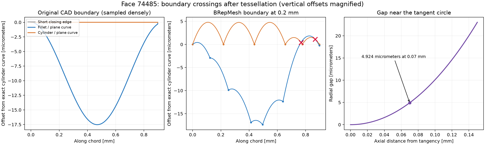

# 穴口の微細隙間とメッシュ欠損の因果調査

2026-09-23。製品コード未変更。実験・生データは `output/gap_causality_20260923/`。
対象は保存済み最終形状 `20260922T075258-e20ae028100d/000021-final-solid.json`、
入力は最適化run `20260921T185659-b6799e00457d/input.json`。面番号はkernel._face_mapの1始まり。

## 結論と適用範囲

フィレット付き保持穴と単純な除外円柱の間に残る細い領域は、正常な入力として扱う。
その領域を囲む曲線が、メッシュ用の折れ線に変換される際に交差することを元形状で確認した。
さらに、同じ局所条件から作った正常な閉じた3面ソリッドでもメッシュ破損を再現した。
単なる位置の相関ではなく、この局所形状と境界近似が破損を起こす十分条件になることを示している。
ただし、元の欠損6面のうち11842は別の円弧／直線の組合せであり、全てをこの隙間だけで説明しない。

OCCTの境界交差検査には小さい交差ループを無視する条件がある。
最小例で、同一の折れ線のまま検査のdeflectionだけを変えると判定が変わった。
形状を変えず標準メッシャーの面deflection設定を変更した実験でも最小例は改善した。
元モデル全体はその設定だけでは直らず、製品修正案の合格を意味しない。

## 元形状で見えた境界交差

deflection=0.2 mmで実際に作られたPolygonOnTriangulationのパラメータを取り出し、
元のpcurve上の点で面内の境界折れ線を復元した。三角形ゼロの面では共有辺の隣接面側から取得。
比較用に元のtrim済みpcurve同士をGeom2dAPI_InterCurveCurveで検査した。

| 面 | 場所 | 境界の種類 | 折れ線の内部交差数 |
|---|---|---|---:|
| 74485 | 下側穴口 | フィレットと平面の交線／円柱と平面の交線 | 2 |
| 74486 | 下側穴口 | 同上 | 3 |
| 74499 | 下側穴口 | 同上 | 1 |
| 7491 | 左上穴口 | 同上 | 1 |
| 8272 | 左上・反対側穴口 | 同上 | 1 |
| 11842 | 右上、y=-5の平面 | 円弧／直線2本 | 2 |

`diagnosis.json`には浮動小数点の端点判定による追加ヒットも保存されている。
表は交点パラメータが端点に約1e-12まで近いヒットを除く。
74485の元の曲線には端点以外の交差は検出されない。
8272では元の曲線にも端点から最大約3.4e-7 mmのヒットがあるが、辺の公差1e-6 mm以内。
全てのCAD境界が厳密数学的に交差ゼロと証明したわけではない。

面74485の対向境界は長さ約0.924/0.917 mm、離散化点数は7/6。
曲線中点と弦中点の距離の最大値は約0.00607/0.00477 mmだった。
同じ共有辺を隣接面が別々に扱う問題ではなく、**異なる対向辺の近似が互いを横切る問題**。

下側穴口はフィレットR=0.5 mm、除外円柱r=2.6 mm。
接する円から軸方向にt離れた位置の半径方向幅は
`w(t)=0.5-sqrt(0.25-t*t)`、小さいtでは `t*t/(2*0.5)` に近い。
t=0.07 mmで幅は0.004924 mm。上記の弦近似誤差と同程度以下になる。
幅は接線に近づくほど二次的にゼロへ近づくため、一定の距離誤差制限だけでは境界の順序を守れない。

左は元の曲線、中央は実際の折れ線、赤×は交点。横軸は弦方向の距離。
差を見せるため円柱側の元曲線を基準として縦方向を差し引き、µmで拡大した表示。
そのため中央の折れ線は図上では曲がって見える。右は解析式による隙間幅。

## 正常な3面ソリッドによる最小再現

元の面74485の平面で局所boxを切り、元の保持リングと解析円柱を差し引いた。
元の巨大な最終B-repや最適化ループを再実行せず、6面・2ソリッドの局所形状が得られる。
booleanのerror/warningはゼロ、BRepCheckはvalid。
分離した `minimal_solid_1.brep` は平面・トーラス・円柱面の3面のみ。
既存inspect_solidでvalid、closed、watertight、単一ソリッド、自己交差ゼロ。

| 同一の3面ソリッドに対する全体deflection | 三角形数 | 境界辺 | 非多様体辺 | 非多様体頂点 |
|---|---:|---:|---:|---:|
| 0.2 mm | 34 | 6 | 2 | 7 |
| 0.01 mm | 38 | 0 | 0 | 0 |
| 0.001 mm | 156 | 0 | 0 | 0 |

0.2でも三角形ゼロの面はなく、IsDone=true、GetStatusFlags=0だった。
従ってAPIの成功や「全ての面に三角形がある」だけでは破損を検出できない。
細かい2条件では向き不整合・縮退・重複もゼロ、接続成分は1。
ここでのメッシュ合否は接続の6項目であり、独立した三角形自己交差検査の合格までは主張しない。

対照実験では円柱半径を2.6から2.59に減らし、幅を0.01 mm増やすと、
元平面および法線方向±0.01 mm移動した平面の3条件とも0.2で接続6項目がゼロになった。
0.001 mmだけ広げた条件には破損が残る。入力の修正提案ではなく原因を切り分ける介入である。
平面位置の小さな変化でも狭い条件の破損は再現し、単一の偶然の座標だけの問題ではない。

## OCCTで見逃しが起きる機序

調べたソースはOCCT V7_9_3。
[BRepMesh_FaceChecker.cxx](https://github.com/Open-Cascade-SAS/OCCT/blob/V7_9_3/src/BRepMesh/BRepMesh_FaceChecker.cxx)
の137〜167行は、線分交差を見つけても、方向角が5度未満の場合や同一wire内の小ループの場合に無視する。
95〜96行、232行より小ループの面積閾値は `pi*(2*face_deflection)^2`。
対象平面のUVはmm座標なのでdeflection=0.2なら約0.503 mm²。
最小例の平面全体の面積約0.00824 mm²よりも大きい。

[BRepMesh_ModelHealer.cxx](https://github.com/Open-Cascade-SAS/OCCT/blob/V7_9_3/src/BRepMesh/BRepMesh_ModelHealer.cxx)
は検出した交差に対し辺のdeflectionを1/3にして再分割する処理を最大5回行う。
見逃した交差はその改善対象にならず、交差する境界が面分割へ渡る経路がある。
結果として面の欠落または部分的な欠損が生じる説明と、元形状・最小例の観測が一致する。
元の112467面全てについて内部の三角形採否の分岐までトレースしたわけではない。

最小例では標準と同じ処理部品を持つIMeshTools_Contextを作り、内部の離散化モデルを取得。
**折れ線は変更せず**対象平面のdeflectionだけ変更してFaceCheckerを再実行した。

| 検査時の面deflection | 交差なしとして受理 |
|---|---|
| 0.2 | true |
| 0.01 | false |
| 0.001 | false |
| 0.00001 | false |

方向角は変更していないので、少なくとも最小例の見逃しには面積閾値が関与する。
元形状全体の内部モデルで同じ直接検査を試みた処理はnative終了したため、その結果は得ていない。

## 形状を変えない標準パラメータでの介入

辺の初期Deflection=0.2、Angle=0.35、ControlSurfaceDeflection=falseを固定し、
ForceFaceDeflectionとDeflectionInteriorを変更した。
[BRepMesh_Deflection.cxx](https://github.com/Open-Cascade-SAS/OCCT/blob/V7_9_3/src/BRepMesh/BRepMesh_Deflection.cxx)
ではForceFaceDeflectionにより辺の平均deflection等で面deflectionが大きくなることを避けられる。
これは面検査・自動再分割への介入であり、製品の推奨設定として確定した値ではない。

| 最小3面ソリッド | 三角形数 | 境界辺／非多様体辺／非多様体頂点 |
|---|---:|---|
| Force=false、Interior=0.2 | 34 | 6 / 2 / 7 |
| Force=false、Interior=0.001 | 34 | 6 / 2 / 7 |
| Force=true、Interior=0.2 | 34 | 6 / 2 / 7 |
| Force=true、Interior=0.01 | 76 | 0 / 0 / 0 |
| Force=true、Interior=0.001 | 76 | 0 / 0 / 0 |
| Force=true、Interior=0.0001 | 96 | 0 / 0 / 0 |

元の全形状でも同じ設定を比較したが、解決には至らなかった。

| Force | Interior | 三角形ゼロの面 | 境界辺 |
|---|---:|---|---:|
| false | 0.2 | 74485 | 38 |
| false | 0.001 | 74485 | 38 |
| true | 0.2 | 74485 | 38 |
| true | 0.01 | 74485 | 17 |
| true | 0.001 | 7491 | 17 |
| true | 0.0001 | 7491 | 17 |

従って次の修正検討は、局所境界の交差を検出し、共有辺との整合を保って再分割する方向が根拠を持つ。
単に全体の精度を下げる／上げるだけ、入力の隙間を消すだけ、APIの成功だけを信頼する方法は根本対策ではない。
メッシュ集合演算への全面変更が必要だとは、この調査からは結論できない。

## 再現ファイル

- `diagnose.py` / `diagnosis.json`: 元の6面の境界・近似誤差・交点。全形状の読み込み先はスクリプト冒頭の既存一時BREP。
- `reproduce.py` / `reproduction.json`: 局所形状の生成と半径・平面位置の対照実験。
- `split_minimal.py` / `minimal_validity.json`: 局所形状から3面ソリッドを抽出し既存の形状検査。
- `minimal_solid_1.brep`: 元の全形状を必要としない最小再現入力。
- `minimal_stats.json`: 全体deflection比較の生データ。
- `internal.py` / `internal.json`: 最小例の内部境界検査。後続の全形状処理は未成功。
- `parameters.py` / `minimal_solid_1_parameters.json` / `original_parameters.json`: 標準パラメータ介入。
- `plot.py` / `mechanism.png` / `mechanism.svg`: 実測図。図用ライブラリは同ディレクトリのdeps。

最小例のパラメータ比較は `.venv/Scripts/python.exe output/gap_causality_20260923/parameters.py`。
全形状の比較は末尾に `original` を付ける。形状を変更せず各回Cleanして再メッシュ化する。
